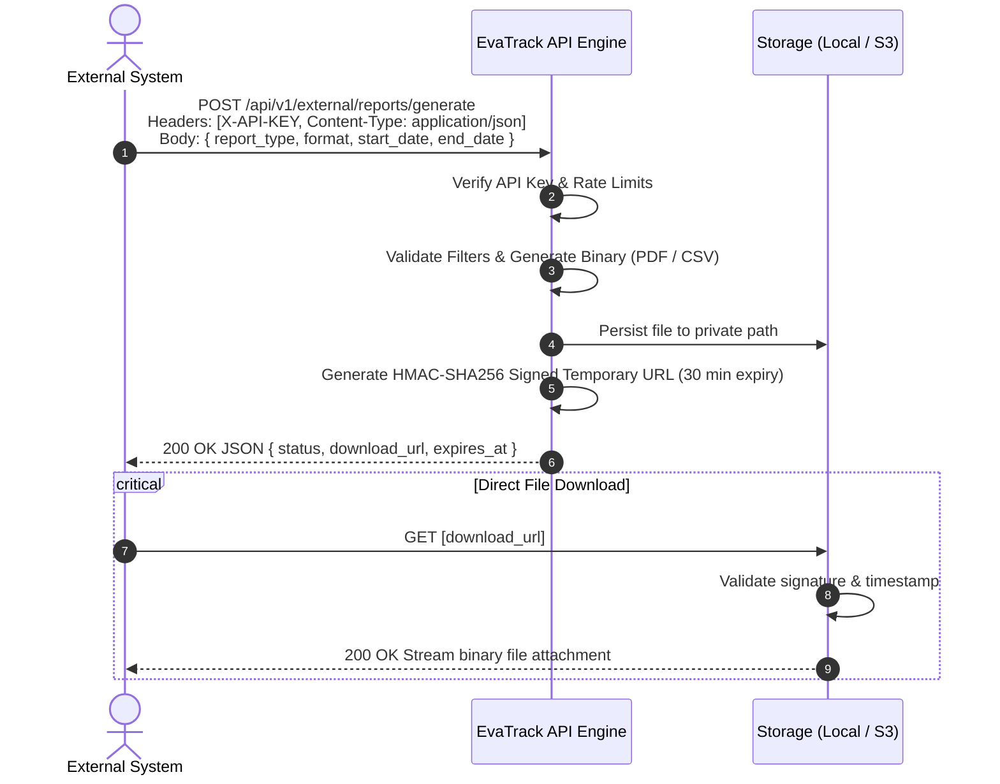

# EvaTrack M2M External Reporting API — Integration Guide

> **Version:** 1.0.0  
> **Protocol:** HTTP/1.1 REST + Cryptographic Signed URLs  
> **Target Audience:** External System Developers, DRRM Integrators, LGU Partners  
> **Backend Architecture:** Laravel 12 / Storage Abstraction (Local & Amazon S3)

---

## 1. Overview & High-Level Architecture

The **EvaTrack External Reporting API** provides an authenticated, automated machine-to-machine (M2M) pipeline for external partner systems to request and retrieve disaster response reports (such as Demographics, DROMIC Master Lists, Center Utilization, and Vulnerability summaries) in **PDF** or **CSV** formats.

Instead of transmitting massive binary streams directly within long-running HTTP connections, EvaTrack utilizes an **asynchronous delivery pattern with expiring signed URLs**:

1. The external system submits a report request specifying parameters and desired format.
2. EvaTrack compiles the report in memory and persists it to private storage.
3. EvaTrack returns a **time-limited, cryptographically signed download URL** (valid for 30 minutes).
4. The external system downloads the file directly using the signed URL.



---

## 2. Authentication & Security

### 2.1 API Key Header
All report generation requests must include your designated secret API key via the HTTP request header:

```http
X-API-KEY: <YOUR_SECRET_API_KEY>
```

> [!CAUTION]
> Treat your `X-API-KEY` like a password. Never commit it to public version control or expose it in frontend client-side code.

### 2.2 Anti-Tamper & Expiration Security
* **HMAC Signature**: Download links are cryptographically sealed with a hash signature. Any tampering with URL query parameters invalidates the signature and yields `403 Forbidden`.
* **Automatic Expiration**: Download links expire **30 minutes** after creation.
* **Rate Limiting**: The generation endpoint is capped at **30 requests per minute** per client to prevent resource exhaustion.

---

## 3. API Reference

### 3.1 Endpoint 1: Generate Report

* **URL**: `POST /api/v1/external/reports/generate`
* **Base URL**: `http://<domain-or-ip>:9000`
* **Content-Type**: `application/json`
* **Accept**: `application/json`

#### Request Headers
| Header | Required | Type | Description |
| :--- | :---: | :---: | :--- |
| `X-API-KEY` | **Yes** | String | Secret key provided by the EvaTrack administrator. |
| `Content-Type` | **Yes** | String | Must be `application/json`. |
| `Accept` | **Yes** | String | Must be `application/json`. |

#### Request Body Parameters
| Field | Type | Required | Default | Allowed Values | Description |
| :--- | :---: | :---: | :---: | :---: | :--- |
| `report_type` | String | **Yes** | — | `demographics`, `dromic`, `utilization`, `vulnerable`, `general` | Category of report to generate. |
| `format` | String | No | `pdf` | `pdf`, `csv` | File export format. |
| `start_date` | Date | No | `null` | `YYYY-MM-DD` | Start of reporting filter range. |
| `end_date` | Date | No | `null` | `YYYY-MM-DD` | End of reporting filter range (must be `>= start_date`). |

#### Example Request Body
```json
{
  "report_type": "demographics",
  "format": "pdf",
  "start_date": "2026-10-01",
  "end_date": "2026-10-08"
}
```

#### Success Response (`200 OK`)
```json
{
  "status": "success",
  "message": "Report generated successfully.",
  "report_type": "demographics",
  "format": "pdf",
  "file_name": "demographics_20261008_142452_uMHQwzsU.pdf",
  "download_url": "http://127.0.0.1:9000/api/v1/external/reports/download/demographics_20261008_142452_uMHQwzsU.pdf?expires=1791471293&signature=a762c4b50a0f83cf643baee5ee1dc496586259806d1ce10d112baa9f3531a2ff",
  "expires_at": "2026-10-08T14:54:53+00:00",
  "expires_in_minutes": 30
}
```

#### Response Fields
| Field | Type | Description |
| :--- | :---: | :--- |
| `status` | String | Operation status (`success` or `error`). |
| `report_type` | String | Echoes the generated report type. |
| `format` | String | Echoes the file format (`pdf` or `csv`). |
| `file_name` | String | System-generated unique filename. |
| `download_url` | String | Temporary, signed URL used to retrieve the file. |
| `expires_at` | String | ISO-8601 timestamp when `download_url` becomes invalid. |
| `expires_in_minutes` | Integer | Expiration duration in minutes (default `30`). |

---

### 3.2 Endpoint 2: Download Report

* **URL**: `GET {download_url}`
* **Headers**: None required.
* **Authentication**: Self-contained inside the URL query parameters (`expires` and `signature`).

#### Response
* **Success (`200 OK`)**: File binary stream with appropriate `Content-Type`:
  * PDF: `application/pdf`
  * CSV: `text/csv; charset=UTF-8`
* **Header `Content-Disposition`**: `attachment; filename="<file_name>"`

---

## 4. Error Codes & Handling

| HTTP Status | Error Reason | Example Response Body |
| :---: | :--- | :--- |
| `401 Unauthorized` | Missing or invalid `X-API-KEY`. | `{"status":"error","message":"Unauthorized: Invalid or missing X-API-KEY header."}` |
| `422 Unprocessable` | Validation failed (e.g. invalid report type or date). | `{"message":"The selected report type is invalid.","errors":{"report_type":["..."]}}` |
| `403 Forbidden` | Expired download URL or tampered signature. | `{"message":"Invalid signature."}` |
| `404 Not Found` | File not found or deleted from storage. | `{"message":"The requested report file does not exist or has expired."}` |
| `429 Too Many Requests`| Rate limit exceeded (more than 30 calls/minute). | `{"message":"Too Many Attempts."}` |

---

## 5. Client Integration Code Examples

### 5.1 cURL (CLI / Bash)
```bash
# 1. Request report generation
RESPONSE=$(curl -s -X POST "http://127.0.0.1:9000/api/v1/external/reports/generate" \
  -H "X-API-KEY: evatrack_live_sec_9a87f12bc34de56f" \
  -H "Content-Type: application/json" \
  -H "Accept: application/json" \
  -d '{
    "report_type": "demographics",
    "format": "pdf"
  }')

# 2. Extract download_url (using jq)
DOWNLOAD_URL=$(echo $RESPONSE | jq -r '.download_url')

# 3. Download the file
curl -o "demographics_report.pdf" "$DOWNLOAD_URL"
echo "Report successfully saved to demographics_report.pdf"
```

---

### 5.2 Python (requests)
```python
import requests

API_BASE_URL = "http://127.0.0.1:9000/api/v1/external"
API_KEY = "evatrack_live_sec_9a87f12bc34de56f"

def fetch_evatrack_report(report_type="demographics", file_format="pdf", output_path="report.pdf"):
    headers = {
        "X-API-KEY": API_KEY,
        "Content-Type": "application/json",
        "Accept": "application/json"
    }
    payload = {
        "report_type": report_type,
        "format": file_format
    }
    
    # Step 1: Request report generation
    response = requests.post(f"{API_BASE_URL}/reports/generate", json=payload, headers=headers)
    response.raise_for_status()
    data = response.json()
    
    download_url = data["download_url"]
    print(f"Generated: {data['file_name']}, downloading from signed URL...")
    
    # Step 2: Stream download the file directly
    file_res = requests.get(download_url, stream=True)
    file_res.raise_for_status()
    
    with open(output_path, "wb") as f:
        for chunk in file_res.iter_content(chunk_size=8192):
            f.write(chunk)
            
    print(f"File successfully saved to {output_path}")

if __name__ == "__main__":
    fetch_evatrack_report()
```

---

### 5.3 JavaScript / Node.js (Axios)
```javascript
const axios = require('axios');
const fs = require('fs');

async function downloadReport() {
  const API_KEY = 'evatrack_live_sec_9a87f12bc34de56f';
  const BASE_URL = 'http://127.0.0.1:9000/api/v1/external';

  try {
    // 1. Request generation
    const res = await axios.post(`${BASE_URL}/reports/generate`, {
      report_type: 'demographics',
      format: 'pdf'
    }, {
      headers: {
        'X-API-KEY': API_KEY,
        'Content-Type': 'application/json',
        'Accept': 'application/json'
      }
    });

    const { download_url, file_name } = res.data;
    console.log(`Downloading: ${file_name}`);

    // 2. Fetch binary stream
    const fileRes = await axios.get(download_url, { responseType: 'stream' });
    const writer = fs.createWriteStream(file_name);
    fileRes.data.pipe(writer);

    writer.on('finish', () => console.log(`Downloaded to ${file_name}`));
  } catch (err) {
    console.error('Error fetching report:', err.response?.data || err.message);
  }
}

downloadReport();
```

---

### 5.4 PHP (GuzzleHttp)
```php
<?php

require 'vendor/autoload.php';

use GuzzleHttp\Client;

$client = new Client();
$apiKey = 'evatrack_live_sec_9a87f12bc34de56f';

// 1. Request generation
$response = $client->post('http://127.0.0.1:9000/api/v1/external/reports/generate', [
    'headers' => [
        'X-API-KEY'    => $apiKey,
        'Content-Type' => 'application/json',
        'Accept'       => 'application/json',
    ],
    'json' => [
        'report_type' => 'demographics',
        'format'      => 'pdf',
    ]
]);

$data = json_decode($response->getBody()->getContents(), true);
$downloadUrl = $data['download_url'];

// 2. Download file
$fileContent = file_get_contents($downloadUrl);
file_put_contents($data['file_name'], $fileContent);

echo "Report successfully saved as: " . $data['file_name'] . PHP_EOL;
```

---

## 6. S3 Cloud Storage Transition Architecture

If the partner or hosting system wishes to replicate this setup using Amazon S3 (or Cloudflare R2 / MinIO), the application layer remains identical:

```
[Client] ---> POST /generate ---> [Laravel Backend]
                                          |
                        +-----------------+-----------------+
                        | (Local Mode)                      | (S3 Cloud Mode)
                        v                                   v
             [storage/app/reports]                  [Amazon S3 Bucket]
                        |                                   |
           URL::temporarySignedRoute()              Storage::temporaryUrl()
                        \                                   /
                         +-----------------+---------------+
                                           |
                              Returns: { download_url }
```

### Transition Steps for Production
1. Install Flysystem S3 package:
   ```bash
   composer require league/flysystem-aws-s3-v3
   ```
2. Update `.env`:
   ```env
   REPORT_DISK=s3
   AWS_ACCESS_KEY_ID=AKIA...
   AWS_SECRET_ACCESS_KEY=...
   AWS_DEFAULT_REGION=ap-southeast-1
   AWS_BUCKET=evatrack-reports-storage
   ```
3. No API contract or controller changes are required. The generated `download_url` automatically transitions from a local signed route to an Amazon S3 pre-signed URL.
