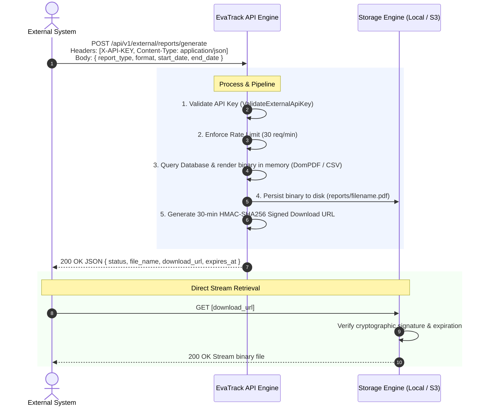

# EvaTrack M2M External Reporting API — Complete Setup, Architecture & Integration Guide

> **Version:** 1.0.0  
> **Framework:** Laravel 12 (PHP 8.2+)  
> **Storage Support:** Local Disk (with cryptographic signed routes) & Amazon S3 (pre-signed temporary URLs)  
> **Target Audience:** Backend Developers, System Administrators, External DRRM Partner Integrators

---

## Table of Contents
1. [System Architecture & Lifecycle](#1-system-architecture--lifecycle)
2. [Environment Configuration (.env)](#2-environment-configuration-env)
3. [Implementation Walkthrough & Source Code](#3-implementation-walkthrough--source-code)
   - [3.1 S3 Driver Dependency](#31-s3-driver-dependency)
   - [3.2 Authentication Middleware](#32-authentication-middleware)
   - [3.3 Middleware Alias in bootstrap/app.php](#33-middleware-alias-in-bootstrapappphp)
   - [3.4 External Report Controller](#34-external-report-controller)
   - [3.5 Route Registrations in routes/api.php](#35-route-registrations-in-routesapiphp)
4. [Storage Engine Mechanics (Local vs. S3)](#4-storage-engine-mechanics-local-vs-s3)
5. [API Specification & Endpoints](#5-api-specification--endpoints)
   - [5.1 Endpoint 1: Generate Report (POST)](#51-endpoint-1-generate-report-post)
   - [5.2 Endpoint 2: Download Report (GET)](#52-endpoint-2-download-report-get)
   - [5.3 Status & Error Codes](#53-status--error-codes)
6. [Testing the Integration (cURL, PowerShell, Postman)](#6-testing-the-integration-curl-powershell-postman)
7. [Client SDK Integration Examples](#7-client-sdk-integration-examples)
   - [Python](#python-requests)
   - [JavaScript / Node.js](#javascript--nodejs-axios)
   - [PHP](#php-guzzlehttp)
   - [cURL / Bash](#curl--bash)

---

## 1. System Architecture & Lifecycle

Instead of transmitting heavy PDF/CSV binaries through long-lived HTTP request sockets (which cause gateway timeouts and exhaust web server threads), the system follows an **Asynchronous Delivery Pattern with Expiring Signed URLs**:



---

## 2. Environment Configuration (.env)

The following keys were added to `.env` to configure storage and machine-to-machine authentication:

```env
# ==============================================================================
# External System Reporting & API Integration
# ==============================================================================

# Determines where generated export files are stored:
# - 'local': Saves files in storage/app/private/reports/ and creates Laravel-signed URLs.
# - 's3': Uploads files to AWS S3 and creates Amazon pre-signed S3 temporary URLs.
REPORT_DISK=local

# Secret authentication token that external systems must supply in the X-API-KEY header.
EXTERNAL_SYSTEM_API_KEY=evatrack_live_sec_9a87f12bc34de56f

# AWS S3 Configuration (Ready for production activation)
AWS_ACCESS_KEY_ID=
AWS_SECRET_ACCESS_KEY=
AWS_DEFAULT_REGION=ap-southeast-1
AWS_BUCKET=evatrack-reports-storage
AWS_USE_PATH_STYLE_ENDPOINT=false
```

> [!TIP]
> To switch between local file storage and Amazon S3 in production, simply change `REPORT_DISK=local` to `REPORT_DISK=s3`. Zero application code edits are required!

---

## 3. Implementation Walkthrough & Source Code

### 3.1 S3 Driver Dependency
To enable seamless switching to Amazon S3 via Laravel Flysystem, install the AWS S3 adapter:

```bash
composer require league/flysystem-aws-s3-v3 "^3.0"
```

---

### 3.2 Authentication Middleware
**File:** `app/Http/Middleware/ValidateExternalApiKey.php`

This middleware validates incoming requests by checking the `X-API-KEY` header against the secret key configured in `.env`. It uses `hash_equals()` to prevent timing attacks.

```php
<?php

namespace App\Http\Middleware;

use Closure;
use Illuminate\Http\Request;
use Symfony\Component\HttpFoundation\Response;

class ValidateExternalApiKey
{
    /**
     * Handle an incoming request.
     */
    public function handle(Request $request, Closure $next): Response
    {
        $providedKey = $request->header('X-API-KEY');
        $validKey = env('EXTERNAL_SYSTEM_API_KEY');

        // Verify key presence and equality with timing-safe comparison
        if (!$providedKey || !hash_equals((string) $validKey, (string) $providedKey)) {
            return response()->json([
                'status'  => 'error',
                'message' => 'Unauthorized: Invalid or missing X-API-KEY header.',
            ], 401);
        }

        return $next($request);
    }
}
```

---

### 3.3 Middleware Alias in bootstrap/app.php
**File:** `bootstrap/app.php`

In Laravel 12, middleware aliases are registered inside `withMiddleware()`:

```php
    ->withMiddleware(function (Middleware $middleware): void {
        $middleware->alias([
            'role' => \App\Http\Middleware\RoleMiddleware::class,
            'external.api.key' => \App\Http\Middleware\ValidateExternalApiKey::class, // <-- Registered alias
        ]);

        $middleware->append(HandleCors::class);
        $middleware->append(EnsureFrontendRequestsAreStateful::class);
    })
```

---

### 3.4 External Report Controller
**File:** `app/Http/Controllers/API/External/ExternalReportController.php`

This controller handles report compilation, saving to the active disk, generating expiring signed URLs, and serving file downloads.

```php
<?php

namespace App\Http\Controllers\API\External;

use App\Http\Controllers\Controller;
use Barryvdh\DomPDF\Facade\Pdf;
use Illuminate\Http\JsonResponse;
use Illuminate\Http\Request;
use Illuminate\Support\Facades\Storage;
use Illuminate\Support\Facades\URL;
use Illuminate\Support\Str;
use Symfony\Component\HttpFoundation\StreamedResponse;

class ExternalReportController extends Controller
{
    /**
     * POST /api/v1/external/reports/generate
     * Compiles report, saves to active disk, and returns expiring download link.
     */
    public function generate(Request $request): JsonResponse
    {
        // 1. Validate payload
        $validated = $request->validate([
            'report_type' => 'required|string|in:demographics,dromic,utilization,vulnerable,general',
            'start_date'  => 'nullable|date',
            'end_date'    => 'nullable|date|after_or_equal:start_date',
            'format'      => 'nullable|string|in:pdf,csv',
        ]);

        $format = $validated['format'] ?? 'pdf';
        $reportType = $validated['report_type'];
        $timestamp = now()->format('Ymd_His');
        $randomHash = Str::random(8);
        $fileName = "{$reportType}_{$timestamp}_{$randomHash}.{$format}";
        $storagePath = "reports/{$fileName}";

        // 2. Generate binary file content in memory
        if ($format === 'pdf') {
            $viewData = [
                'title' => ucfirst($reportType) . ' Report',
                'meta'  => [
                    'event'        => 'External Request',
                    'center'       => 'All Centers',
                    'start_date'   => $validated['start_date'] ?? 'N/A',
                    'end_date'     => $validated['end_date'] ?? 'N/A',
                    'generated_at' => now()->format('Y-m-d H:i:s'),
                    'generated_by' => 'External System API',
                ],
                'totalHouseholds'  => 0,
                'totalIndividuals' => 0,
                'male'             => 0,
                'female'           => 0,
                'children'         => 0,
                'youth'            => 0,
                'adults'           => 0,
                'elderly'          => 0,
                'vulnCounts'       => [],
            ];

            // Render Blade template using Barryvdh DomPDF
            $pdf = Pdf::loadView('exports.demographic', $viewData)
                      ->setPaper('a4', 'landscape');
            $fileContent = $pdf->output();
        } else {
            // Render CSV content
            $fileContent = $this->generateCsvContent($reportType, $validated);
        }

        // 3. Save to active disk (local now, S3 in production)
        $disk = env('REPORT_DISK', 'local');
        Storage::disk($disk)->put($storagePath, $fileContent);

        // 4. Generate Expiring Download URL (Valid 30 minutes)
        $expiresAt = now()->addMinutes(30);

        if ($disk === 's3') {
            // Amazon S3 pre-signed temporary URL
            $downloadUrl = Storage::disk('s3')->temporaryUrl($storagePath, $expiresAt);
        } else {
            // Laravel cryptographic signed route
            $downloadUrl = URL::temporarySignedRoute(
                'external.reports.download',
                $expiresAt,
                ['filename' => $fileName]
            );
        }

        // 5. Return JSON payload
        return response()->json([
            'status'             => 'success',
            'message'            => 'Report generated successfully.',
            'report_type'        => $reportType,
            'format'             => $format,
            'file_name'          => $fileName,
            'download_url'       => $downloadUrl,
            'expires_at'         => $expiresAt->toIso8601String(),
            'expires_in_minutes' => 30,
        ], 200);
    }

    /**
     * GET /api/v1/external/reports/download/{filename}
     * Downloads local file. Protected by Laravel 'signed' middleware.
     */
    public function download(Request $request, string $filename): StreamedResponse
    {
        $disk = env('REPORT_DISK', 'local');
        $filePath = "reports/{$filename}";

        if (!Storage::disk($disk)->exists($filePath)) {
            abort(404, 'The requested report file does not exist or has expired.');
        }

        return Storage::disk($disk)->download($filePath);
    }

    /**
     * CSV helper generator
     */
    private function generateCsvContent(string $reportType, array $filters): string
    {
        $handle = fopen('php://temp', 'r+');
        // UTF-8 BOM for Microsoft Excel compatibility
        fprintf($handle, chr(0xEF) . chr(0xBB) . chr(0xBF));
        fputcsv($handle, ['Report Type', ucfirst($reportType)]);
        fputcsv($handle, ['Date Range', ($filters['start_date'] ?? 'All') . ' to ' . ($filters['end_date'] ?? 'All')]);
        fputcsv($handle, ['Generated At', now()->toDateTimeString()]);
        fputcsv($handle, []);
        fputcsv($handle, ['Record ID', 'Description', 'Timestamp']);
        fputcsv($handle, [1, 'Sample Record', now()->toDateTimeString()]);
        rewind($handle);
        $csv = stream_get_contents($handle);
        fclose($handle);
        return $csv;
    }
}
```

---

### 3.5 Route Registrations in routes/api.php
**File:** `routes/api.php`

```php
use App\Http\Controllers\API\External\ExternalReportController;

Route::prefix('v1/external')->group(function () {
    
    // 1. Generation Endpoint (Protected by API Key + Rate Limiting 30 requests/minute)
    Route::post('/reports/generate', [ExternalReportController::class, 'generate'])
        ->middleware(['external.api.key', 'throttle:30,1']);

    // 2. Download Endpoint (Protected by Laravel's signed URL validator)
    Route::get('/reports/download/{filename}', [ExternalReportController::class, 'download'])
        ->name('external.reports.download')
        ->middleware('signed');
});
```

---

## 4. Storage Engine Mechanics (Local vs. S3)

| Feature | Local Disk (`REPORT_DISK=local`) | Amazon S3 (`REPORT_DISK=s3`) |
| :--- | :--- | :--- |
| **Physical Storage** | `storage/app/private/reports/` | AWS S3 Bucket (Private) |
| **Download URL Format** | `http://.../api/v1/external/reports/download/file.pdf?expires=...&signature=...` | `https://bucket.s3.region.amazonaws.com/reports/file.pdf?X-Amz-Signature=...` |
| **Signature Method** | Laravel `APP_KEY` HMAC-SHA256 signature | AWS SigV4 signed query parameter |
| **Server Bandwidth** | Streams through Laravel server process | Downloaded directly from AWS S3 edge (Zero server load) |
| **Cleanup** | Scheduled cron job or disk purge | Automated via S3 24h Bucket Lifecycle Rule |

---

## 5. API Specification & Endpoints

### 5.1 Endpoint 1: Generate Report (POST)

* **URL:** `POST /api/v1/external/reports/generate`
* **Headers:**
  * `X-API-KEY: <SECRET_API_KEY>` (Required)
  * `Content-Type: application/json`
  * `Accept: application/json`

#### Request Body
```json
{
  "report_type": "demographics",
  "format": "pdf",
  "start_date": "2026-10-01",
  "end_date": "2026-10-08"
}
```

#### Parameters
| Field | Type | Required | Allowed Values | Description |
| :--- | :---: | :---: | :--- | :--- |
| `report_type` | String | **Yes** | `demographics`, `dromic`, `utilization`, `vulnerable`, `general` | Category of report. |
| `format` | String | No | `pdf` (default), `csv` | Export format. |
| `start_date` | Date | No | `YYYY-MM-DD` | Filter beginning. |
| `end_date` | Date | No | `YYYY-MM-DD` | Filter ending (`>= start_date`). |

#### Response (`200 OK`)
```json
{
  "status": "success",
  "message": "Report generated successfully.",
  "report_type": "demographics",
  "format": "pdf",
  "file_name": "demographics_20261008_142452_uMHQwzsU.pdf",
  "download_url": "http://127.0.0.1:9000/api/v1/external/reports/download/demographics_20261008_142452_uMHQwzsU.pdf?expires=1791471293&signature=a762c4...",
  "expires_at": "2026-10-08T14:54:53+00:00",
  "expires_in_minutes": 30
}
```

---

### 5.2 Endpoint 2: Download Report (GET)

* **URL:** `GET {download_url}`
* **Headers:** None needed (Authentication is embedded inside the URL query signature).
* **Response:** Binary file stream (`application/pdf` or `text/csv`).

---

### 5.3 Status & Error Codes

| Status Code | Reason | Example JSON Response |
| :---: | :--- | :--- |
| `401 Unauthorized` | Missing or incorrect `X-API-KEY`. | `{"status":"error","message":"Unauthorized: Invalid or missing X-API-KEY header."}` |
| `422 Unprocessable` | Validation error (e.g., invalid date or type). | `{"message":"The selected report type is invalid.","errors":{...}}` |
| `403 Forbidden` | Expired download URL or tampered signature. | `{"message":"Invalid signature."}` |
| `404 Not Found` | File not found or expired from storage. | `{"message":"The requested report file does not exist or has expired."}` |
| `429 Too Many Requests`| Exceeded rate limit (>30 req/min). | `{"message":"Too Many Attempts."}` |

---

## 6. Testing the Integration (cURL, PowerShell, Postman)

### 6.1 PowerShell
```powershell
# 1. Request Generation
$res = Invoke-RestMethod -Uri "http://127.0.0.1:9000/api/v1/external/reports/generate" `
  -Method Post `
  -Headers @{ "X-API-KEY" = "evatrack_live_sec_9a87f12bc34de56f"; "Content-Type" = "application/json" } `
  -Body '{"report_type": "demographics", "format": "pdf"}'

# 2. Download File
Invoke-WebRequest -Uri $res.download_url -OutFile $res.file_name
Write-Host "Downloaded: $($res.file_name)"
```

### 6.2 Postman Setup
1. **Method:** `POST`
2. **URL:** `http://127.0.0.1:9000/api/v1/external/reports/generate`
3. **Headers tab:**
   * `X-API-KEY`: `evatrack_live_sec_9a87f12bc34de56f`
   * `Content-Type`: `application/json`
4. **Body tab:** Select **raw** > **JSON**:
   ```json
   { "report_type": "demographics", "format": "pdf" }
   ```
5. **Download step:** Copy `download_url` into a new Postman tab, click the dropdown arrow next to **Send**, and choose **Send and Download**.

> [!NOTE]
> If testing with Postman Web in a browser, click **Use Postman's Desktop Agent** in the bottom footer to allow Postman to reach your local `127.0.0.1` address.

---

## 7. Client SDK Integration Examples

### Python (`requests`)
```python
import requests

API_URL = "http://127.0.0.1:9000/api/v1/external/reports/generate"
API_KEY = "evatrack_live_sec_9a87f12bc34de56f"

# 1. Generate report
headers = {"X-API-KEY": API_KEY, "Content-Type": "application/json"}
payload = {"report_type": "demographics", "format": "pdf"}

resp = requests.post(API_URL, json=payload, headers=headers)
resp.raise_for_status()
data = resp.json()

# 2. Download file directly
file_resp = requests.get(data["download_url"])
with open(data["file_name"], "wb") as f:
    f.write(file_resp.content)

print(f"Successfully downloaded {data['file_name']}")
```

### JavaScript / Node.js (`axios`)
```javascript
const axios = require('axios');
const fs = require('fs');

async function exportReport() {
  const headers = {
    'X-API-KEY': 'evatrack_live_sec_9a87f12bc34de56f',
    'Content-Type': 'application/json'
  };

  // 1. Generate
  const { data } = await axios.post('http://127.0.0.1:9000/api/v1/external/reports/generate', {
    report_type: 'demographics',
    format: 'pdf'
  }, { headers });

  // 2. Stream download
  const writer = fs.createWriteStream(data.file_name);
  const response = await axios.get(data.download_url, { responseType: 'stream' });
  response.data.pipe(writer);

  writer.on('finish', () => console.log(`Downloaded ${data.file_name}`));
}

exportReport();
```

### PHP (`GuzzleHttp`)
```php
<?php
require 'vendor/autoload.php';

use GuzzleHttp\Client;

$client = new Client();
$res = $client->post('http://127.0.0.1:9000/api/v1/external/reports/generate', [
    'headers' => [
        'X-API-KEY'    => 'evatrack_live_sec_9a87f12bc34de56f',
        'Content-Type' => 'application/json',
    ],
    'json' => [
        'report_type' => 'demographics',
        'format'      => 'pdf',
    ]
]);

$data = json_decode($res->getBody(), true);
file_put_contents($data['file_name'], file_get_contents($data['download_url']));
echo "Saved " . $data['file_name'] . PHP_EOL;
```

### cURL / Bash
```bash
RESPONSE=$(curl -s -X POST "http://127.0.0.1:9000/api/v1/external/reports/generate" \
  -H "X-API-KEY: evatrack_live_sec_9a87f12bc34de56f" \
  -H "Content-Type: application/json" \
  -d '{"report_type": "demographics", "format": "pdf"}')

DOWNLOAD_URL=$(echo $RESPONSE | grep -oP '(?<="download_url":")[^"]*')
curl -o "report.pdf" "$DOWNLOAD_URL"
```
