# EvaTrack — System Architecture & External Systems Integration

**Project Title:** EVATRACK: Streamlined Evacuation Processes and Coordination Platform Integrating SafeTrack Demographics and ResQperation Response Support  
**Proponents:** Klint M. Ruales, Danica Gelbolingo, Anna Rhea Villadolid, Vhenz Cernal  
**Institution:** School of Computer Studies, University of San Jose-Recoletos (USJ-R)  
**Adviser:** Mr. Stefan A.D. Flores | **Project Coordinator:** Mr. Roderick A. Bandalan  
**Date:** November 2026 (Version 1.0)

---

## 1. High-Level Architectural Diagram

The diagram below illustrates the end-to-end multi-tier architecture of EvaTrack, covering the presentation layer, Laravel domain-driven backend, data persistence layer, and third-party external integrations.

```mermaid
flowchart TB
    %% ==========================================
    %% TIER 1: CLIENTS & USERS
    %% ==========================================
    subgraph CLIENT_TIER ["1. Client & User Tier"]
        direction LR
        U_ADMIN["👤 Barangay & Camp Operators<br/>(Super Admin & Evac Admin)"]:::bwNode
        U_STAFF["👤 On-Site Shelter Personnel<br/>(Evacuation Personnel)"]:::bwNode
        U_PUBLIC["📱 Evacuees & Citizens<br/>(Public Portal / Mobile Devices)"]:::bwNode
    end

    %% ==========================================
    %% TIER 2: PRESENTATION LAYER (REACT SPA)
    %% ==========================================
    subgraph FRONTEND_TIER ["2. Presentation Layer — EvaTrackFrontEnd (React 18 + Vite)"]
        direction TB
        subgraph UI_MODULES ["UI Components & Modules"]
            UI_DASH["Dashboard & Live Occupancy"]:::bwUC
            UI_VERIFY["QR Camera Scanner & Manual Lookup"]:::bwUC
            UI_UNITS["Accommodation Unit Config & Allocation"]:::bwUC
            UI_ALERTS["Emergency Broadcast Alerts Console"]:::bwUC
            UI_ISSUES["Center Issue Tracker (Sanitation/Health/Facility)"]:::bwUC
            UI_RESOURCES["Resource & Logistics Requests"]:::bwUC
            UI_ANALYTICS["Demographic & Vulnerability Analytics (Recharts)"]:::bwUC
            UI_PORTAL["Public Portal & Shelter Map (Leaflet)"]:::bwUC
        end

        subgraph STATE_CACHE ["Client State & Query Cache"]
            REACT_QUERY["TanStack React Query<br/>(Server State & Caching)"]:::bwUC
            ZUSTAND_STORE["Zustand User Store<br/>(RBAC & Capability Matrix)"]:::bwUC
        end
    end

    %% ==========================================
    %% TIER 3: APPLICATION LAYER (LARAVEL 12 API)
    %% ==========================================
    subgraph BACKEND_TIER ["3. Application Layer — EvaTrack Backend API (Laravel 12)"]
        direction TB
        
        API_GATEWAY["API Gateway & Middleware<br/>(Sanctum Bearer Auth, Rate Limiting, RBAC Enforcer, CORS)"]:::bwNode

        subgraph DOMAIN_LAYER ["Core Business Domains"]
            DOM_AUTH["Authentication & User Management Domain"]:::bwUC
            DOM_CTR["Evacuation Centers & Accommodation Units Domain"]:::bwUC
            DOM_EVAC["Evacuation Admissions & Checkout Domain"]:::bwUC
            DOM_EVENT["Disaster Events Management Domain"]:::bwUC
            DOM_ISSUE["Center Issue Reporting & Triage Domain"]:::bwUC
            DOM_RES["Resource Requisitions Domain"]:::bwUC
            DOM_NOTIF["Notification & Alert Broadcast Domain"]:::bwUC
            DOM_ANL["Live Analytics & Export Engine (DomPDF / CSV)"]:::bwUC
        end

        subgraph INTEGRATION_SERVICES ["Integration & Gateway Services"]
            SVC_SAFETRACK["ExternalHouseholdService<br/>(SafeTrack Demographics Gateway)"]:::bwUC
            SVC_NOTIF["NotificationService<br/>(Multi-channel Dispatch Coordinator)"]:::bwUC
            SVC_ONESIGNAL["OneSignalService<br/>(Mobile Push Gateway)"]:::bwUC
            SVC_TEXTBEE["TextBeeService<br/>(Cellular SMS Gateway)"]:::bwUC
        end
    end

    %% ==========================================
    %% TIER 4: DATA PERSISTENCE LAYER
    %% ==========================================
    subgraph DATA_TIER ["4. Data Layer — MySQL 8.0 (shared_db / mysql_v2)"]
        direction TB
        DB_USERS[("Users, Roles & In-App Alerts")]:::bwDB
        DB_CTR[("Evacuation Centers, Occupancy & Units")]:::bwDB
        DB_EVAC[("Evacuation Records & Member Presence")]:::bwDB
        DB_OPERATIONS[("Center Issues, Resource Requests & Events")]:::bwDB
        DB_NOTIF[("Notifications, Recipient Logs & Device Tokens")]:::bwDB
        DB_ANL[("Analytics Snapshots & Job Logs")]:::bwDB
    end

    %% ==========================================
    %% TIER 5: EXTERNAL SYSTEMS & GATEWAYS
    %% ==========================================
    subgraph EXTERNAL_TIER ["5. External Systems & Third-Party Gateways"]
        direction TB
        EXT_SAFETRACK["🌐 SafeTrack System<br/>(Authoritative Demographic Repository)"]:::bwExt
        EXT_RESQ["🌐 ResQperation Platform<br/>(Response Logistics & Field Dispatch)"]:::bwExt
        EXT_TEXTBEE["📡 TextBee SMS Gateway<br/>(Cellular SMS Delivery)"]:::bwExt
        EXT_ONESIGNAL["☁️ OneSignal Push Server<br/>(Resident Smartphone App Alerts)"]:::bwExt
        EXT_TILES["🗺️ OpenStreetMap / Tile Server<br/>(Map Cartography)"]:::bwExt
    end

    %% ==========================================
    %% CONNECTIVITY & DATA FLOW
    %% ==========================================
    %% User to Frontend
    U_ADMIN -->|"Web Browser (HTTPS)"| FRONTEND_TIER
    U_STAFF -->|"Camera Scanner & UI"| FRONTEND_TIER
    U_PUBLIC -->|"Public Web Access"| UI_PORTAL

    %% Frontend to Backend
    UI_MODULES --> STATE_CACHE
    STATE_CACHE -->|"REST API / JSON (HTTPS)"| API_GATEWAY

    %% Backend routing
    API_GATEWAY --> DOMAIN_LAYER
    DOMAIN_LAYER --> INTEGRATION_SERVICES

    %% Backend to Database
    DOM_AUTH --> DB_USERS
    DOM_CTR --> DB_CTR
    DOM_EVAC --> DB_EVAC
    DOM_ISSUE --> DB_OPERATIONS
    DOM_RES --> DB_OPERATIONS
    DOM_EVENT --> DB_OPERATIONS
    DOM_NOTIF --> DB_NOTIF
    DOM_ANL --> DB_ANL

    %% Backend to External Systems
    SVC_SAFETRACK -->|"1. Demographic Roster Query (REST/Shared DB)"| EXT_SAFETRACK
    DOM_RES -->|"2. Forward Logistics Requests (REST)"| EXT_RESQ
    SVC_ONESIGNAL -->|"3. Push Notification API"| EXT_ONESIGNAL
    SVC_TEXTBEE -->|"4. Cellular SMS Dispatch API"| EXT_TEXTBEE
    UI_PORTAL -.->|"Map Tiles"| EXT_TILES

    %% External System to Citizens
    EXT_TEXTBEE -->|"SMS Broadcast (Offline)"| U_PUBLIC
    EXT_ONESIGNAL -->|"Push Notifications (Online App)"| U_PUBLIC
    EXT_RESQ -.->|"Push Delivery Bridge"| EXT_ONESIGNAL

    %% ==========================================
    %% STYLING CLASSES (Clean B&W with High Contrast)
    %% ==========================================
    classDef bwNode fill:#ffffff,stroke:#0f172a,stroke-width:2px,color:#0f172a,font-weight:bold;
    classDef bwUC fill:#ffffff,stroke:#334155,stroke-width:1.5px,color:#0f172a;
    classDef bwDB fill:#f8fafc,stroke:#0f172a,stroke-width:2px,color:#0f172a;
    classDef bwExt fill:#ffffff,stroke:#0284c7,stroke-width:2px,color:#0f172a,font-weight:bold;

    style CLIENT_TIER fill:#f8fafc,stroke:#94a3b8,stroke-width:1.5px,stroke-dasharray: 4 4;
    style FRONTEND_TIER fill:#ffffff,stroke:#334155,stroke-width:2px;
    style BACKEND_TIER fill:#ffffff,stroke:#0f172a,stroke-width:2px;
    style DATA_TIER fill:#f1f5f9,stroke:#475569,stroke-width:2px;
    style EXTERNAL_TIER fill:#f0f9ff,stroke:#0284c7,stroke-width:2px;

    %% Link Colors
    linkStyle 3 stroke:#2563eb,stroke-width:2.5px;
    linkStyle 16 stroke:#4f46e5,stroke-width:2.5px;
    linkStyle 17 stroke:#e11d48,stroke-width:2.5px;
    linkStyle 18 stroke:#059669,stroke-width:2.5px;
    linkStyle 19 stroke:#d97706,stroke-width:2.5px;
    linkStyle 21 stroke:#d97706,stroke-width:2px;
    linkStyle 22 stroke:#059669,stroke-width:2px;
```

---

## 2. Architectural Tier Descriptions

### Tier 1: Client & User Tier
The platform serves three distinct user classes across various devices:
* **Barangay & Camp Administrators (Super Admin & Evacuation Admin):** Use desktop and tablet browsers to oversee shelter logistics, declare disaster scenarios, assign personnel, review facility condition tickets, and dispatch broadcasts.
* **On-Site Shelter Personnel (Evacuation Personnel):** Stationed at physical evacuation shelters. They operate the camera-based QR scanner or manual search to admit evacuees, manage accommodation units, track members, and log local incident tickets.
* **Citizens & Displaced Households (Public):** Require no login credentials. They access the public portal map to view available shelter spaces and receive emergency warnings via SMS and smartphone push notifications.

### Tier 2: Presentation Layer (`EvaTrackFrontEnd`)
* **Technology Stack:** Built with **React 18**, **Vite**, and **Tailwind CSS**.
* **Client-Side Caching & Performance:** Consumes **TanStack React Query** for server-state caching, automatic background invalidations, and instant route transitions without redundant loading spinners.
* **Role-Based State Management:** Uses **Zustand** stores (`useUserStore`) coupled with a centralized **Capability Matrix** (`can(PermissionAction, Module)`) to control view permissions.
* **Peripheral Integrations:**
  * **HTML5 Camera API (`html5-qrcode`):** Hardware camera stream integration for on-site QR code verification.
  * **Leaflet & OpenStreetMap:** High-performance mapping for geocoding and live shelter pin overlays.
  * **Recharts:** Client-rendered dynamic demographic charts (age cohorts, gender, vulnerability ratios).

### Tier 3: Application Layer (`EvaTrack` Laravel Backend)
* **API Gateway & Routing:** Requests enter through `routes/api.php` and are validated by:
  * **Laravel Sanctum:** Bearer tokens and HttpOnly session cookies for authenticated requests.
  * **Rate Limiting Middleware:** Protects public and sensitive authentication endpoints.
  * **CORS & CSRF Verification:** Controls authorized cross-origin requests.
* **Domain-Driven Design (DDD):** Organized into isolated domains containing dedicated Controllers, Actions, Requests, DTOs, Models, and Eloquent Repositories:
  1. `Authentication`: User accounts, login, logout, password updates, and center assignments.
  2. `EvacuationCenters`: Shelter metadata, GPS coordinates, and real-time occupancy rollups.
  3. `AccommodationUnits`: Configurable spaces (`Family Room`, `Dormitory`, `Tent`, `Classroom`, `Gymnasium`, `Covered Court`) and bed slot capacities.
  4. `Evacuations`: Intake verification (QR & manual), member presence toggles, unit allocations, and departure checkouts.
  5. `EvacuationEvents`: Declared disaster scenarios, dates, and severity links.
  6. `CenterIssueReports`: Shelter issue tickets (Sanitation, Medical, Facility, Security) with severity triage.
  7. `ResourceRequests`: Requisitions for food, water, medical supplies, and manpower.
  8. `Notifications`: Broadcast scheduler, audience filtering, and multi-channel dispatching.
  9. `Analytics`: Demographic intelligence engine (`LiveAnalyticsService`) with PDF (DomPDF) and CSV export pipelines.
* **Integration Adapters:**
  * `ExternalHouseholdService`: Interface for SafeTrack demographic ingestion.
  * `NotificationService`: Manages multi-channel dispatch resolution.
  * `OneSignalService`: Push notification payload construction and REST delivery.
  * `TextBeeService`: Cellular SMS payload dispatch.

### Tier 4: Data Layer (`MySQL 8.0` — `shared_db` / `mysql_v2`)
* Relational database using the **InnoDB** storage engine.
* Enforces foreign key referential integrity with cascading updates and soft deletes (`deleted_at`) to preserve historical disaster records.
* Structured into core operational clusters:
  * `users`, `roles`, `user_notifications`
  * `evacuation_centers`, `center_occupancies`, `accommodation_types`, `accommodation_units`, `unit_allocations`
  * `evacuation_records`, `evacuated_members`, `household_statuses`
  * `center_issue_reports`, `center_issue_categories`, `center_issue_report_statuses`
  * `resource_requests`, `resource_request_statuses`
  * `notifications`, `notification_recipients`, `notification_logs`, `device_tokens`
  * `analytics`, `analytics_job_logs`

### Tier 5: External Systems & Third-Party Gateways
* **SafeTrack Demographics System:** External demographic authority providing master household lists, family rosters, addresses, and vulnerability categories.
* **ResQperation Platform:** Interoperable disaster response platform that receives forwarded supply/manpower aid requests and routes push notifications to resident apps.
* **TextBee SMS Gateway:** HTTPS cellular gateway ensuring critical evacuation notices reach residents in low-connectivity areas without smartphone data.
* **OneSignal Service:** Cloud push delivery network sending targeted alerts to registered mobile device tokens.
* **OpenStreetMap:** Provides map cartography and reverse geocoding for geographic shelter coordinates.

---

## 3. Data Privacy & Security Boundaries (RA 10173 Compliance)

1. **Demographic Privacy Isolation:** In accordance with the Data Privacy Act of 2012 (Republic Act No. 10173), household demographic rosters and vulnerable sector tags are restricted exclusively to authenticated operators for intake verification and analytics. Personal resident records are strictly excluded from public portal endpoints.
2. **Credential Security:** All operator credentials are encrypted using Bcrypt (`BCRYPT_ROUNDS=12`) with personal access tokens revoked immediately upon session logout.
3. **Auditability & Integrity:** Database operations modifying multiple tables (e.g., admitting evacuees and updating center headcount) execute within atomic database transactions (`DB::transaction`) to guarantee capacity consistency.

