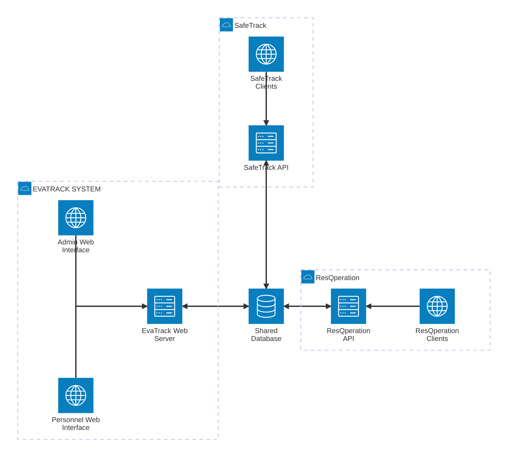

# EvaTrack — System Architecture & External Systems Integration

**Project Title:** EVATRACK: Streamlined Evacuation Processes and Coordination Platform Integrating SafeTrack Demographics and ResQperation Response Support  
**Proponents:** Klint M. Ruales, Danica Gelbolingo, Anna Rhea Villadolid, Vhenz Cernal  
**Institution:** School of Computer Studies, University of San Jose-Recoletos (USJ-R)  
**Adviser:** Mr. Stefan A.D. Flores | **Project Coordinator:** Mr. Roderick A. Bandalan  
**Date:** November 2026 (Version 2.0)

---

## 1. Proposed System Architecture

The EvaTrack system architecture follows a clean multi-tier, component-based topology designed for high availability, fast disaster intake, and seamless cross-platform interoperability across the three integrated capstone systems (**EvaTrack**, **SafeTrack**, and **ResQperation**).

### Visual Architecture Diagram
A vector SVG version of this architecture is maintained at [`system_architecture.svg`](file:///c:/CAPSTONE/EvaTrack/docs/system_architecture.svg).

```mermaid
flowchart TD

    %% =========================================================================
    %% TIER 1: DATA LAYER & INTER-SYSTEM INTEGRATION (TOP)
    %% =========================================================================
    subgraph DATA_AND_PARTNERS ["1. Data & Inter-System Integration Tier"]
        direction LR

        subgraph SAFETRACK ["SafeTrack System (Partner)"]
            direction TB
            ST_DB[("SafeTrack Demographics\n(Household Registry)")]
            ST_API["SafeTrack REST API\n(/api/external/households)"]
            ST_DB --- ST_API
        end

        subgraph SHARED_DB ["Central Shared Database"]
            direction TB
            DB[("MySQL 8.0 (shared_db)\n• Evacuation Centers & Units\n• Evacuation Admissions & Members\n• Resource Requests & Issues\n• Shared Demographics & Events")]
        end

        subgraph RESQPERATION ["ResQperation Platform (Partner)"]
            direction TB
            RQ_API["ResQ REST API\n(Incident Dispatch & Reports)"]
            RQ_DB[("ResQ Disaster Records\n(Events & Hazards)")]
            RQ_API --- RQ_DB
        end
    end

    %% =========================================================================
    %% TIER 2: APPLICATION SERVER (MIDDLE)
    %% =========================================================================
    subgraph SERVER_TIER ["2. Application Server Tier (EvaTrack Backend)"]
        direction TB
        SERVER["EvaTrack Application Server (Laravel 12 REST API)\n• API Gateway, Sanctum Auth & RBAC Middleware\n• QR Intake Verification & Manual Search Engine\n• Modular Unit Allocation & Dynamic Headcount Tracking\n• Resource Requisition & Center Issue Triage\n• Multi-Channel Alerts & Analytical Export Pipeline"]
    end

    %% =========================================================================
    %% TIER 3: CLIENT APPLICATIONS & DEVICES (MIDDLE-BOTTOM)
    %% =========================================================================
    subgraph CLIENT_TIER ["3. Client Applications & Devices (EvaTrackFrontEnd - React 18 + Vite)"]
        direction LR

        APP_MOBILE["Mobile Web & Public Portal\n(Smartphone Interface)\n• Public Evacuation Shelter Map\n• Live Occupancy & Vacancies\n• SafeTrack Household QR Pass\n• Emergency Broadcast Alerts"]
        
        APP_TABLET["Tablet Intake Scanner Terminal\n(Tablet Interface)\n• Hardware Camera QR Verification\n• Rapid Walk-in Member Intake\n• Room / Cot Slot Allocation\n• Dynamic Headcount Tally"]

        APP_DESKTOP["Desktop Management Console\n(Desktop Workstation)\n• Center Infrastructure Setup\n• Supply Requisition Triage\n• Incident / Issue Escalation\n• Reports (PDF/CSV) & IT Admin"]
    end

    %% =========================================================================
    %% TIER 4: STAKEHOLDERS & USERS (BOTTOM)
    %% =========================================================================
    subgraph USER_TIER ["4. Stakeholder & User Tier"]
        direction LR

        USER_PUBLIC["Displaced Residents / Evacuees\n(General Public)\n• View shelter vacancies\n• Present household QR pass\n• Receive SMS & push notices"]

        USER_STAFF["Evacuation Personnel\n(On-Site Shelter Staff / Intake Desk)\n• Fast QR & manual check-in\n• Room & member verification\n• Log facility/medical issues"]

        USER_ADMIN["Camp Commander & IT Administrator\n(Evac Admin & Super Admin)\n• Oversee shelter operations\n• Forward aid requests to ResQ\n• User provisioning & system audit"]
    end

    %% =========================================================================
    %% CONNECTIONS & DATA FLOWS
    %% =========================================================================

    %% SafeTrack connections
    ST_API <-->|"1. Demographics & QR Sync (REST / X-API-KEY)"| SERVER
    ST_DB <-->|"Shared Relational Tables"| DB

    %% Central DB connections
    DB <-->|"SQL Queries & Eloquent ORM Persistence"| SERVER

    %% ResQperation connections
    RQ_API <-->|"2. Disaster Telemetry & Aid Dispatch (REST API)"| SERVER
    RQ_DB <-->|"Incident Data Tables"| DB

    %% Server to Client Applications
    SERVER -->|"HTTPS / JSON (REST API)"| APP_MOBILE
    SERVER -->|"HTTPS / JSON (REST API)"| APP_TABLET
    SERVER -->|"HTTPS / JSON (REST API)"| APP_DESKTOP

    %% Client Applications to Stakeholders
    APP_MOBILE --- USER_PUBLIC
    APP_TABLET --- USER_STAFF
    APP_DESKTOP --- USER_ADMIN

    %% =========================================================================
    %% STYLING
    %% =========================================================================
    classDef default fill:#ffffff,stroke:#334155,stroke-width:1.5px,color:#0f172a;
    classDef partnerNode fill:#ffffff,stroke:#059669,stroke-width:2px,color:#065f46,font-weight:bold;
    classDef resqNode fill:#ffffff,stroke:#d97706,stroke-width:2px,color:#92400e,font-weight:bold;
    classDef dbNode fill:#eff6ff,stroke:#2563eb,stroke-width:2px,color:#1e40af,font-weight:bold;
    classDef serverNode fill:#1e3a8a,stroke:#1d4ed8,stroke-width:2.5px,color:#ffffff,font-weight:bold;
    classDef clientNode fill:#ffffff,stroke:#3b82f6,stroke-width:2px,color:#1e293b,font-weight:bold;
    classDef userNode fill:#f8fafc,stroke:#64748b,stroke-width:1.5px,color:#0f172a,font-weight:bold;

    class ST_DB,ST_API partnerNode;
    class RQ_DB,RQ_API resqNode;
    class DB dbNode;
    class SERVER serverNode;
    class APP_MOBILE,APP_TABLET,APP_DESKTOP clientNode;
    class USER_PUBLIC,USER_STAFF,USER_ADMIN userNode;
```



---

### 1.2 Simple Mermaid Architecture

One shared database serves three systems. EvaTrack (web only, no mobile app) follows the reference flow: user interfaces → web server → database. SafeTrack and ResQperation keep their own clients and API and connect to the same database.



How to read it (same flow as the reference picture): the **Admin** (Super Admin, Evacuation Admin) and **Personnel** (Evacuation Personnel) use their web interfaces → both go to the **EvaTrack Web Server** → the server reads and writes the **Shared Database**. **SafeTrack** (above) and **ResQperation** (right) each connect their API to the same database.

---

## 2. Connections with Partner & External Systems

EvaTrack operates as the **Evacuation Management and Shelter Tracking Core** of a tripartite disaster risk reduction and management (DRRM) ecosystem. The platform interfaces directly with two dedicated peer systems and external communication networks:

```
+---------------------------------------------------------------------------------------------------+
|                                     MUNICIPAL / BARANGAY DRRM ECOSYSTEM                           |
+---------------------------------------------------------------------------------------------------+
|   [ SafeTrack System ]       <=====>      [ EvaTrack Platform ]       <=====>   [ ResQperation ]  |
|   • Master Household Census               • Camp / Shelter Management           • Incident Monitoring |
|   • Family Demographic Rosters            • Rapid QR Intake & Allocations       • Field Rescue Teams  |
|   • Vulnerability Sector Profiling        • Room Headcounts & Tracking          • Logistics Aid Dispatch|
|   • Pre-generated Resident QR Codes       • Center Issues & Requisitions        • Calamity Broadcasts |
+---------------------------------------------------------------------------------------------------+
```

### 2.1 Connection with SafeTrack System (Demographic Authority)
* **Purpose:** SafeTrack maintains the authoritative civil census, household composition, demographic profiles, and vulnerability indicators (PWD, pregnant, senior citizens, infants) for the barangay.
* **Integration Mechanisms:**
  1. **REST API Ingestion (`ExternalHouseholdService`):**
     * **Endpoint:** `GET http://192.168.110.201:8000/api/external/households`
     * **Authentication:** Shared secret header `X-API-KEY: evatrack_live_sec_9a87f12bc34de56f`.
     * **Payload Delivered:** Household ID, Head of Family, residential address (Sitio/Purok/Barangay), verified family member lists with birthdates and special needs classifications.
     * **Caching & Rate-Limitation:** EvaTrack enforces a 45-second cache cooldown lock (`external_households_sync_lock`) to prevent network congestion during high-volume lookups.
  2. **Direct Relational Coexistence (`shared_db`):**
     * SafeTrack populates tables `households`, `household_members`, `addresses`, and `vulnerable_groups`.
     * EvaTrack references `households.household_id` directly in `evacuation_records` and `household_members.member_id` in `evacuated_members`.
  3. **QR Code Intake Verification:**
     * SafeTrack generates a unique digital QR token for each registered household.
     * EvaTrack intake scanners read this QR payload on-site to immediately resolve family members without manual paper registration.

### 2.2 Connection with ResQ / ResQperation System (Disaster Response Platform)
* **Purpose:** ResQperation manages disaster incidents, hazard warnings, emergency dispatch, and city/barangay-wide rescue team coordination.
* **Integration Mechanisms:**
  1. **Disaster Event Synchronization:**
     * ResQ logs disaster incidents into `disaster_events` (`event_id`, `event_name`, `disaster_type_id`, `start_date`, `status`).
     * EvaTrack links evacuation operations to `event_id` in `evacuation_records`, enabling multi-disaster filtering and automatic occupancy resets when ResQ concludes an incident.
  2. **Inter-System Reporting API (`EXTERNAL_REPORTS_API`):**
     * **Endpoint:** `POST /api/v1/external/reports/generate`
     * **Security:** Cryptographic `X-API-KEY` verification, rate-limited to 30 requests/minute.
     * **Delivery:** Asynchronous HMAC-SHA256 signed download URLs valid for 30 minutes.
     * **Function:** Delivers real-time shelter capacity reports, displacement metrics, and demographic vulnerability aggregations to ResQ command operators.
  3. **Logistics & Resource Aid Requisition Routing:**
     * When an evacuation center faces critical shortages (food packs, potable water, cots, medical personnel), EvaTrack logs a ticket in `resource_requests`.
     * Requests are routed to ResQperation for emergency relief procurement and distribution.

### 2.3 Shared Database Architecture (`shared_db` on MySQL 8.0)
The three systems utilize an integrated MySQL 8.0 relational database (`shared_db`) configured with the InnoDB storage engine, ensuring ACID transactions, foreign key constraints, and relational consistency:

| Domain Schema Partition | Primary System Owner | Key Tables | Cross-System Relationships |
| :--- | :--- | :--- | :--- |
| **Demographics & Census** | **SafeTrack** | `households`, `household_members`, `addresses`, `vulnerable_groups` | Referenced by `evacuation_records(household_id)` and `evacuated_members(member_id)`. |
| **Shelter & Admissions** | **EvaTrack** | `evacuation_centers`, `accommodation_units`, `evacuation_records`, `evacuated_members`, `unit_allocations` | Core EvaTrack domain for intake, headcounts, and room allotments. |
| **Center Logistics & Issues** | **EvaTrack** | `resource_requests`, `center_issue_reports`, `center_issue_categories`, `center_personnel_assignments` | Shelter maintenance and requests forwarded to ResQ for relief aid. |
| **Disasters & Incidents** | **ResQ / ResQperation** | `disaster_events`, `disaster_types`, `emergency_alerts`, `weather_logs` | Referenced by `evacuation_records(event_id)` to tag evacuations to calamities. |
| **Analytical Reporting Views**| **Shared Core** | `v_household_status_board`, `v_member_status_monitor` | Aggregates real-time evacuee status across all systems. |

### 2.4 External Communication & Auxiliary Services
* **TextBee SMS Gateway:** Dispatches critical evacuation warnings, shelter opening notices, and relief distribution bulletins directly to evacuees' basic cellular phones via GSM SMS (crucial when cellular data and internet infrastructure are down during typhoons).
* **OneSignal Push Notification Service:** Transmits instant push alerts to registered smartphones and mobile applications.
* **OpenStreetMap / Leaflet:** Provides tile mapping cartography and coordinate geocoding for shelter maps without proprietary licensing fees.

---

## 3. Tiered Architectural Breakdown

### Tier 1: Data & Inter-System Integration Tier
* **Central Database:** MySQL 8.0 (`shared_db`) hosting 122 base tables and 2 analytical views.
* **Integrity Constraints:** Foreign key referential integrity with cascading updates and soft deletes (`deleted_at`) for historical record auditability.
* **Inter-System Protocol:** Bidirectional REST API pipelines over HTTPS, authenticated via API keys and IP white-listing.

### Tier 2: Application Server Tier (Laravel 12 Backend API)
* **Architecture:** Domain-Driven Design (DDD) organizing controllers, actions, DTOs, and Eloquent repositories into modular domains:
  * `Authentication`: User accounts, session management, and RBAC enforcement.
  * `EvacuationCenters`: Shelter facility geometry, maximum capacities, and live rollups.
  * `AccommodationUnits`: Modular unit partitions (classrooms, tents, gym floors, family cubicles).
  * `Evacuations`: QR/manual intake verification, presence checking, and departures.
  * `CenterIssueReports`: On-site sanitation, medical, structural, and security incident tracking.
  * `ResourceRequests`: Requisitions for food, water, medical supplies, and manpower.
  * `Notifications`: Multi-channel broadcast dispatch (SMS, Push, In-App).
  * `Analytics`: Real-time demographic analytics and DomPDF/CSV reporting pipelines.
* **Security & Auth:** Laravel Sanctum issuing cryptographically signed Bearer tokens with strict token expiration and permission gate checks (`can(Action, Module)`).

### Tier 3: Client Applications & Device Interfaces (`EvaTrackFrontEnd`)
* **Technology:** Built with **React 18**, **Vite**, **Tailwind CSS**, and **TanStack React Query**.
* **Device Profiles (matching reference topology):**
  1. **Smartphone (Mobile Web / PWA):**
     * Accessible by the general public and displaced residents.
     * Lightweight, fast-loading, mobile-first design with Leaflet shelter mapping.
     * Displays household digital QR pass for swift presentation at check-in stations.
  2. **Tablet (Intake Scanner Terminal):**
     * Stationed at evacuation center intake registration tables.
     * Uses `html5-qrcode` to access the camera hardware for instant QR code scanning.
     * Optimized for rapid finger taps: check off present members, assign living units, and update live shelter headcount immediately.
  3. **Desktop Workstation (Management Console):**
     * Used by Camp Commanders and Barangay IT Administrators.
     * Complete operational dashboard: shelter capacity overviews, supply requisition approvals, issue escalation, user management, and formal barangay DRRM report generation.

### Tier 4: Stakeholders & Roles
* **Displaced Residents / Evacuees (General Public):**
  * Check shelter availability before leaving hazardous areas.
  * Present household QR pass during intake.
  * Receive emergency notifications.
* **Evacuation Personnel (Frontline Staff / Intake Desk):**
  * Stationed at physical shelter entrance.
  * Verify incoming families, register walk-ins, allocate rooms, and log facility tickets.
* **Camp Commander (Evac Admin / BDRRMC Operations Lead):**
  * Oversees camp operations, approves resource requests, triages issues, and generates displacement reports.
* **IT / System Administrator (Super Admin):**
  * System health, user provisioning, security monitoring, role assignments, and database maintenance.

---

## 4. Hardware & Network Deployment Specifications

| Deployment Layer | Component | Hardware / Software Specifications | Network Protocol |
| :--- | :--- | :--- | :--- |
| **Database Server** | MySQL 8.0 Community / Enterprise | 4 vCPU, 8 GB RAM, NVMe SSD Storage | TCP/IP (Port 3306), SSL Encrypted |
| **Application Server** | Ubuntu Linux / Nginx / PHP 8.2+ | 4 vCPU, 8 GB RAM, PHP-FPM, Laravel 12 | HTTPS (Port 443), TLS 1.3 |
| **Client Workstations**| Desktop / Laptop PCs | Modern Chromium / Firefox / Safari Browser | HTTPS (Port 443) |
| **Intake Terminals** | Android / iPad Tablets | Front/Rear Camera, Chrome / Safari Browser | HTTPS / WSS |
| **Citizen Devices** | Android / iOS Smartphones | Any standard mobile browser | HTTPS / SMS Cellular |

---

## 5. Security & Regulatory Compliance (RA 10173)

1. **Role-Based Access Control (RBAC):** Strict privilege separation between Super Admin (IT), Evac Admin (Camp Commander), and Evac Personnel (Intake Desk).
2. **Data Privacy Act of 2012 (RA 10173):** Personal and sensitive demographic data (names, dates of birth, vulnerability conditions) are restricted to authorized shelter personnel and never exposed over public endpoints.
3. **Audit Trails & Soft Deletes:** Critical operations (admissions, checkouts, unit reallocations) are logged with user timestamps and transaction atomicity (`DB::transaction`). Historical disaster records are preserved via soft deletes (`deleted_at`).
