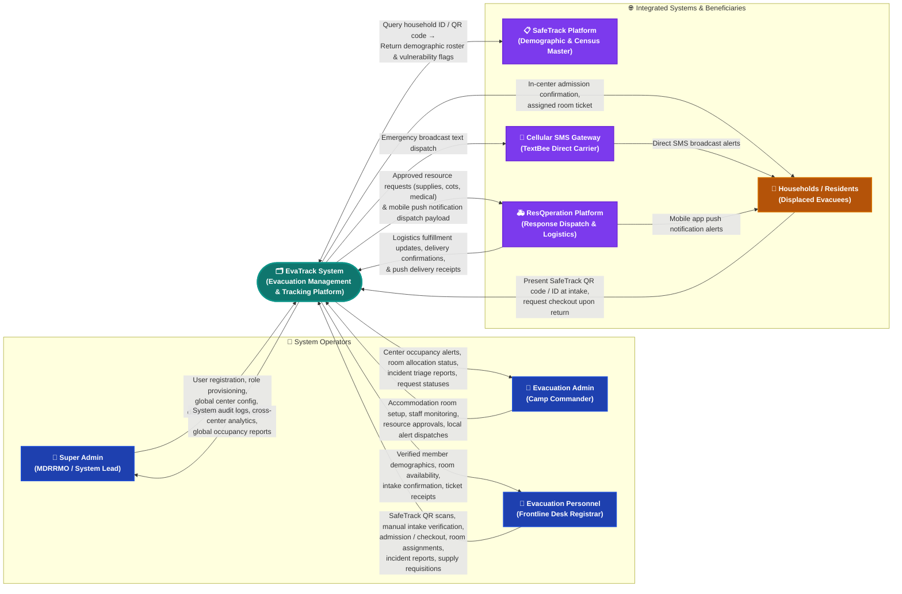

# EvaTrack – Data Flow Diagrams (DFD)

**Project Title:** EVATRACK: Streamlined Evacuation Processes and Coordination Platform Integrating SafeTrack Demographics and ResQperation Response Support  
**Proponents:** Klint M. Ruales, Danica Gelbolingo, Anna Rhea Villadolid, Vhenz Cernal  

Render these diagrams using [Mermaid Live Editor](https://mermaid.live) or view them natively in Markdown preview.

---

## 1. Architectural System Context & Scope

EvaTrack operates as the central camp coordination and evacuation management platform within an interconnected tri-platform disaster management ecosystem:
1. **EvaTrack (Central System):** Camp coordination, shelter intake, resident admission & room allocation, real-time occupancy tracking, in-center incident triage, resource shortage requests, SMS & push notification broadcasts, and demographic analytics.
2. **SafeTrack (Demographic & Census Authority - External System):** Manages pre-disaster resident census profiles, family rosters, vulnerability statuses (PWD, pregnant, seniors, infants), and issues unique household QR codes.
3. **ResQperation (Emergency Operations & Dispatch - External System):** Manages disaster incident response, rescue logistics, emergency supply fulfillment, and hosts the mobile push notification gateway for smartphone residents.
4. **Households / Residents (End Beneficiaries):** Present SafeTrack QR codes or identification at evacuation centers, receive real-time SMS broadcasts and mobile push alerts.
5. **System Operators:**
   - **Super Admin:** System-wide administrator (MDRRMO) managing all user accounts, role provisioning, global center registrations, disaster event activations, and cross-center analytics.
   - **Evacuation Admin:** Camp Incident Commander managing shelter capacities, room assignments, staff shifts, resource request approvals, and local emergency broadcast dispatches.
   - **Evacuation Personnel:** Frontline desk staff verifying evacuees against SafeTrack records, checking in/out households, logging room allocations, reporting facility/medical incidents, and drafting supply requests.

---

## 2. Level 0: Context Diagram

The Level 0 Context Diagram depicts the entire EvaTrack system as a single central process interacting with all internal actors, external partner systems, and beneficiaries.

---

## 3. Level 1: Data Flow Diagram (All System Subsystems)

The Level 1 DFD decomposes EvaTrack into **nine functional sub-processes**, displaying data flows between system operators, external partner platforms, data stores, and recipient gateways.

```mermaid
%%{ init: { "flowchart": { "rankSpacing": 70, "nodeSpacing": 45 } } }%%
flowchart TB

    %% ══════════════════════════════════════════════════════════════════════════
    %% EXTERNAL ENTITIES (Top & Bottom Boundaries)
    %% ══════════════════════════════════════════════════════════════════════════
    subgraph ACTORS["👥 System Operators & External Systems"]
        SA["👤 Super Admin"]
        EA["👤 Evacuation Admin"]
        EP["👤 Evacuation Personnel"]
        ST["📋 SafeTrack Platform"]
        RQ["🚑 ResQperation Platform"]
        HH["📱 Households / Residents"]
        GW["📡 Cellular SMS Gateway"]
    end

    %% ══════════════════════════════════════════════════════════════════════════
    %% DATA STORES
    %% ══════════════════════════════════════════════════════════════════════════
    subgraph STORES["💽 System Data Stores (mysql_v2 / shared_db)"]
        D1[("D1: Users & Roles\n(users, roles, user_notifications)")]
        D2[("D2: Evacuation Centers & Occupancy\n(evacuation_centers, center_occupancies)")]
        D3[("D3: Accommodation Units\n(accommodation_units, unit_allocations)")]
        D4[("D4: Disaster Events\n(disaster_events, disaster_types, severities)")]
        D5[("D5: Households & Demographics\n(households, household_members, addresses)")]
        D6[("D6: Evacuation Records\n(evacuation_records, evacuated_members)")]
        D7[("D7: Center Issue Reports\n(center_issue_reports, categories, statuses)")]
        D8[("D8: Resource Requests\n(resource_requests, request_statuses)")]
        D9[("D9: Notifications & Logs\n(notifications, notification_logs, device_tokens)")]
        D10[("D10: Analytics Snapshots\n(analytics, analytics_job_logs)")]
    end

    %% ══════════════════════════════════════════════════════════════════════════
    %% PROCESSES
    %% ══════════════════════════════════════════════════════════════════════════

    subgraph P_ADMIN["🔐 Subsystem 1: Administration & Setup"]
        P1(["1.0\nUser Provisioning\n& Access Control"])
        P2(["2.0\nCenter & Room\nConfiguration"])
        P3(["3.0\nDisaster Event &\nSeverity Activation"])
    end

    subgraph P_INTAKE["🚨 Subsystem 2: Intake & Evacuation Tracking"]
        P4(["4.0\nSafeTrack Intake &\nDemographic Sync"])
        P5(["5.0\nAdmission, Room\nAllocation & Checkout"])
    end

    subgraph P_OPS["🛠️ Subsystem 3: Camp Operations & Coordination"]
        P6(["6.0\nIn-Center Incident &\nHealth Issue Triage"])
        P7(["7.0\nResource Shortage &\nResQperation Routing"])
    end

    subgraph P_COMM["📢 Subsystem 4: Alert Broadcast & Intelligence"]
        P8(["8.0\nMulti-Channel Alert\nBroadcast Engine"])
        P9(["9.0\nLive Demographic\nAnalytics & Reporting"])
    end

    %% ══════════════════════════════════════════════════════════════════════════
    %% DATA FLOW CONNECTIONS
    %% ══════════════════════════════════════════════════════════════════════════

    %% Process 1.0 (Auth & User Provisioning)
    SA -->|"Create accounts, assign roles (SUP/EAD/EPE)"| P1
    EA -->|"Login credentials"| P1
    EP -->|"Login credentials"| P1
    P1 <-->|"Read/write credentials, roles, user notifs"| D1
    P1 -->|"Auth tokens, profile data"| SA
    P1 -->|"Auth tokens, assigned center"| EA
    P1 -->|"Auth tokens, assigned center"| EP

    %% Process 2.0 (Center & Room Config)
    SA -->|"Register evacuation centers, GPS, capacities"| P2
    EA -->|"Configure accommodation units, rooms, tents"| P2
    P2 <-->|"Persist center profiles, occupancy limits"| D2
    P2 <-->|"Persist room capacities, unit records"| D3
    P2 -->|"Center directories, floor plan capacities"| EA

    %% Process 3.0 (Disaster Event Management)
    SA -->|"Declare disaster event, set severity, link centers"| P3
    P3 <-->|"Store events, hazard types, severity levels"| D4
    P3 -->|"Active event context"| P5
    P3 -->|"Active event context"| P8
    P3 -->|"Event operational status"| EA

    %% Process 4.0 (SafeTrack Demographic Ingestion & Verification)
    EP -->|"Scan SafeTrack QR code or enter Household ID"| P4
    P4 <-->|"Query household ID → Return family roster & PWD/pregnant flags"| ST
    P4 <-->|"Cache / sync verified household & member records"| D5
    P4 -->|"Demographic verification roster (internal personnel view)"| EP
    P4 -->|"Verified household payload"| P5

    %% Process 5.0 (Admission, Room Allocation & Checkout)
    EP -->|"Check-in members present, select accommodation unit"| P5
    EP -->|"Process evacuee checkout on return home"| P5
    HH -->|"Present QR code / ID, verify present members"| P5
    P5 <-->|"Create/update admission tickets, status ('Evacuated'/'Not Evacuated')"| D6
    P5 <-->|"Assign/release accommodation unit slots"| D3
    P5 <-->|"Increment/decrement real-time center occupancy"| D2
    P5 -->|"Admission ticket, assigned room number"| HH
    P5 -->|"Intake confirmation & updated headcount"| EP
    P5 -->|"Live occupancy trigger"| P9

    %% Process 6.0 (Center Issue Reporting & Health Triage)
    EP -->|"Report medical emergency, facility damage, security incident"| P6
    EA -->|"Review, prioritize severity, assign handler, resolve issue"| P6
    P6 <-->|"Store issue tickets, attachments, triage status"| D7
    P6 -->|"Real-time in-app alert"| D1
    P6 -->|"Incident summary & resolution status"| EA

    %% Process 7.0 (Resource Shortage & ResQperation Routing)
    EP -->|"Draft shortage request (food, cots, medicine)"| P7
    EA -->|"Review, approve & dispatch request"| P7
    P7 <-->|"Store request records, status lifecycle"| D8
    P7 -->|"Dispatch approved requisition payload"| RQ
    RQ -->|"Fulfillment status, tracking ID, delivery confirmation"| P7
    P7 -->|"Requisition status updates"| EA
    P7 -->|"Requisition status updates"| EP

    %% Process 8.0 (Multi-Channel Alert Broadcast Engine)
    EA -->|"Compose advisory, select channel (SMS/Push), filter target area"| P8
    SA -->|"System-wide emergency broadcast"| P8
    P8 <-->|"Retrieve contact numbers & active device tokens"| D5
    P8 <-->|"Retrieve push tokens"| D9
    P8 <-->|"Persist broadcast records & delivery logs"| D9
    P8 -->|"Send SMS payload to direct carrier"| GW
    GW -->|"Direct SMS broadcast alerts"| HH
    P8 -->|"Send Push payload to mobile gateway"| RQ
    RQ -->|"Mobile app push notification dispatches"| HH

    %% Process 9.0 (Live Demographic Analytics & Reporting)
    D6 -->|"Aggregated admission & member records"| P9
    D5 -->|"Vulnerability attributes (PWD, pregnant, senior, infant)"| P9
    D2 -->|"Capacity vs occupancy counts"| P9
    P9 <-->|"Persist computed periodic & live snapshots"| D10
    P9 -->|"Demographic breakdown (Age, Gender, PWD, Pregnant), Occupancy Rate"| EA
    P9 -->|"Cross-center disaster rollup, city-wide humanitarian metrics"| SA

    %% ══════════════════════════════════════════════════════════════════════════
    %% STYLING
    %% ══════════════════════════════════════════════════════════════════════════
    classDef actorNode   fill:#1e40af,stroke:#1d4ed8,stroke-width:2px,color:#fff,font-weight:bold
    classDef extNode     fill:#7c3aed,stroke:#6d28d9,stroke-width:2px,color:#fff,font-weight:bold
    classDef recipNode   fill:#b45309,stroke:#d97706,stroke-width:2px,color:#fff,font-weight:bold
    classDef processNode fill:#ea580c,stroke:#c2410c,stroke-width:2px,color:#fff,font-weight:bold
    classDef storeNode   fill:#0f766e,stroke:#0d9488,stroke-width:2px,color:#fff,font-weight:bold

    class SA,EA,EP actorNode
    class ST,RQ,GW extNode
    class HH recipNode
    class P1,P2,P3,P4,P5,P6,P7,P8,P9 processNode
    class D1,D2,D3,D4,D5,D6,D7,D8,D9,D10 storeNode
```

---

## 4. Sub-Process Functional Specifications

### 1.0 User Provisioning & Access Control
- **Purpose:** Securely manages user identity, role-based access control (RBAC), authentication tokens, and user-to-center assignments.
- **Inputs:** 
  - Super Admin: Staff creation requests (names, email, role selection: `SUP`, `EAD`, `EPE`, center assignment).
  - All Users: Login credentials (email/username, password).
- **Outputs:** Sanctum API bearer tokens, user profile payloads, authorization gates, and in-app user notifications.
- **Data Stores Accessed:** `D1 Users & Roles`.
- **Business Logic:**
  - Enforces exclusive user creation rights to Super Admin.
  - Automatically generates formatted User IDs (`SUP-YYYY-XXXXXX`, `EAD-YYYY-XXXXXX`, `EPE-YYYY-XXXXXX`).
  - Restricts Evacuation Personnel access strictly to their assigned evacuation center (`assigned_center_id`).

### 2.0 Center & Room Configuration
- **Purpose:** Maintains the physical inventory of evacuation shelters and internal living quarters.
- **Inputs:**
  - Super Admin: Evacuation center facility profiles (name, GPS latitude/longitude, total facility capacity, OpenStreetMap address).
  - Evacuation Admin: Internal accommodation units (classrooms, modular tents, gym sectors, individual room capacities).
- **Outputs:** Real-time facility availability lists, room inventory matrices, maximum capacity thresholds.
- **Data Stores Accessed:** `D2 Evacuation Centers & Occupancy`, `D3 Accommodation Units`.
- **Business Logic:**
  - Centers generate formatted IDs (`EC-YYYY-XXXXXX`).
  - Total room capacities cannot exceed total facility design capacity.
  - Tracks room-level availability to prevent physical over-allocation.

### 3.0 Disaster Event & Severity Activation
- **Purpose:** Declares, categorizes, and tracks disaster operations.
- **Inputs:** Super Admin: Disaster event declarations, hazard type selection (Typhoon, Flood, Earthquake, Landslide, Fire), severity level ratings (Low, Moderate, High, Critical), activation dates.
- **Outputs:** Active disaster event context provided to intake, alerting, and reporting modules.
- **Data Stores Accessed:** `D4 Disaster Events`.
- **Business Logic:**
  - Centers are linked to an active `current_event_id`.
  - Closing an event archives evacuation records and marks shelter occupancy as resolved.

### 4.0 SafeTrack Intake & Demographic Sync
- **Purpose:** Interfaces directly with the SafeTrack master census platform to fetch household demographics, member identities, and vulnerability tags during shelter arrival.
- **Inputs:** Evacuation Personnel: SafeTrack QR code scan payload or manual `household_id` search.
- **Outputs:** Verified household roster, list of registered family members, vulnerability flags (PWD, pregnant, senior, infant).
- **Data Stores Accessed:** `D5 Households & Demographics`.
- **External Interfaces:** `SafeTrack Platform` (REST API).
- **Business Logic:**
  - **Data Privacy Rule:** Full demographic data and vulnerability classifications are exposed strictly to authenticated Evacuation Personnel on their intake screen and are never exposed publicly or reflected back to unauthenticated devices.
  - If a household record is updated in SafeTrack, the latest demographic snapshot is synchronized with EvaTrack's cache (`households`, `household_members`).

### 5.0 Admission, Room Allocation & Checkout
- **Purpose:** Handles the physical intake, member headcount verification, living space assignment, and departure of displaced families.
- **Inputs:**
  - Evacuation Personnel: Checkbox selection of physically present members, accommodation unit assignment (`unit_id`), departure/checkout trigger.
  - Households: Presentation of QR code or physical ID.
- **Outputs:** Admission confirmation, room assignment ticket, auto-updated center headcount.
- **Data Stores Accessed:** `D6 Evacuation Records`, `D3 Accommodation Units`, `D2 Evacuation Centers & Occupancy`.
- **Business Logic:**
  - Admission creates an `evacuation_records` entry, marks `household_status_id` = `Evacuated`, and logs verified individuals in `evacuated_members`.
  - Atomically increments `center_occupancies.current_occupancy` and updates room allocation slots in `unit_allocations`.
  - Processing checkout changes `household_status_id` = `Not Evacuated`, frees accommodation unit capacity, and decrements `center_occupancies.current_occupancy`.

### 6.0 In-Center Incident & Health Issue Triage
- **Purpose:** Enables frontline camp staff to report and triage operational incidents, facility damage, sanitation problems, medical emergencies, and security issues.
- **Inputs:**
  - Evacuation Personnel: Incident category (`facility_damage`, `medical_emergency`, `sanitation`, `security`, `food_water`), description, severity rating, photo attachment.
  - Evacuation Admin: Triage status updates (`pending`, `under_review`, `in_progress`, `resolved`), assigned handler user.
- **Outputs:** Incident tickets (`CIR-YYYY-XXXXXX`), real-time in-app dashboard notifications, resolution reports.
- **Data Stores Accessed:** `D7 Center Issue Reports`, `D1 Users & Roles`.
- **Business Logic:**
  - Critical/high severity incidents immediately trigger in-app notifications to center Camp Managers.
  - Photo attachments are stored securely in local app storage and served via signed asset URLs.

### 7.0 Resource Shortage & ResQperation Routing
- **Purpose:** Tracks in-center material and personnel deficits, enables administrative approval, and dispatches external logistics requests directly to the ResQperation disaster response platform.
- **Inputs:**
  - Evacuation Personnel: Supply deficit requisition (item type, quantity needed, priority, justification).
  - Evacuation Admin: Administrative review, quantity adjustment, approval or rejection.
  - ResQperation Platform: Dispatch acknowledgment, tracking reference, fulfillment and delivery status.
- **Outputs:** Requisition tickets (`REQ-YYYY-XXXXXX`), outbound JSON payload to ResQperation, delivery receipts.
- **Data Stores Accessed:** `D8 Resource Requests`.
- **External Interfaces:** `ResQperation Platform` (REST API).
- **Business Logic:**
  - Personnel create requests in `pending` status.
  - Evacuation Admin approves the request, which triggers the dispatch integration payload to ResQperation.
  - Status updates (`acknowledged`, `approved`, `delivered`) synchronize back into EvaTrack.

### 8.0 Multi-Channel Alert Broadcast Engine
- **Purpose:** Dispatches critical emergency bulletins, weather advisories, and evacuation notices across multiple communication channels tailored to resident connectivity.
- **Inputs:** Evacuation Admin / Super Admin: Advisory message text, urgency level, channel selection (`sms`, `push`, `both`), target filter (barangay, evacuation center, or all).
- **Outputs:** Outbound SMS dispatches via cellular gateway, outbound push notification requests to ResQperation / OneSignal, recipient delivery audit logs.
- **Data Stores Accessed:** `D9 Notifications & Logs`, `D5 Households & Demographics`.
- **External Interfaces:** `Cellular SMS Gateway` (TextBee GSM API), `ResQperation / OneSignal Push Gateway`.
- **Business Logic:**
  - **Hybrid Delivery Strategy:**
    - Non-smartphone or offline households receive direct cellular SMS text broadcasts.
    - Smartphone app users receive instant push notifications via device tokens.
  - Delivery attempts, status responses (`sent`, `delivered`, `failed`), and retry counts are logged per recipient in `notification_logs`.

### 9.0 Live Demographic Analytics & Reporting
- **Purpose:** Aggregates real-time intake data to produce demographic distributions and humanitarian intelligence for camp managers and disaster agency executives.
- **Inputs:** Data streams from `D6 Evacuation Records`, `D5 Households & Demographics`, and `D2 Evacuation Centers & Occupancy`.
- **Outputs:**
  - Center-level dashboard: Real-time occupancy percentage, gender distribution (Male vs. Female), age brackets (Children, Adults, Elderly), vulnerability counts (PWD, Pregnant, Lactating).
  - City-wide / MDRRMO dashboard: Total affected population, total displaced families, aggregate resource consumption rates, downloadable CSV/PDF audit summaries.
- **Data Stores Accessed:** `D10 Analytics Snapshots`.
- **Business Logic:**
  - Aggregations are calculated live upon query and periodically captured as immutable historical snapshots by background scheduler jobs (`analytics_job_logs`).

---

## 5. Data Store Dictionary

| Data Store | Primary Tables | Schema Key Elements | Functional Purpose |
|---|---|---|---|
| **D1: Users & Roles** | `users`, `roles`, `user_notifications` | `user_id` (PK), `role_id` (FK), `assigned_center_id` (FK), `email`, `password` | Stores administrative credentials, authorization tiers, and staff center assignments. |
| **D2: Evacuation Centers & Occupancy** | `evacuation_centers`, `center_occupancies` | `evacuation_center_id` (PK), `capacity`, `latitude`, `longitude`, `current_occupancy` | Maintains shelter facility locations, maximum capacities, and live headcount counters. |
| **D3: Accommodation Units** | `accommodation_units`, `accommodation_types`, `unit_allocations` | `unit_id` (PK), `center_id` (FK), `max_capacity`, `allocation_id` (PK), `evacuation_id` (FK) | Tracks individual rooms, classrooms, and modular tents and their family assignments. |
| **D4: Disaster Events** | `disaster_events`, `disaster_types`, `severity_levels`, `disaster_event_types` | `event_id` (PK), `type_id` (FK), `severity_level_id` (FK), `started_at`, `ended_at` | Maintains operational disaster incidents, warning signals, and active shelter associations. |
| **D5: Households & Demographics** | `households`, `household_members`, `addresses`, `member_vulnerable_groups`, `vulnerable_groups` | `household_id` (PK), `member_id` (PK), `address_id` (FK), `is_pwd`, `is_pregnant`, `birth_date` | Caches SafeTrack master family census profiles, addresses, and demographic attributes. |
| **D6: Evacuation Records** | `evacuation_records`, `evacuated_members`, `household_statuses` | `evacuation_id` (PK), `event_id` (FK), `household_id` (FK), `center_id` (FK), `verified_by` (FK) | Records intake admission tickets, member verifications, and departure/checkout timestamps. |
| **D7: Center Issue Reports** | `center_issue_reports`, `center_issue_categories`, `center_issue_report_statuses` | `report_id` (PK), `evacuation_center_id` (FK), `reported_by` (FK), `category_id` (FK), `severity_id` (FK) | Logs facility damage, medical emergencies, sanitation, and safety incidents. |
| **D8: Resource Requests** | `resource_requests`, `resource_request_status`, `urgency_levels` | `request_id` (PK), `evacuation_center_id` (FK), `requested_by` (FK), `urgency_id` (FK), `status_id` (FK) | Records camp supply shortages and tracks fulfillment coordination with ResQperation. |
| **D9: Notifications & Logs** | `notifications`, `notification_recipients`, `notification_logs`, `device_tokens`, `recurrence_types` | `notif_id` (PK), `channel`, `message`, `household_id` (FK), `status_id` (FK), `player_id` | Stores broadcast messages, scheduled dispatches, device tokens, and carrier delivery logs. |
| **D10: Analytics Snapshots** | `analytics`, `analytics_job_logs`, `analytics_job_status` | `analytic_id` (PK), `evacuation_event_id` (FK), `total_population`, `total_households`, `pwd_count` | Persists computed demographic distributions, vulnerability rollups, and batch job logs. |

---

## 6. External Entities & Interface Protocols

| Entity Name | Classification | Direction | Data Items Transferred | Interface Protocol |
|---|---|---|---|---|
| **Super Admin** | Internal Operator | In / Out | In: User accounts, center configs, disaster declarations. Out: System audit logs, global analytics, multi-center summaries. | HTTPS / REST / Web GUI |
| **Evacuation Admin** | Internal Operator | In / Out | In: Room configs, supply request approvals, broadcast dispatches. Out: Center occupancy dashboards, room rosters, incident triage alerts. | HTTPS / REST / Web GUI |
| **Evacuation Personnel** | Internal Operator | In / Out | In: SafeTrack QR scans, admission checklists, room assignments, incident reports. Out: Verified family rosters, admission receipts, room availability. | HTTPS / REST / Mobile Web GUI |
| **SafeTrack Platform** | Partner System | Bidirectional | Out to ST: Query Household ID / QR code. In from ST: Household demographics, member roster, vulnerability flags. | RESTful API / JSON over HTTPS |
| **ResQperation Platform** | Partner System | Bidirectional | Out to RQ: Approved resource requests, push alert payloads. In from RQ: Logistics delivery updates, push delivery statuses. | RESTful API / Webhooks / HTTPS |
| **Cellular SMS Gateway** | Delivery Service | Outbound | Out to Gateway: Recipient phone number, alert text message body. In from Gateway: Carrier delivery status, message reference ID. | REST API (TextBee) / GSM Gateway |
| **Households / Residents** | End Beneficiaries | In / Out | In to System: SafeTrack QR code, personal identity, member presence. Out to Household: Admission tickets, room assignments, SMS alerts, mobile push notices. | Physical QR / Mobile SMS / Push |
