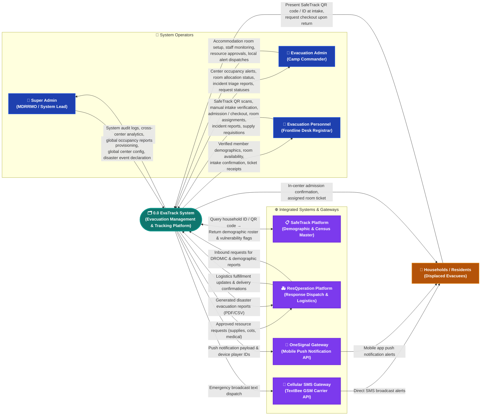
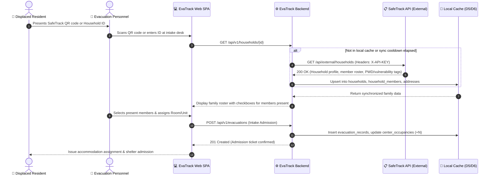
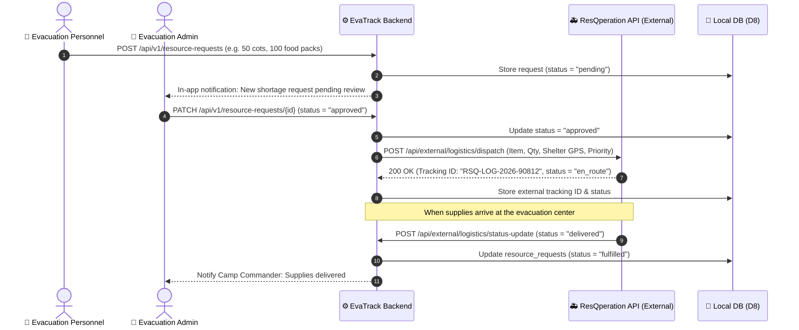
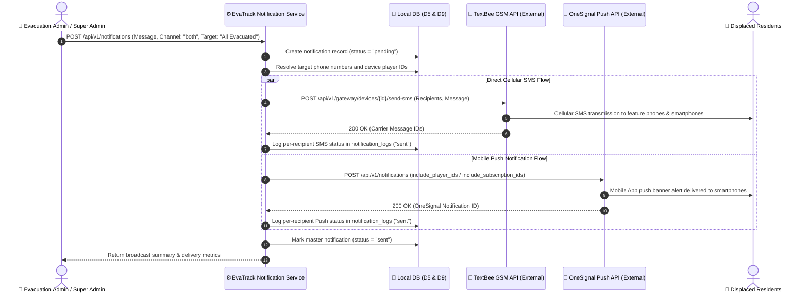
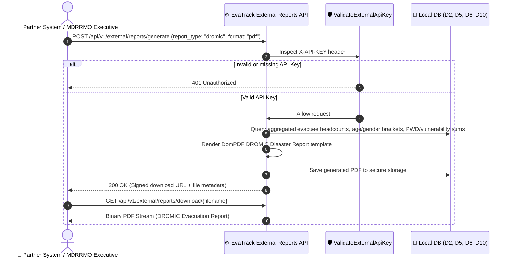

# EvaTrack – Data Flow Diagrams & External Systems Integration

**Project Title:** EVATRACK: Streamlined Evacuation Processes and Coordination Platform Integrating SafeTrack Demographics and ResQperation Response Support  
**Proponents:** Klint M. Ruales, Danica Gelbolingo, Anna Rhea Villadolid, Vhenz Cernal  

Render these diagrams using [Mermaid Live Editor](https://mermaid.live), GitHub Markdown viewer, or your IDE's Markdown preview.

---

## 1. Architectural System Context & Scope

EvaTrack operates as the central camp coordination and evacuation management platform within an interconnected tri-platform disaster management ecosystem:

1. **EvaTrack (Central System):** Camp coordination, shelter intake, resident admission & room allocation, real-time occupancy tracking, in-center incident triage, resource shortage requests, SMS & push notification broadcasts, and demographic analytics.
2. **SafeTrack (Demographic & Census Master - External Partner System):** Manages pre-disaster resident census profiles, family rosters, vulnerability statuses (PWD, pregnant, seniors, infants), and issues unique household QR codes.
3. **ResQperation (Emergency Operations & Dispatch - External Partner System):** Manages disaster incident response, rescue logistics, emergency supply fulfillment, and consumes EvaTrack humanitarian analytics.
4. **TextBee Cellular Gateway (External SMS Gateway):** Direct carrier GSM SMS dispatch gateway for real-time text message alerts to resident mobile phones.
5. **OneSignal Gateway (External Push Gateway):** Mobile push notification delivery gateway targeting smartphone app users via registered device player tokens and subscription IDs.
6. **Households / Residents (End Beneficiaries):** Present SafeTrack QR codes or identification at evacuation centers, receive real-time SMS broadcasts and mobile push alerts.
7. **System Operators:**
   - **Super Admin (MDRRMO):** System-wide administrator managing all user accounts, role provisioning (`SUP`), global center registrations, disaster event activations, and cross-center analytics.
   - **Evacuation Admin (Camp Commander):** Camp Incident Commander managing shelter capacities (`EAD`), room assignments, staff shifts, resource request approvals, and local emergency broadcast dispatches.
   - **Evacuation Personnel (Frontline Desk Registrar):** Frontline desk staff (`EPE`) verifying evacuees against SafeTrack records, checking in/out households, logging room allocations, reporting facility/medical incidents, and drafting supply requisitions.

---

## 2. Level 0: Context Diagram

The Level 0 Context Diagram depicts the entire EvaTrack system as a single central process interacting with all internal actors, external partner systems, and beneficiaries.



---

## 3. Level 1: Data Flow Diagram (All Subsystems)

The Level 1 DFD decomposes EvaTrack into **nine functional sub-processes**, displaying data flows between system operators, external partner platforms, data stores, and recipient gateways.

```mermaid
flowchart TB

    %% ══════════════════════════════════════════════════════════════════════════
    %% EXTERNAL ENTITIES
    %% ══════════════════════════════════════════════════════════════════════════
    subgraph ACTORS["👥 System Operators & External Systems"]
        SA["👤 Super Admin"]
        EA["👤 Evacuation Admin"]
        EP["👤 Evacuation Personnel"]
        ST["📋 SafeTrack Platform"]
        RQ["🚑 ResQperation Platform"]
        TB["📡 TextBee SMS Gateway"]
        OS["🔔 OneSignal Gateway"]
        HH["📱 Households / Residents"]
    end

    %% ══════════════════════════════════════════════════════════════════════════
    %% DATA STORES
    %% ══════════════════════════════════════════════════════════════════════════
    subgraph STORES["💽 System Data Stores (mysql_v2 / shared_db)"]
        D1[("D1: Users, Roles & Station Assignments\n(users, roles, center_personnel_assignments, user_notifications)")]
        D2[("D2: Evacuation Centers & Occupancy\n(evacuation_centers, center_occupancies)")]
        D3[("D3: Accommodation Units\n(accommodation_units, unit_allocations)")]
        D4[("D4: Disaster Events\n(disaster_events, disaster_types, severities)")]
        D5[("D5: Households & Demographics\n(households, household_members, addresses)")]
        D6[("D6: Evacuation Records\n(evacuation_records, evacuated_members)")]
        D7[("D7: Center Issue Reports\n(center_issue_reports, categories, statuses)")]
        D8[("D8: Resource Requests\n(resource_requests, request_statuses)")]
        D9[("D9: Notifications & Logs\n(notifications, notification_logs, device_tokens)")]
        D10[("D10: Analytics Snapshots\n(analytics, analytics_job_logs)")]
    end

    %% ══════════════════════════════════════════════════════════════════════════
    %% PROCESSES
    %% ══════════════════════════════════════════════════════════════════════════

    subgraph P_ADMIN["🔐 Subsystem 1: Administration & Setup"]
        P1(["1.0\nUser Provisioning,\nStation Assignment\n& Security Auth"])
        P2(["2.0\nCenter & Room\nConfiguration"])
        P3(["3.0\nDisaster Event &\nSeverity Activation"])
    end

    subgraph P_INTAKE["🚨 Subsystem 2: Intake & Evacuation Tracking"]
        P4(["4.0\nSafeTrack Intake &\nDemographic Sync"])
        P5(["5.0\nAdmission, Room\nAllocation & Checkout"])
    end

    subgraph P_OPS["🛠️ Subsystem 3: Camp Operations & Coordination"]
        P6(["6.0\nIn-Center Incident &\nHealth Issue Triage"])
        P7(["7.0\nResource Shortage &\nResQperation Routing"])
    end

    subgraph P_COMM["📢 Subsystem 4: Alert Broadcast & Intelligence"]
        P8(["8.0\nMulti-Channel Alert\nBroadcast Engine"])
        P9(["9.0\nLive Demographic\nAnalytics & Reporting"])
    end

    %% ══════════════════════════════════════════════════════════════════════════
    %% DATA FLOW CONNECTIONS
    %% ══════════════════════════════════════════════════════════════════════════

    %% Process 1.0 (Auth, User Provisioning & Station Assignment)
    SA -->|"Create accounts, assign roles (SUP/EAD/EPE),\nassign personnel to station"| P1
    EA -->|"Assign/transfer personnel to shelter station,\nlogin credentials"| P1
    EP -->|"Login credentials"| P1
    P1 <-->|"Read/write credentials, roles, station assignment\naudit log, user notifications"| D1
    P1 <-->|"Validate center existence & link personnel"| D2
    P1 -->|"HttpOnly secure auth cookies, profile data"| SA
    P1 -->|"HttpOnly secure auth cookies, assigned station"| EA
    P1 -->|"HttpOnly secure auth cookies, assigned station"| EP

    %% Process 2.0 (Center & Room Config)
    SA -->|"Register evacuation centers, GPS, capacities"| P2
    EA -->|"Configure accommodation units, rooms, tents"| P2
    P2 <-->|"Persist center profiles, occupancy limits"| D2
    P2 <-->|"Persist room capacities, unit records"| D3
    P2 -->|"Center directories, floor plan capacities"| EA

    %% Process 3.0 (Disaster Event Management)
    SA -->|"Declare disaster event, set severity, link centers"| P3
    P3 <-->|"Store events, hazard types, severity levels"| D4
    P3 -->|"Active event context"| P5
    P3 -->|"Active event context"| P8
    P3 -->|"Event operational status"| EA

    %% Process 4.0 (SafeTrack Demographic Ingestion & Verification)
    EP -->|"Scan SafeTrack QR code or enter Household ID"| P4
    P4 <-->|"Query household ID → Return family roster & PWD/pregnant flags"| ST
    P4 <-->|"Cache / sync verified household & member records"| D5
    P4 -->|"Demographic verification roster (internal personnel view)"| EP
    P4 -->|"Verified household payload"| P5

    %% Process 5.0 (Admission, Room Allocation & Checkout)
    EP -->|"Check-in members present, allocate/change room unit\n(via Unit Grid or Evacuated Household Details drawer)"| P5
    EP -->|"Process evacuee checkout on return home"| P5
    HH -->|"Present QR code / ID, verify present members"| P5
    P5 <-->|"Create/update admission tickets, status ('Evacuated'/'Not Evacuated')"| D6
    P5 <-->|"Assign/release accommodation unit slots"| D3
    P5 <-->|"Increment/decrement real-time center occupancy"| D2
    P5 -->|"Admission ticket, assigned room number"| HH
    P5 -->|"Intake confirmation & updated headcount"| EP
    P5 -->|"Live occupancy trigger"| P9

    %% Process 6.0 (Center Issue Reporting & Health Triage)
    EP -->|"Report medical emergency, facility damage, security incident"| P6
    EA -->|"Review, prioritize severity, assign handler, resolve issue"| P6
    P6 <-->|"Store issue tickets, attachments, triage status"| D7
    P6 -->|"Real-time in-app alert"| D1
    P6 -->|"Incident summary & resolution status"| EA

    %% Process 7.0 (Resource Shortage & ResQperation Routing)
    EP -->|"Draft shortage request (food, cots, medicine)"| P7
    EA -->|"Review, approve & dispatch request"| P7
    P7 <-->|"Store request records, status lifecycle"| D8
    P7 -->|"Dispatch approved requisition payload"| RQ
    RQ -->|"Fulfillment status, tracking ID, delivery confirmation"| P7
    P7 -->|"Requisition status updates"| EA
    P7 -->|"Requisition status updates"| EP

    %% Process 8.0 (Multi-Channel Alert Broadcast Engine)
    EA -->|"Compose advisory, select channel (SMS/Push), filter target area"| P8
    SA -->|"System-wide emergency broadcast"| P8
    P8 <-->|"Retrieve contact numbers & active device tokens"| D5
    P8 <-->|"Retrieve push tokens"| D9
    P8 <-->|"Persist broadcast records & delivery logs"| D9
    P8 -->|"Send SMS payload to direct carrier"| TB
    TB -->|"Direct SMS broadcast alerts"| HH
    P8 -->|"Send Push payload to mobile gateway"| OS
    OS -->|"Mobile app push notification dispatches"| HH

    %% Process 9.0 (Live Demographic Analytics & Reporting)
    D6 -->|"Aggregated admission & member records"| P9
    D5 -->|"Vulnerability attributes (PWD, pregnant, senior, infant)"| P9
    D2 -->|"Capacity vs occupancy counts"| P9
    P9 <-->|"Persist computed periodic & live snapshots"| D10
    P9 -->|"Demographic breakdown (Age, Gender, PWD, Pregnant), Occupancy Rate"| EA
    P9 -->|"Cross-center disaster rollup, city-wide humanitarian metrics"| SA
    RQ -->|"Request external DROMIC & utilization reports"| P9
    P9 -->|"Generated PDF/CSV report stream"| RQ

    %% ══════════════════════════════════════════════════════════════════════════
    %% STYLING
    %% ══════════════════════════════════════════════════════════════════════════
    classDef actorNode   fill:#1e40af,stroke:#1d4ed8,stroke-width:2px,color:#fff,font-weight:bold
    classDef extNode     fill:#7c3aed,stroke:#6d28d9,stroke-width:2px,color:#fff,font-weight:bold
    classDef recipNode   fill:#b45309,stroke:#d97706,stroke-width:2px,color:#fff,font-weight:bold
    classDef processNode fill:#ea580c,stroke:#c2410c,stroke-width:2px,color:#fff,font-weight:bold
    classDef storeNode   fill:#0f766e,stroke:#0d9488,stroke-width:2px,color:#fff,font-weight:bold

    class SA,EA,EP actorNode
    class ST,RQ,TB,OS extNode
    class HH recipNode
    class P1,P2,P3,P4,P5,P6,P7,P8,P9 processNode
    class D1,D2,D3,D4,D5,D6,D7,D8,D9,D10 storeNode
```



---

## 4. Sub-Process Functional Specifications

### 1.0 User Provisioning, Station Assignment & Security Access Control
- **Purpose:** Securely manages user identity, role-based access control (RBAC), multi-tier authentication security (HttpOnly session cookies, brute-force rate limiting), and personnel-to-center station assignment lifecycle with historical auditing.
- **Inputs:** 
  - Super Admin: Staff creation requests (names, email, role selection: `SUP`, `EAD`, `EPE`, center assignment).
  - Evacuation Admin: Personnel center station assignment, transfer, and relief commands.
  - All Users: Login credentials (User ID / email, password).
- **Outputs:** HttpOnly `access_token` cookies (web SPA) and Sanctum API bearer tokens (mobile), user profile payloads, station assignment audit records, in-app alerts, and SMS assignment notifications.
- **Data Stores Accessed:** `D1 Users, Roles & Station Assignments`, `D2 Evacuation Centers & Occupancy`.

### 2.0 Center & Room Configuration
- **Purpose:** Maintains the physical inventory of evacuation shelters and internal living quarters.
- **Inputs:**
  - Super Admin: Evacuation center facility profiles (name, GPS latitude/longitude, total facility capacity, OpenStreetMap address).
  - Evacuation Admin: Internal accommodation units (classrooms, modular tents, gym sectors, individual room capacities).
- **Outputs:** Real-time facility availability lists, room inventory matrices, maximum capacity thresholds.
- **Data Stores Accessed:** `D2 Evacuation Centers & Occupancy`, `D3 Accommodation Units`.

### 3.0 Disaster Event & Severity Activation
- **Purpose:** Declares, categorizes, and tracks disaster operations.
- **Inputs:** Super Admin: Disaster event declarations, hazard type selection (Typhoon, Flood, Earthquake, Landslide, Fire), severity level ratings (Low, Moderate, High, Critical), activation dates.
- **Outputs:** Active disaster event context provided to intake, alerting, and reporting modules.
- **Data Stores Accessed:** `D4 Disaster Events`.

### 4.0 SafeTrack Intake & Demographic Sync
- **Purpose:** Interfaces directly with the SafeTrack master census platform to fetch household demographics, member identities, and vulnerability tags during shelter arrival.
- **Inputs:** Evacuation Personnel: SafeTrack QR code scan payload or manual `household_id` search.
- **Outputs:** Verified household roster, list of registered family members, vulnerability flags (PWD, pregnant, senior, infant).
- **Data Stores Accessed:** `D5 Households & Demographics`.
- **External Interfaces:** `SafeTrack Platform` (`GET /api/external/households`).

### 5.0 Admission, Room Allocation & Checkout
- **Purpose:** Handles physical intake, member headcount verification, living space / accommodation unit assignment, and departure of displaced families.
- **Inputs:** Evacuation Personnel: Member checkboxes, accommodation unit assignment (`unit_id`), departure/checkout trigger.
- **Outputs:** Admission confirmation, room assignment ticket, auto-updated center headcount, room allocation status.
- **Data Stores Accessed:** `D6 Evacuation Records`, `D3 Accommodation Units`, `D2 Evacuation Centers & Occupancy`.

### 6.0 In-Center Incident & Health Issue Triage
- **Purpose:** Enables frontline camp staff to report and triage operational incidents, facility damage, sanitation problems, medical emergencies, and security issues.
- **Inputs:** Evacuation Personnel: Incident category, issue name/title, optional description, photo attachment.
- **Outputs:** Incident tickets (`CIR-YYYY-XXXXXX`), real-time in-app dashboard notifications, resolution reports.
- **Data Stores Accessed:** `D7 Center Issue Reports`, `D1 Users & Roles`.

### 7.0 Resource Shortage & ResQperation Routing
- **Purpose:** Tracks in-center material and personnel deficits, enables administrative approval, and dispatches external logistics requests directly to the ResQperation disaster response platform.
- **Inputs:** Evacuation Personnel: Supply deficit requisition; Evacuation Admin: Administrative review & approval; ResQperation: Fulfillment & delivery callbacks.
- **Outputs:** Requisition tickets (`REQ-YYYY-XXXXXX`), outbound JSON payload to ResQperation, delivery receipts.
- **Data Stores Accessed:** `D8 Resource Requests`.
- **External Interfaces:** `ResQperation Platform` (REST API).

### 8.0 Multi-Channel Alert Broadcast Engine
- **Purpose:** Dispatches critical emergency bulletins, weather advisories, and evacuation notices across cellular SMS and mobile push channels.
- **Inputs:** Evacuation Admin / Super Admin: Advisory message text, urgency level, channel selection (`sms`, `push`, `both`), target filter.
- **Outputs:** Outbound SMS dispatches via TextBee GSM gateway, outbound push notification requests to OneSignal, recipient delivery audit logs.
- **Data Stores Accessed:** `D9 Notifications & Logs`, `D5 Households & Demographics`.
- **External Interfaces:** `TextBee SMS Gateway` (Direct GSM), `OneSignal Push Gateway` (REST API v1).

### 9.0 Live Demographic Analytics & Reporting
- **Purpose:** Aggregates real-time intake data to produce demographic distributions, shelter utilization, and external humanitarian intelligence (e.g. DROMIC reports).
- **Inputs:** Data streams from `D6 Evacuation Records`, `D5 Households & Demographics`, and `D2 Evacuation Centers & Occupancy`.
- **Outputs:** Interactive dashboards, periodic snapshots, streamed PDF/CSV downloads for partner platforms (`/api/v1/external/reports/generate`).
- **Data Stores Accessed:** `D10 Analytics Snapshots`.

---

## 5. System Data Store Dictionary

| Data Store | Primary Tables | Schema Key Elements | Functional Purpose |
|---|---|---|---|
| **D1: Users, Roles & Station Assignments** | `users`, `roles`, `center_personnel_assignments`, `user_notifications` | `user_id` (PK), `role_id` (FK), `assigned_center_id` (FK), `assignment_id` (PK), `email`, `password` | Stores administrative credentials, authorization tiers, personnel station assignments, and historical station audit trails. |
| **D2: Evacuation Centers & Occupancy** | `evacuation_centers`, `center_occupancies` | `evacuation_center_id` (PK), `capacity`, `latitude`, `longitude`, `current_occupancy` | Maintains shelter facility locations, maximum capacities, and live headcount counters. |
| **D3: Accommodation Units** | `accommodation_units`, `accommodation_types`, `unit_allocations` | `unit_id` (PK), `center_id` (FK), `max_capacity`, `allocation_id` (PK), `evacuation_id` (FK) | Tracks individual rooms, classrooms, and modular tents and their family assignments. |
| **D4: Disaster Events** | `disaster_events`, `disaster_types`, `severity_levels`, `disaster_event_types` | `event_id` (PK), `type_id` (FK), `severity_level_id` (FK), `started_at`, `ended_at` | Maintains operational disaster incidents, warning signals, and active shelter associations. |
| **D5: Households & Demographics** | `households`, `household_members`, `addresses`, `member_vulnerable_groups`, `vulnerable_groups` | `household_id` (PK), `member_id` (PK), `address_id` (FK), `is_pwd`, `is_pregnant`, `birth_date` | Caches SafeTrack master family census profiles, addresses, and demographic attributes. |
| **D6: Evacuation Records** | `evacuation_records`, `evacuated_members`, `household_statuses` | `evacuation_id` (PK), `event_id` (FK), `household_id` (FK), `center_id` (FK), `verified_by` (FK) | Records intake admission tickets, member verifications, and departure/checkout timestamps. |
| **D7: Center Issue Reports** | `center_issue_reports`, `center_issue_categories`, `center_issue_report_statuses` | `report_id` (PK), `evacuation_center_id` (FK), `reported_by` (FK), `category_id` (FK), `severity_id` (FK) | Logs facility damage, medical emergencies, sanitation, and safety incidents. |
| **D8: Resource Requests** | `resource_requests`, `resource_request_status`, `urgency_levels` | `request_id` (PK), `evacuation_center_id` (FK), `requested_by` (FK), `urgency_id` (FK), `status_id` (FK) | Records camp supply shortages and tracks fulfillment coordination with ResQperation. |
| **D9: Notifications & Logs** | `notifications`, `notification_recipients`, `notification_logs`, `device_tokens`, `recurrence_types` | `notif_id` (PK), `channel`, `message`, `household_id` (FK), `status_id` (FK), `player_id` | Stores broadcast messages, scheduled dispatches, device tokens, and carrier delivery logs. |
| **D10: Analytics Snapshots** | `analytics`, `analytics_job_logs`, `analytics_job_status` | `analytic_id` (PK), `evacuation_event_id` (FK), `total_population`, `total_households`, `pwd_count` | Persists computed demographic distributions, vulnerability rollups, and batch job logs. |

---

## 6. External Entities & Interface Protocols

| Entity Name | Classification | Direction | Data Items Transferred | Interface Protocol |
|---|---|---|---|---|
| **Super Admin** | Internal Operator | In / Out | In: User accounts, center configs, disaster declarations.<br>Out: System audit logs, global analytics, multi-center summaries. | HTTPS / REST / Web GUI |
| **Evacuation Admin** | Internal Operator | In / Out | In: Room configs, supply request approvals, broadcast dispatches.<br>Out: Center occupancy dashboards, room rosters, incident triage alerts. | HTTPS / REST / Web GUI |
| **Evacuation Personnel** | Internal Operator | In / Out | In: SafeTrack QR scans, admission checklists, room assignments, incident reports.<br>Out: Verified family rosters, admission receipts, room availability. | HTTPS / REST / Mobile Web GUI |
| **SafeTrack Platform** | Partner System | Bidirectional | Out to ST: Query Household ID / QR code.<br>In from ST: Household demographics, member roster, vulnerability flags. | RESTful API / JSON over HTTPS (`X-API-KEY`) |
| **ResQperation Platform** | Partner System | Bidirectional | Out to RQ: Approved resource requests, supply requisitions.<br>In from RQ: Logistics delivery updates, DROMIC report queries. | RESTful API / Webhooks / HTTPS |
| **TextBee SMS Gateway** | Delivery Service | Outbound | Out to Gateway: Recipient phone number, alert text message body.<br>In from Gateway: Carrier delivery status, message reference ID. | REST API (TextBee) / GSM Gateway |
| **OneSignal Push Gateway** | Delivery Service | Outbound | Out to Gateway: App ID, player/subscription IDs, title, body.<br>In from Gateway: OneSignal notification ID, delivery stats. | REST API v1 (`Basic API Key`) |
| **Households / Residents** | End Beneficiaries | In / Out | In to System: SafeTrack QR code, personal identity, member presence.<br>Out to Household: Admission tickets, room assignments, SMS alerts, mobile push notices. | Physical QR / Mobile SMS / Push |

---

## 7. Detailed External Integration Sequence Workflows

### 7.1 SafeTrack Master Demographic Ingestion & QR Check-In Flow



---

### 7.2 ResQperation Resource Fulfillment & Logistics Tracking Flow



---

### 7.3 Multi-Channel Emergency Alerts (TextBee SMS + OneSignal Push) Flow



---

### 7.4 Inbound External Reporting API (DROMIC & Humanitarian Analytics) Flow



---

## 8. External Data Payload Specifications

### 8.1 SafeTrack Inbound Household Payload (`GET /api/external/households`)
```json
{
  "status": "success",
  "data": [
    {
      "household_id": "NHH-2026-000142",
      "household_head": "Juan Dela Cruz",
      "contact_number": "09171234567",
      "address": {
        "region": "Region VII",
        "province": "Cebu",
        "city": "Cebu City",
        "barangay": "Apas",
        "sitio": "San Antonio",
        "purok": "Purok 3"
      },
      "members": [
        {
          "member_id": "MEM-2026-000412",
          "first_name": "Juan",
          "last_name": "Dela Cruz",
          "relationship_to_head": "Head",
          "birth_date": "1980-05-14",
          "gender": "Male",
          "is_pwd": false,
          "is_pregnant": false
        },
        {
          "member_id": "MEM-2026-000413",
          "first_name": "Maria",
          "last_name": "Dela Cruz",
          "relationship_to_head": "Spouse",
          "birth_date": "1984-08-22",
          "gender": "Female",
          "is_pwd": false,
          "is_pregnant": true
        }
      ]
    }
  ]
}
```

### 8.2 ResQperation Resource Requisition Payload
```json
{
  "request_id": "REQ-2026-000089",
  "evacuation_center_id": "EC-2026-000004",
  "center_name": "Apas National High School",
  "latitude": 10.3341,
  "longitude": 123.8992,
  "item_type": "Folding Beds / Cots",
  "quantity_requested": 50,
  "urgency": "High",
  "justification": "Surge in evacuated families due to flash flood in Sitio San Antonio",
  "status": "approved",
  "requested_at": "2026-11-11T14:30:00Z"
}
```

### 8.3 OneSignal Push Notification Payload (`POST /api/v1/notifications`)
```json
{
  "app_id": "bc6266ac-90a4-4bfe-b4d5-59c57939e7a5",
  "headings": {
    "en": "Disaster Alert: Evacuation Advisory"
  },
  "contents": {
    "en": "Urgent advisory: Heavy rainfall warning raised to Red. Apas NHS is open for evacuation."
  },
  "include_subscription_ids": [
    "5a6e5925-b61a-447b-9e8d-afc7539d028e",
    "61ae232f-dfd2-4cfb-a830-93c4552899c6"
  ],
  "data": {
    "notif_id": 42,
    "url": "http://100.73.14.100:5173/evacuation-centers/EC-2026-000004",
    "center_id": "EC-2026-000004",
    "event_id": 3
  }
}
```

### 8.4 External Reports Generation API Payload (`POST /api/v1/external/reports/generate`)
```json
{
  "report_type": "dromic",
  "format": "pdf",
  "start_date": "2026-11-01",
  "end_date": "2026-11-11"
}
```
**Response:**
```json
{
  "success": true,
  "message": "Report generated successfully.",
  "download_url": "http://127.0.0.1:8000/api/v1/external/reports/download/dromic_20261111_143000_a1b2c3d4.pdf",
  "file_name": "dromic_20261111_143000_a1b2c3d4.pdf",
  "format": "pdf",
  "expires_in_minutes": 60
}
```
