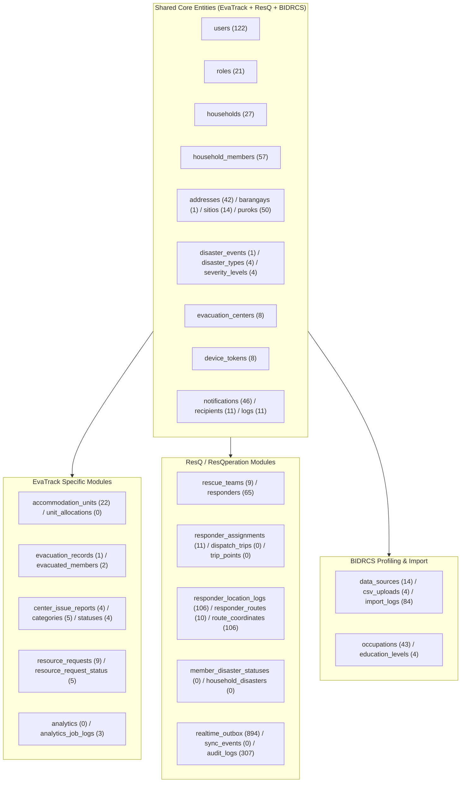

# Comprehensive Database Architecture, Integrity, Performance & Security Assessment

**Target Database:** `klint` (Connection: `mysql_v2`)  
**Database Engine & Version:** MySQL Community Server `8.0.44` (GPL) — `InnoDB` Storage Engine  
**Server SQL Mode:** `ONLY_FULL_GROUP_BY,STRICT_TRANS_TABLES,NO_ZERO_IN_DATE,NO_ZERO_DATE,ERROR_FOR_DIVISION_BY_ZERO,NO_ENGINE_SUBSTITUTION`  
**Character Set / Collation:** Server default `utf8mb4` / `utf8mb4_0900_ai_ci` (mixed with `utf8mb4_unicode_ci` on 24 tables)  
**Scope of Assessment:** **111 Base Tables** and **2 Views** (`v_member_status_monitor`, `v_household_status_board`) across the shared municipal DRRM ecosystem (**EvaTrack**, **ResQ / ResQperation**, and **BIDRCS**).

---

## A. Executive Summary

### 1. Overall Condition
The `klint` database is a **shared, multi-application relational database** running on MySQL `8.0.44` (`InnoDB`). Rather than serving only the **EvaTrack** evacuation management web application ([`c:/CAPSTONE/EvaTrack`](file:///c:/CAPSTONE/EvaTrack)), `klint` acts as an integrated data hub for three Barangay Mambaling DRRM capstone modules:
1. **EvaTrack** (44 tables actively mapped via Eloquent models/migrations): Evacuation center management, shelter room/unit allocation, QR/manual evacuee check-in, center issue reporting, supply/personnel resource requests, SMS/push alerts, and evacuation analytics.
2. **ResQ / ResQperation** (49 tables + 2 views): Emergency dispatch, responder GPS tracking & routing, field assessments, per-member/per-household disaster safety monitoring, offline map tile/pack distribution, outbox real-time pub/sub, and weather monitoring.
3. **BIDRCS** (10 tables + shared master tables): Barangay resident/household profiling, socioeconomic lookup tables (`occupations`, `education_levels`), and bulk CSV ingestion (`data_sources`, `csv_uploads`, `import_logs`).

### 2. Strongest Design Aspects
- **Thoughtful Reference/Lookup Modeling:** Statuses, categories, severity levels, roles, and geographic hierarchies (`regions` → `provinces` → `cities` → `barangays` → `sitios` → `puroks`) are separated into dedicated lookup tables with stable `*_key` and `*_label` columns.
- **High-Quality Newer Schema Additions:** Tables introduced via [`2026_09_15_upgrade_original_to_new_schema.sql`](file:///c:/CAPSTONE/all/2026_09_15_upgrade_original_to_new_schema.sql) (`member_disaster_statuses`, `household_disasters`, `dispatch_trips`, `trip_points`, `cached_routes`, `sync_events`) exhibit strong relational discipline: proper `PRIMARY KEY`s, `FOREIGN KEY` constraints, composite unique keys (`uk_mds_event_member`, `uk_hd_event_household`), and targeted composite indexes.
- **Accurate Household Member Rollups:** Live verification confirmed **0 mismatches** between `households.member_count` and active (`deleted_at IS NULL`) rows in `household_members`.

### 3. Biggest Risks & Confirmed Defects
> [!CAUTION]
> **Critical Structural, Integrity, and Security Findings Discovered:**
> 1. **27 Tables Lack a `PRIMARY KEY` (`DB-001` — Critical):** Including active tables with data (`responders` [65 rows], `responder_communication_logs` [305 rows], `responder_location_logs` [106 rows], `route_coordinates` [106 rows], `import_logs` [84 rows], `zipcodes` [54 rows], `occupations` [43 rows], `incident_archives` [14 rows], `data_sources` [14 rows], `responder_routes` [10 rows], `cache` [9 rows]). In InnoDB, tables without a primary key use a hidden 6-byte row ID under a global mutex, break row-based replication/clustering, and allow duplicate primary identifiers.
> 2. **22 Tables Have Integer Primary Keys Without `AUTO_INCREMENT` (`DB-002` — High):** Tables such as `addresses`, `device_tokens`, `rescue_teams`, `responder_assignments`, and `analytics_job_logs` rely on manual ID calculation or `operational_sequences` instead of native `AUTO_INCREMENT`, risking race conditions on concurrent inserts.
> 3. **Only 6 of 111 Tables Enforce Outbound Foreign Keys (`DB-003` — High):** 105 tables have zero outbound `FOREIGN KEY` constraints. Read-only data verification uncovered **orphaned records across 23 implicit relationships** (e.g., 90 orphaned `personal_access_tokens`, 41 users pointing to deleted `households`, 31 orphaned `notification_recipients`, 52/53 `zipcodes` pointing to non-existent `city_id` values, and free-text strings like `'Mambaling Emergency Desk'` stored in `resource_requests.requested_by`).
> 4. **Eloquent Model ↔ Schema Mismatches in EvaTrack (`DB-004`, `DB-005` — Critical/High):**
>    - [`DeviceToken.php`](file:///c:/CAPSTONE/EvaTrack/app/Domains/Notifications/Models/DeviceToken.php#L12) declares `protected $primaryKey = 'token_id'`, but `device_tokens` actually uses `id` (`bigint NOT NULL`) as its primary key.
>    - [`CenterOccupancy.php`](file:///c:/CAPSTONE/EvaTrack/app/Domains/Analytics/Models/CenterOccupancy.php#L12) targets `center_occupancies`, a table that **does not exist** in `klint`.
>    - [`Role.php`](file:///c:/CAPSTONE/EvaTrack/app/Domains/Authentication/Models/Role.php#L9) omits `protected $connection = 'mysql_v2'`.
> 5. **Plaintext Credential Exposure & Root DB Usage (`DB-006`, `DB-007` — Critical):**
>    - `users.temp_password` stores **plaintext temporary passwords** for 62 user accounts.
>    - [`export_database.php`](file:///c:/CAPSTONE/export_database.php#L35) contains a hardcoded fallback database password and dumps unredacted `users`, `personal_access_tokens`, and `sessions` into workspace files ([`c:/CAPSTONE/all/json_data/`](file:///c:/CAPSTONE/all/json_data)).
>    - The application connects as `root@localhost` with full `SUPER` and `GRANT OPTION` privileges over all 18 databases on the MySQL server.

---

## B. Complete Database Inventory

### 1. Server & Environment Metadata
| Property | Observed Value | Assessment |
| :--- | :--- | :--- |
| **Database Engine** | MySQL Community Server `8.0.44` (`InnoDB`) | Current LTS 8.0 release |
| **Target Schema** | `klint` (111 Base Tables, 2 Views, 0 Triggers, 0 Procedures, 0 Events) | Shared across 3 systems |
| **Other Schemas on Server** | `all_db`, `capstone_db`, `demo_db`, `evactrack_v2`, `inventory_db`, `klint_test`, `laravel`, `library_management_db`, `myapp`, `spec4a32`, `usjr`, `world` | Exposed due to `root@localhost` connection |
| **Collation Split** | 87 tables use `utf8mb4_0900_ai_ci`; 24 tables use `utf8mb4_unicode_ci` | Cross-collation joins risk index bypass (`Illegal mix of collations`) |
| **InnoDB Buffer Pool** | `134,217,728` bytes (128 MB) | Adequate for dev; small for production GIS/telemetry workloads |
| **Slow Query Log** | Enabled (`slow_query_log = 1`), `long_query_time = 10s` | `10s` threshold is too high to catch sub-second N+1 or scan queries |

### 2. Master Inventory of All 111 Tables & 2 Views



| # | Table / Object Name | Classification | Subsystem Owner | Exact Rows | PK Present? | Outbound FKs | Inbound FKs | Collation |
| :- | :--- | :--- | :--- | -: | :-: | :-: | :-: | :--- |
| 1 | `_archive_orphan_household_disasters` | **Legacy** | ResQ Upgrade Backup | 6 | ❌ No | 0 | 0 | `utf8mb4_0900_ai_ci` |
| 2 | `_archive_orphan_household_status_logs` | **Legacy** | ResQ Upgrade Backup | 46 | ❌ No | 0 | 0 | `utf8mb4_0900_ai_ci` |
| 3 | `accommodation_types` | **Core** | EvaTrack | 6 | ✅ `type_id` (no AI) | 0 | 0 | `utf8mb4_0900_ai_ci` |
| 4 | `accommodation_units` | **Core** | EvaTrack | 22 | ✅ `unit_id` (AI) | 0 | 0 | `utf8mb4_0900_ai_ci` |
| 5 | `addresses` | **Core** | Shared (All) | 42 | ✅ `address_id` (no AI) | 0 | 0 | `utf8mb4_0900_ai_ci` |
| 6 | `affected_areas` | **External/Shared** | ResQ | 0 | ❌ No | 0 | 0 | `utf8mb4_0900_ai_ci` |
| 7 | `analytics` | **Supporting** | EvaTrack | 0 | ✅ `analytic_id` | 0 | 0 | `utf8mb4_0900_ai_ci` |
| 8 | `analytics_job_logs` | **Supporting** | EvaTrack | 3 | ✅ `job_id` (no AI) | 0 | 0 | `utf8mb4_0900_ai_ci` |
| 9 | `analytics_job_status` | **Supporting** | EvaTrack | 4 | ❌ No | 0 | 0 | `utf8mb4_0900_ai_ci` |
| 10 | `audit_logs` | **External/Shared** | ResQ / Shared | 307 | ✅ `audit_log_id` (AI) | 0 | 0 | `utf8mb4_0900_ai_ci` |
| 11 | `barangay_boundaries` | **External/Shared** | ResQ GIS | 1 | ✅ `psgc_code` | 0 | 0 | `utf8mb4_unicode_ci` |
| 12 | `barangays` | **Core** | Shared (All) | 1 | ✅ `barangay_id` (no AI) | 0 | 0 | `utf8mb4_0900_ai_ci` |
| 13 | `cache` | **Supporting** | Laravel Infra | 9 | ❌ No | 0 | 0 | `utf8mb4_0900_ai_ci` |
| 14 | `cache_locks` | **Supporting** | Laravel Infra | 0 | ❌ No | 0 | 0 | `utf8mb4_0900_ai_ci` |
| 15 | `cached_routes` | **External/Shared** | ResQ Navigation | 0 | ✅ `id` (AI) | 3 | 0 | `utf8mb4_unicode_ci` |
| 16 | `center_issue_categories` | **Core** | EvaTrack | 5 | ✅ `category_id` (no AI) | 0 | 0 | `utf8mb4_0900_ai_ci` |
| 17 | `center_issue_report_statuses` | **Core** | EvaTrack | 4 | ✅ `status_id` (no AI) | 0 | 0 | `utf8mb4_0900_ai_ci` |
| 18 | `center_issue_reports` | **Core** | EvaTrack | 4 | ✅ `report_id` | 0 | 0 | `utf8mb4_0900_ai_ci` |
| 19 | `cities` | **Core** | Shared (All) | 1 | ✅ `city_id` (no AI) | 0 | 0 | `utf8mb4_0900_ai_ci` |
| 20 | `civil_statuses` | **Core** | Shared (All) | 6 | ✅ `status_id` (AI) | 0 | 0 | `utf8mb4_0900_ai_ci` |
| 21 | `csv_uploads` | **External/Shared** | BIDRCS | 4 | ❌ No | 0 | 0 | `utf8mb4_0900_ai_ci` |
| 22 | `data_sources` | **External/Shared** | BIDRCS | 14 | ❌ No | 0 | 0 | `utf8mb4_0900_ai_ci` |
| 23 | `device_tokens` | **Core** | Shared (EvaTrack + ResQ) | 8 | ✅ `id` (no AI) | 0 | 2 | `utf8mb4_0900_ai_ci` |
| 24 | `device_tracking_logs` | **External/Shared** | ResQ Telemetry | 0 | ❌ No | 0 | 0 | `utf8mb4_0900_ai_ci` |
| 25 | `disaster_broadcasts` | **External/Shared** | ResQ Alerts | 0 | ❌ No | 0 | 0 | `utf8mb4_0900_ai_ci` |
| 26 | `disaster_event_types` | **Unused Candidate** | EvaTrack Pivot | 0 | ✅ `event_type_id` (no AI) | 0 | 0 | `utf8mb4_0900_ai_ci` |
| 27 | `disaster_events` | **Core** | Shared (EvaTrack + ResQ) | 1 | ✅ `event_id` | 0 | 2 | `utf8mb4_0900_ai_ci` |
| 28 | `disaster_types` | **Core** | Shared (EvaTrack + ResQ) | 4 | ✅ `type_id` (no AI) | 0 | 0 | `utf8mb4_0900_ai_ci` |
| 29 | `dispatch_statuses` | **External/Shared** | ResQ Dispatch | 8 | ✅ `status_key` | 0 | 0 | `utf8mb4_0900_ai_ci` |
| 30 | `dispatch_trips` | **External/Shared** | ResQ Dispatch | 0 | ✅ `id` (AI) | 3 | 1 | `utf8mb4_unicode_ci` |
| 31 | `education_levels` | **External/Shared** | BIDRCS / Shared | 4 | ❌ No | 0 | 0 | `utf8mb4_0900_ai_ci` |
| 32 | `evacuated_members` | **Core** | EvaTrack | 2 | ✅ `evacuated_member_id` (AI) | 0 | 0 | `utf8mb4_0900_ai_ci` |
| 33 | `evacuation_centers` | **Core** | Shared (EvaTrack + ResQ) | 8 | ✅ `evacuation_center_id` | 0 | 1 | `utf8mb4_0900_ai_ci` |
| 34 | `evacuation_records` | **Core** | EvaTrack | 1 | ✅ `evacuation_id` (AI) | 0 | 0 | `utf8mb4_0900_ai_ci` |
| 35 | `event_center_history` | **Supporting** | EvaTrack | 7 | ✅ `id` (AI) | 0 | 0 | `utf8mb4_0900_ai_ci` |
| 36 | `failed_jobs` | **Supporting** | Laravel Infra | 0 | ✅ `id` (AI) | 0 | 0 | `utf8mb4_0900_ai_ci` |
| 37 | `field_report_categories` | **External/Shared** | ResQ Field Reports | 0 | ❌ No | 0 | 0 | `utf8mb4_0900_ai_ci` |
| 38 | `genders` | **Core** | Shared (All) | 3 | ✅ `gender_id` (AI) | 0 | 0 | `utf8mb4_0900_ai_ci` |
| 39 | `geotagged_locations` | **External/Shared** | ResQ / BIDRCS | 6 | ✅ `location_id` (AI) | 0 | 0 | `utf8mb4_0900_ai_ci` |
| 40 | `household_disasters` | **External/Shared** | ResQ Safety Rollup | 0 | ✅ `household_disaster_id` (AI) | 4 | 0 | `utf8mb4_0900_ai_ci` |
| 41 | `household_members` | **Core** | Shared (All) | 57 | ✅ `member_id` | 0 | 1 | `utf8mb4_0900_ai_ci` |
| 42 | `household_status_logs` | **External/Shared** | ResQ Safety Logs | 0 | ✅ `status_log_id` (AI) | 1 | 0 | `utf8mb4_0900_ai_ci` |
| 43 | `household_statuses` | **Core** | Shared (EvaTrack + ResQ) | 5 | ✅ `status_id` (no AI) | 0 | 3 | `utf8mb4_0900_ai_ci` |
| 44 | `household_trusted_pins` | **External/Shared** | ResQ Mobile Auth | 0 | ✅ `household_id` | 0 | 0 | `utf8mb4_unicode_ci` |
| 45 | `households` | **Core** | Shared (All) | 27 | ✅ `household_id` | 0 | 3 | `utf8mb4_0900_ai_ci` |
| 46 | `hq_field_reports` | **External/Shared** | ResQ HQ | 0 | ✅ `hq_report_id` (AI) | 0 | 0 | `utf8mb4_0900_ai_ci` |
| 47 | `import_logs` | **External/Shared** | BIDRCS | 84 | ❌ No | 0 | 0 | `utf8mb4_0900_ai_ci` |
| 48 | `incident_archives` | **External/Shared** | ResQ Archives | 14 | ❌ No | 0 | 0 | `utf8mb4_0900_ai_ci` |
| 49 | `inquiries` | **Legacy** | Superseded by `landing_inquiries` | 0 | ✅ `id` (AI) | 0 | 0 | `utf8mb4_0900_ai_ci` |
| 50 | `job_batches` | **Supporting** | Laravel Infra | 0 | ❌ No | 0 | 0 | `utf8mb4_0900_ai_ci` |
| 51 | `jobs` | **Supporting** | Laravel Infra | 12 | ✅ `id` (AI) | 0 | 0 | `utf8mb4_0900_ai_ci` |
| 52 | `landing_inquiries` | **External/Shared** | Public Landing Page | 2 | ✅ `inquiry_id` (AI) | 0 | 0 | `utf8mb4_unicode_ci` |
| 53 | `map_tile_metadata` | **External/Shared** | ResQ Offline Maps | 0 | ❌ No | 0 | 0 | `utf8mb4_0900_ai_ci` |
| 54 | `mapping_hazard_layers` | **External/Shared** | ResQ GIS | 0 | ✅ `id` (AI) | 0 | 0 | `utf8mb4_unicode_ci` |
| 55 | `member_disaster_statuses` | **External/Shared** | ResQ Safety Monitor | 0 | ✅ `member_status_id` (AI) | 5 | 0 | `utf8mb4_0900_ai_ci` |
| 56 | `member_status_logs` | **External/Shared** | ResQ Safety Monitor | 0 | ✅ `member_status_log_id` (AI) | 0 | 0 | `utf8mb4_0900_ai_ci` |
| 57 | `member_statuses` | **External/Shared** | ResQ Safety Monitor | 12 | ✅ `status_id` (AI) | 0 | 2 | `utf8mb4_0900_ai_ci` |
| 58 | `member_vulnerable_groups` | **Core** | Shared (EvaTrack + BIDRCS) | 19 | ✅ `id` (AI) | 0 | 0 | `utf8mb4_0900_ai_ci` |
| 59 | `migrations` | **Supporting** | Laravel Infra | 26 | ✅ `id` (AI) | 0 | 0 | `utf8mb4_0900_ai_ci` |
| 60 | `notification_channels` | **Core** | EvaTrack | 3 | ✅ `channel_id` (no AI) | 0 | 0 | `utf8mb4_0900_ai_ci` |
| 61 | `notification_logs` | **Core** | EvaTrack | 11 | ✅ `log_id` (AI) | 0 | 0 | `utf8mb4_0900_ai_ci` |
| 62 | `notification_recipients` | **Core** | EvaTrack | 11 | ✅ `id` (AI) | 0 | 0 | `utf8mb4_0900_ai_ci` |
| 63 | `notification_statuses` | **Core** | EvaTrack | 5 | ✅ `status_id` (no AI) | 0 | 0 | `utf8mb4_0900_ai_ci` |
| 64 | `notifications` | **Core** | Shared (EvaTrack + ResQ) | 46 | ✅ `notif_id` (AI) | 0 | 0 | `utf8mb4_0900_ai_ci` |
| 65 | `occupations` | **External/Shared** | BIDRCS / Shared | 43 | ❌ No (`occuaption_id`) | 0 | 0 | `utf8mb4_0900_ai_ci` |
| 66 | `offline_packs` | **External/Shared** | ResQ Offline Maps | 0 | ✅ `version` | 0 | 0 | `utf8mb4_unicode_ci` |
| 67 | `operational_sequences` | **External/Shared** | ResQ ID Generator | 12 | ✅ `sequence_key` | 0 | 0 | `utf8mb4_unicode_ci` |
| 68 | `password_reset_requests` | **External/Shared** | ResQ Auth | 0 | ✅ `request_id` | 0 | 0 | `utf8mb4_unicode_ci` |
| 69 | `password_reset_tokens` | **Supporting** | Laravel Auth | 0 | ✅ `email` | 0 | 0 | `utf8mb4_unicode_ci` |
| 70 | `personal_access_tokens` | **Core** | Shared (Sanctum) | 352 | ✅ `id` (AI) | 0 | 0 | `utf8mb4_0900_ai_ci` |
| 71 | `property_damage_levels` | **External/Shared** | ResQ Field Reports | 5 | ✅ `damage_key` | 0 | 0 | `utf8mb4_unicode_ci` |
| 72 | `provinces` | **Core** | Shared (All) | 7 | ✅ `province_id` (no AI) | 0 | 0 | `utf8mb4_0900_ai_ci` |
| 73 | `puroks` | **Core** | Shared (All) | 50 | ✅ `purok_id` (no AI) | 0 | 0 | `utf8mb4_0900_ai_ci` |
| 74 | `realtime_outbox` | **External/Shared** | ResQ Realtime | 894 | ✅ `id` (AI) | 0 | 0 | `utf8mb4_unicode_ci` |
| 75 | `recurrence_types` | **Core** | EvaTrack | 6 | ✅ `type_id` (AI) | 0 | 0 | `utf8mb4_0900_ai_ci` |
| 76 | `regions` | **Core** | Shared (All) | 4 | ✅ `region_id` (no AI) | 0 | 0 | `utf8mb4_0900_ai_ci` |
| 77 | `relationships` | **Core** | Shared (All) | 39 | ✅ `relationship_id` (AI) | 0 | 0 | `utf8mb4_0900_ai_ci` |
| 78 | `remembered_devices` | **External/Shared** | ResQ Auth | 0 | ✅ `remembered_device_id` | 0 | 0 | `utf8mb4_unicode_ci` |
| 79 | `report_idempotency` | **External/Shared** | ResQ API | 4 | ✅ `scope` | 0 | 0 | `utf8mb4_unicode_ci` |
| 80 | `request_validations` | **External/Shared** | ResQ / BDRRM | 5 | ✅ `validation_id` (AI) | 0 | 0 | `utf8mb4_0900_ai_ci` |
| 81 | `rescue_priority_settings` | **External/Shared** | ResQ Triage | 1 | ✅ `version` (AI) | 0 | 0 | `utf8mb4_unicode_ci` |
| 82 | `rescue_teams` | **External/Shared** | ResQ Dispatch | 9 | ⚠️ UNIQUE only (`team_id`) | 0 | 2 | `utf8mb4_0900_ai_ci` |
| 83 | `resource_request_status` | **Core** | Shared (EvaTrack + ResQ) | 5 | ✅ `status_id` (no AI) | 0 | 0 | `utf8mb4_0900_ai_ci` |
| 84 | `resource_requests` | **Core** | Shared (EvaTrack + ResQ) | 9 | ✅ `request_id` | 0 | 0 | `utf8mb4_0900_ai_ci` |
| 85 | `responder_assignments` | **External/Shared** | ResQ Dispatch | 11 | ⚠️ UNIQUE only (`assignment_id`) | 0 | 1 | `utf8mb4_0900_ai_ci` |
| 86 | `responder_check_ins` | **External/Shared** | ResQ Field Ops | 0 | ❌ No | 0 | 0 | `utf8mb4_0900_ai_ci` |
| 87 | `responder_communication_logs` | **External/Shared** | ResQ Comms | 305 | ❌ No | 0 | 0 | `utf8mb4_0900_ai_ci` |
| 88 | `responder_field_report_details` | **External/Shared** | ResQ Field Reports | 0 | ❌ No | 0 | 0 | `utf8mb4_0900_ai_ci` |
| 89 | `responder_field_report_members` | **External/Shared** | ResQ Field Reports | 0 | ✅ `detail_id` (AI) | 0 | 0 | `utf8mb4_unicode_ci` |
| 90 | `responder_field_reports` | **External/Shared** | ResQ Field Reports | 0 | ❌ No | 0 | 0 | `utf8mb4_0900_ai_ci` |
| 91 | `responder_location_logs` | **External/Shared** | ResQ Telemetry | 106 | ❌ No | 0 | 0 | `utf8mb4_0900_ai_ci` |
| 92 | `responder_routes` | **External/Shared** | ResQ Navigation | 10 | ❌ No | 0 | 0 | `utf8mb4_0900_ai_ci` |
| 93 | `responders` | **External/Shared** | ResQ Personnel | 65 | ❌ No | 0 | 0 | `utf8mb4_0900_ai_ci` |
| 94 | `roles` | **Core** | Shared (All) | 21 | ✅ `role_id` (no AI) | 0 | 0 | `utf8mb4_0900_ai_ci` |
| 95 | `route_coordinates` | **External/Shared** | ResQ Navigation | 106 | ❌ No | 0 | 0 | `utf8mb4_0900_ai_ci` |
| 96 | `sessions` | **Supporting** | Laravel Infra | 5 | ✅ `id` | 0 | 0 | `utf8mb4_unicode_ci` |
| 97 | `severity_levels` | **Core** | Shared (EvaTrack + ResQ) | 4 | ✅ `severity_id` (no AI) | 0 | 0 | `utf8mb4_0900_ai_ci` |
| 98 | `sitios` | **Core** | Shared (All) | 14 | ✅ `sitio_id` (no AI) | 0 | 0 | `utf8mb4_0900_ai_ci` |
| 99 | `situation_reports` | **External/Shared** | ResQ HQ | 0 | ❌ No | 0 | 0 | `utf8mb4_0900_ai_ci` |
| 100 | `status_reminders` | **External/Shared** | ResQ Reminders | 0 | ✅ `reminder_id` (AI) | 0 | 0 | `utf8mb4_unicode_ci` |
| 101 | `sync_events` | **External/Shared** | ResQ Offline Sync | 0 | ✅ `id` (AI) | 1 | 0 | `utf8mb4_unicode_ci` |
| 102 | `trip_points` | **External/Shared** | ResQ GPS Telemetry | 0 | ✅ `id` (AI) | 1 | 0 | `utf8mb4_unicode_ci` |
| 103 | `trusted_households` | **External/Shared** | ResQ Proxy Safety | 0 | ✅ `connection_id` | 0 | 0 | `utf8mb4_0900_ai_ci` |
| 104 | `unit_allocations` | **Core** | EvaTrack | 0 | ✅ `allocation_id` (AI) | 0 | 0 | `utf8mb4_0900_ai_ci` |
| 105 | `user_notifications` | **Supporting** | EvaTrack / ResQ | 1 | ✅ `id` (AI) | 0 | 0 | `utf8mb4_unicode_ci` |
| 106 | `users` | **Core** | Shared (All) | 122 | ✅ `user_id` | 0 | 0 | `utf8mb4_0900_ai_ci` |
| 107 | `vulnerable_groups` | **Core** | Shared (All) | 5 | ✅ `vulnerable_group_id` (AI) | 0 | 0 | `utf8mb4_0900_ai_ci` |
| 108 | `weather_logs` | **External/Shared** | ResQ Weather | 14 | ✅ `weather_log_id` (AI) | 0 | 0 | `utf8mb4_0900_ai_ci` |
| 109 | `web_push_deliveries` | **External/Shared** | ResQ WebPush | 0 | ✅ `id` (AI) | 0 | 0 | `utf8mb4_unicode_ci` |
| 110 | `web_push_subscriptions` | **External/Shared** | ResQ WebPush | 0 | ✅ `id` (AI) | 0 | 0 | `utf8mb4_unicode_ci` |
| 111 | `zipcodes` | **Core** | Shared (All) | 54 | ❌ No | 0 | 0 | `utf8mb4_0900_ai_ci` |
| V1 | `v_member_status_monitor` | **View (External)** | ResQ Safety Monitor | — | View (`DEFINER`) | — | — | — |
| V2 | `v_household_status_board` | **View (External)** | ResQ Safety Monitor | — | View (`DEFINER`) | — | — | — |
| M1 | `center_occupancies` *(Missing)* | **Missing Table** | Referenced by [`CenterOccupancy.php`](file:///c:/CAPSTONE/EvaTrack/app/Domains/Analytics/Models/CenterOccupancy.php) | — | ❌ Table Does Not Exist | — | — | — |

---
## C. Table-by-Table Assessment (All 111 Tables & 2 Views)

Every table discovered in `klint` is evaluated below across all 9 required audit criteria.

### Group 1: Authentication, RBAC & Session Management (7 Tables)

| 1. Table | 2. Purpose | 3. Key Columns & Relationships | 4. Design Quality | 5. Integrity & Indexing Concerns | 6. Overlap | 7. Usage Verified? | 8. Recommended Action | 9. Confidence & Evidence |
| :--- | :--- | :--- | :--- | :--- | :--- | :--- | :--- | :--- |
| `users` | Master user account registry across EvaTrack, ResQ, and BIDRCS | PK `user_id` (`varchar(255)`). Logical FKs: `role_id` → `roles`, `assigned_center_id` → `evacuation_centers`, `household_id` → `households`, `member_id` → `household_members` (`UNIQUE`). | Fair — mixes staff, responder, and resident accounts plus legacy `name` alongside `first_name`/`last_name`. | **Critical:** `temp_password` stores plaintext strings for 62 rows. No unique index on `email`, `username`, or `contact_number` (3 duplicate `contact_number` values exist). 41 rows have orphaned `household_id`; 1 row has `assigned_center_id = 'Command Center Personel'`. Missing indexes on `role_id`, `email`, `contact_number`, `assigned_center_id`. | Overlaps with `responders` (`username`, `password_hash`, `full_name`, `contact_number`). | **Verified (Core)** — [`User.php`](file:///c:/CAPSTONE/EvaTrack/app/Domains/Authentication/Models/User.php), ResQ, BIDRCS. | NULL out `temp_password`; add indexes on `role_id`, `email`, `contact_number`, `assigned_center_id`; clean orphaned `household_id` & invalid `assigned_center_id`. | **High** (122 rows; DDL & JSON verified). |
| `roles` | RBAC role definitions and module permissions | PK `role_id` (`int`, no `AUTO_INCREMENT`), `role_key`, `role_name`, `name`, `base_role_key`, `web_modules` (`json`). | Fair — redundant `role_name` (`varchar(100)`) and `name` (`varchar(255)`) storing identical text across all 21 rows. | Missing `UNIQUE` constraint on `role_key`. [`Role.php`](file:///c:/CAPSTONE/EvaTrack/app/Domains/Authentication/Models/Role.php) omits `protected $connection = 'mysql_v2'`. Roles `5` (`tm`) and `25` (`tl`) duplicate `13` (`personnel_team_leader`). | Internal column duplication (`role_name` vs `name`). | **Verified (Core)** — [`Role.php`](file:///c:/CAPSTONE/EvaTrack/app/Domains/Authentication/Models/Role.php) + BIDRCS/ResQ `web_modules`. | Add `UNIQUE (role_key)`; set `$connection = 'mysql_v2'` in `Role.php`; keep `name` & `web_modules` for sister systems. | **High** (21 rows inspected). |
| `personal_access_tokens` | Laravel Sanctum API bearer tokens | PK `id` (`bigint unsigned AUTO_INCREMENT`), `tokenable_id`, `tokenable_type`, `token` (`varchar(64)`). | Poor index coverage — missing standard Laravel Sanctum indexes! | **High:** Missing `UNIQUE (token)` and composite index `(tokenable_type, tokenable_id)`. Every authenticated API call scans 352 rows on `token`! **90 rows** reference deleted `user_id`s. | None. | **Verified (Core)** — Sanctum auth in EvaTrack & ResQ. | Add `UNIQUE INDEX` on `token` and index on `(tokenable_type, tokenable_id)`; prune expired/orphaned tokens. | **High** (352 rows, 0 secondary indexes in DDL). |
| `password_reset_tokens` | Standard Laravel password reset token table | PK `email` (`varchar(255)`), `token`, `created_at`. Collation: `utf8mb4_unicode_ci`. | Good standard Laravel structure. | Currently unused by `ForgotPasswordController` (which uses file cache) and ResQ (which uses `password_reset_requests`). | Overlaps with `password_reset_requests`. | **Verified (Supporting)** — `config/auth.php`. | Retain for Laravel auth compatibility. | **High** (0 rows). |
| `password_reset_requests` | ResQ multi-method password reset & OTP tracking | PK `request_id` (`char(36)`), `user_id`, `verification_method` (`enum`), `token_hash`, `otp_subject_key`, `code_hash`. | Strong — properly indexed (`user_id`, `expires_at`, `token_hash` unique). | Collation is `utf8mb4_unicode_ci` while `users.user_id` is `utf8mb4_0900_ai_ci`. No FK on `user_id`. | Overlaps with EvaTrack's cache-based OTP flow. | **Verified (External/Shared)** — ResQ auth (`resq_otp_subject_unique`). | Retain; align collation of `user_id` if joined with `users`. | **High** (0 rows; ResQ index naming). |
| `remembered_devices` | Trusted browser/device tokens for ResQ 2FA/login | PK `remembered_device_id` (`char(36)`), `user_id`, `token_hash` (`UNIQUE`), `expires_at`, `revoked_at`. | Good — appropriate composite indexes on `(user_id, revoked_at)` and `(expires_at, revoked_at)`. | Collation `utf8mb4_unicode_ci` vs `users.user_id` (`utf8mb4_0900_ai_ci`). | Slight conceptual overlap with `device_tokens`. | **Verified (External/Shared)** — ResQ auth module. | Retain intact. | **High** (0 rows). |
| `sessions` | Laravel database session store | PK `id` (`varchar(255)`), `user_id`, `ip_address`, `payload`, `last_activity`. | Good — indexed on `user_id` and `last_activity`. | Collation `utf8mb4_unicode_ci`. | None. | **Verified (Supporting)** — `config/session.php` (5 rows). | Retain intact. | **High** (5 rows). |

---

### Group 2: Geographic & Demographic Reference Data (13 Tables)

| 1. Table | 2. Purpose | 3. Key Columns & Relationships | 4. Design Quality | 5. Integrity & Indexing Concerns | 6. Overlap | 7. Usage Verified? | 8. Recommended Action | 9. Confidence & Evidence |
| :--- | :--- | :--- | :--- | :--- | :--- | :--- | :--- | :--- |
| `regions` | Philippine administrative regions | PK `region_id` (`int`, no AI), `region_code`, `region_name`. | Good lookup structure. | Missing `UNIQUE (region_code)`. | None. | **Verified (Core)** — [`Region.php`](file:///c:/CAPSTONE/EvaTrack/app/Domains/ReferenceData/Models/Region.php). | Add `UNIQUE (region_code)`. | **High** (4 rows). |
| `provinces` | Provinces under regions | PK `province_id` (`int`, no AI), `province_code`, `province_name`, `region_id`. | Good. | Missing FK & index on `region_id`. | None. | **Verified (Core)** — [`Province.php`](file:///c:/CAPSTONE/EvaTrack/app/Domains/ReferenceData/Models/Province.php). | Add index & FK on `region_id` → `regions(region_id)`. | **High** (7 rows, 0 orphans). |
| `cities` | Cities/municipalities under provinces | PK `city_id` (`int`, no AI), `city_code`, `city_name`, `province_id`. | Good. | Missing FK & index on `province_id`. Only `city_id = 7` (Cebu City) exists. | None. | **Verified (Core)** — [`City.php`](file:///c:/CAPSTONE/EvaTrack/app/Domains/ReferenceData/Models/City.php). | Add index & FK on `province_id` → `provinces(province_id)`. | **High** (1 row). |
| `barangays` | Barangays under cities | PK `barangay_id` (`int`, no AI), `barangay_code`, `barangay_name`, `city_id`. | Good. | Missing FK & index on `city_id`. | Overlaps with `barangay_boundaries`. | **Verified (Core)** — [`Barangay.php`](file:///c:/CAPSTONE/EvaTrack/app/Domains/ReferenceData/Models/Barangay.php). | Add index & FK on `city_id` → `cities(city_id)`. | **High** (1 row: Mambaling). |
| `sitios` | Sitios within a barangay | PK `sitio_id` (`int`, no AI), `sitio_name`, `barangay_id`. | Good. | Missing FK & index on `barangay_id`. | Overlaps with `puroks` & `addresses.purok_sitio`. | **Verified (Core)** — [`Sitio.php`](file:///c:/CAPSTONE/EvaTrack/app/Domains/ReferenceData/Models/Sitio.php). | Add index & FK on `barangay_id` → `barangays(barangay_id)`. | **High** (14 rows). |
| `puroks` | Puroks within sitios | PK `purok_id` (`int`, no AI), `purok_name`, `sitio_id`. | Good. | Missing FK & index on `sitio_id`. | None. | **Verified (Core)** — [`Purok.php`](file:///c:/CAPSTONE/EvaTrack/app/Domains/ReferenceData/Models/Purok.php). | Add index & FK on `sitio_id` → `sitios(sitio_id)`. | **High** (50 rows). |
| `zipcodes` | Postal zip codes per city | `zipcode_id` (`int`), `zipcode` (`varchar(10)`), `city_id` (`int`). | **Poor** — lacks a `PRIMARY KEY`! | **Critical:** No `PRIMARY KEY` on `zipcode_id`. **52 of 53 rows** reference `city_id` `1..6` which do not exist in `cities` (only `city_id = 7` exists). | Denormalized into `addresses.zip_code`. | **Verified (Core)** — [`ZipCode.php`](file:///c:/CAPSTONE/EvaTrack/app/Domains/ReferenceData/Models/ZipCode.php). | Add `PRIMARY KEY (zipcode_id)`; seed missing Cebu province cities (`1..6`) or reconcile `city_id`. | **High** (54 rows). |
| `addresses` | Physical street/sitio/building addresses for households | PK `address_id` (`int`, no AI). Mixes normalized IDs (`barangay_id`, `sitio_id`, `purok_id`, `zipcode_id`) and free-text (`barangay_name`, `purok_sitio`, `zip_code`, `full_address`). | **Poor (2NF/3NF violation)** — `street_address` is `int DEFAULT NULL` while `street` is `varchar(255)`; `address_id` lacks `AUTO_INCREMENT`. | No `AUTO_INCREMENT` on `address_id` (requires `MAX(address_id)+1` in PHP, risking race conditions). No indexes on `barangay_id`, `sitio_id`, `purok_id`. | Denormalizes `barangays`, `sitios`, `puroks`, `zipcodes`. | **Verified (Core)** — [`Address.php`](file:///c:/CAPSTONE/EvaTrack/app/Domains/ReferenceData/Models/Address.php). | Add `AUTO_INCREMENT` to `address_id`; add indexes on `barangay_id`, `sitio_id`, `purok_id`. | **High** (42 rows). |
| `genders` | Gender lookup table | PK `gender_id` (`int AI`), `gender_key` (`UNIQUE`), `gender_label`. | Good. | None. | Duplicated in `household_members.sex` & `gender`. | **Verified (Core)** — [`Gender.php`](file:///c:/CAPSTONE/EvaTrack/app/Domains/ReferenceData/Models/Gender.php). | Retain intact. | **High** (3 rows). |
| `civil_statuses` | Civil status lookup table | PK `status_id` (`int AI`), `status_key` (`UNIQUE`), `status_label`. | Good. | `status_label` is `varchar(20)` (tight for longer labels). | Duplicated in `household_members.civil_status`. | **Verified (Core)** — [`CivilStatus.php`](file:///c:/CAPSTONE/EvaTrack/app/Domains/ReferenceData/Models/CivilStatus.php). | Widen `status_label` to `varchar(50)`. | **High** (6 rows). |
| `relationships` | Household head relationship lookup | PK `relationship_id` (`int AI`), `relationship_key` (`UNIQUE`), `relationship_label`, `is_head`, `can_report_for_household`. | Very Good — enriched in Sept 2026 upgrade. | None. | Duplicated in `household_members.relation`. | **Verified (Core)** — [`Relationship.php`](file:///c:/CAPSTONE/EvaTrack/app/Domains/ReferenceData/Models/Relationship.php), `v_member_status_monitor`. | Retain intact. | **High** (39 rows). |
| `education_levels` | Educational attainment lookup | `education_level_id` (`int`), `education_level_key` (`varchar(20)`), `education_level_label` (`varchar(20)`). | **Poor** — no `PRIMARY KEY`, no `UNIQUE` key, `varchar(20)` is too short. | **High:** Missing `PRIMARY KEY (education_level_id)` and `UNIQUE (education_level_key)`. | Duplicated in `household_members.education_level`. | **Verified (External/Shared)** — BIDRCS & `household_members.education_level_id`. | Add `PRIMARY KEY (education_level_id)` and widen label to `varchar(100)`. | **High** (4 rows). |
| `occupations` | Occupation lookup table | `occuaption_id` (`int NOT NULL`), `occupation_name` (`varchar(100)`). | **Poor** — column name has a typo (`occuaption_id`) and lacks a `PRIMARY KEY`! | **High:** Missing `PRIMARY KEY (occuaption_id)`. Typo `occuaption_id` must be preserved or aliased for BIDRCS compatibility. | Referenced by `household_members.occupation`. | **Verified (External/Shared)** — BIDRCS resident profiling. | Add `PRIMARY KEY (occuaption_id)` (do not rename column without updating BIDRCS). | **High** (43 rows). |

---

### Group 3: Households, Residents & Vulnerability Tracking (9 Tables)

| 1. Table | 2. Purpose | 3. Key Columns & Relationships | 4. Design Quality | 5. Integrity & Indexing Concerns | 6. Overlap | 7. Usage Verified? | 8. Recommended Action | 9. Confidence & Evidence |
| :--- | :--- | :--- | :--- | :--- | :--- | :--- | :--- | :--- |
| `households` | Master household registry | PK `household_id` (`varchar(255)`), `household_code`, `household_number`, `household_name`, `member_count`, `address_id`, `login_user_id`. | Fair — contains 3 identifier columns (`household_id`, `household_code`, `household_number`). | Missing `UNIQUE` index on `household_code`; missing indexes on `address_id`, `login_user_id`, `deleted_at`. | None. | **Verified (Core)** — [`Household.php`](file:///c:/CAPSTONE/EvaTrack/app/Domains/Households/Models/Household.php), ResQ, BIDRCS. | Add indexes on `address_id`, `household_code`, `deleted_at`. | **High** (27 rows). |
| `household_members` | Individual residents belonging to a household | PK `member_id` (`varchar(255)`), `household_id`, `first_name`, `middle_name`, `last_name`, `birth_date`, `gender_id`, `relationship_id`, `is_pwd`, `is_senior`, `is_pregnant`, plus legacy columns (`name`, `sex`, `gender`, `relation`, `civil_status`, `education_level`, `special_needs`). | **Fair (Denormalized)** — stores both normalized FK IDs (`gender_id`, `relationship_id`, `civil_status_id`, `education_level_id`) AND legacy text columns (`sex`, `gender`, `relation`, `civil_status`, `education_level`), plus boolean flags (`is_pwd`, `is_senior`, `is_pregnant`) alongside `member_vulnerable_groups`. | Missing FK constraint from `household_id` → `households(household_id)`. Has good indexes `idx_hm_household`, `idx_hm_relationship`, `idx_hm_head`. | Dual representation of vulnerability (`is_pwd`/`is_senior`/`is_pregnant` vs `member_vulnerable_groups`). | **Verified (Core)** — [`HouseholdMember.php`](file:///c:/CAPSTONE/EvaTrack/app/Domains/Households/Models/HouseholdMember.php), `v_member_status_monitor`. | Preserve legacy columns (documented in upgrade script for mobile/BIDRCS compatibility); add FK `household_id` → `households`. | **High** (57 rows, 0 orphans). |
| `vulnerable_groups` | Lookup table for vulnerability classifications | PK `vulnerable_group_id` (`int AI`), `vulnerable_group_key` (`UNIQUE`), `vulnerable_group_label`. | Good. | `vulnerable_group_label` is `varchar(20)` (recommend `varchar(100)`). | None. | **Verified (Core)** — [`VulnerableGroup.php`](file:///c:/CAPSTONE/EvaTrack/app/Domains/ReferenceData/Models/VulnerableGroup.php). | Widen label column to `varchar(100)`. | **High** (5 rows). |
| `member_vulnerable_groups` | M:N pivot linking `household_members` to `vulnerable_groups` | PK `id` (`int AI`), `member_id` (`varchar(255)`), `vulnerable_group_id` (`int`). | **Poor indexing** — has no secondary indexes or unique constraint! | **High:** Missing `UNIQUE (member_id, vulnerable_group_id)` allows duplicate vulnerability tags for the same member, and joining from `household_members` performs a full table scan. | Overlaps with boolean flags `is_pwd`, `is_senior`, `is_pregnant` on `household_members`. | **Verified (Core)** — [`MemberVulnerableGroup.php`](file:///c:/CAPSTONE/EvaTrack/app/Domains/ReferenceData/Models/MemberVulnerableGroup.php). | Add `UNIQUE KEY uk_mvg_member_group (member_id, vulnerable_group_id)` and `KEY idx_mvg_group (vulnerable_group_id)`. | **High** (19 rows, 0 orphans). |
| `household_statuses` | Safety/evacuation status lookup for households | PK `status_id` (`int`, no AI), `status_key` (`UNIQUE`), `status_label`, `severity_rank`, `requires_rescue`, `safety_basis`. | Good, but contains test data (`status_id = 5`, `status_key = 'test'`). | Row `status_id = 5` (`'test'`) is active (`is_active = 1`) in production lookup data. | Overlaps with `member_statuses` (12 granular member statuses). | **Verified (Core)** — [`HouseholdStatus.php`](file:///c:/CAPSTONE/EvaTrack/app/Domains/Households/Models/HouseholdStatus.php), `v_household_status_board`. | Set `is_active = 0` on `status_id = 5 ('test')`. | **High** (5 rows). |
| `geotagged_locations` | GPS coordinates captured for households | PK `location_id` (`int AI`), `household_id`, `latitude`, `longitude`, `geotag_source`, `is_verified`. | Good structure; indexed on `household_id`. | **6 of 6 rows** in JSON export reference deleted/historical `household_id`s (`HH-2024035501`, `HH1001`, etc.). | Overlaps with `addresses` and `device_tokens` coordinates. | **Verified (External/Shared)** — ResQ / BIDRCS GIS mapping. | Clean or archive orphaned rows before adding FK to `households`. | **High** (6 rows). |
| `trusted_households` | Peer-to-peer proxy reporting links between households | PK `connection_id` (`varchar(80)`), `requesting_household_id`, `trusted_household_id`, `validation_status`. | Good — indexed on `requesting_household_id`, `trusted_household_id`, `validation_status`. | Missing FKs to `households(household_id)`. | Related to `household_trusted_pins`. | **Verified (External/Shared)** — ResQ proxy safety reporting. | Retain intact. | **High** (0 rows). |
| `household_trusted_pins` | Hashed PIN codes for household proxy reporting | PK `household_id` (`varchar(255)`), `pin_hash`, `updated_by_user_id`. | Good 1:1 extension table. | Collation `utf8mb4_unicode_ci` vs `households.household_id` (`utf8mb4_0900_ai_ci`). | Related to `trusted_households`. | **Verified (External/Shared)** — ResQ mobile app. | Align collation to `utf8mb4_0900_ai_ci`. | **High** (0 rows). |
| `landing_inquiries` | Public contact/inquiry submissions | PK `inquiry_id` (`bigint unsigned AI`), `name`, `organization`, `email`, `message`, `status`, `handled_by_user_id`. | Good. | Missing index on `status`. Supersedes legacy `inquiries` table. | Overlaps with `inquiries` (0 rows). | **Verified (External/Shared)** — ResQ landing page (`web_modules: ["inquiries"]`). | Retain `landing_inquiries`; mark `inquiries` as legacy. | **High** (2 rows). |

---

### Group 4: Evacuation Centers, Shelter Units & Evacuee Check-Ins (7 Tables)

| 1. Table | 2. Purpose | 3. Key Columns & Relationships | 4. Design Quality | 5. Integrity & Indexing Concerns | 6. Overlap | 7. Usage Verified? | 8. Recommended Action | 9. Confidence & Evidence |
| :--- | :--- | :--- | :--- | :--- | :--- | :--- | :--- | :--- |
| `evacuation_centers` | Master shelter facilities registry | PK `evacuation_center_id` (`varchar(255)`), `current_event_id`, `name`, `latitude`, `longitude`, `capacity`, `status`, `current_occupancy`. | Good core table. | Missing secondary indexes on `current_event_id`, `status`, `deleted_at`. Denormalized `current_occupancy` must stay in sync with check-ins. | [`CenterOccupancy.php`](file:///c:/CAPSTONE/EvaTrack/app/Domains/Analytics/Models/CenterOccupancy.php) references non-existent `center_occupancies`. | **Verified (Core)** — [`EvacuationCenter.php`](file:///c:/CAPSTONE/EvaTrack/app/Domains/EvacuationCenters/Models/EvacuationCenter.php), ResQ `cached_routes`. | Add indexes on `status`, `current_event_id`, `deleted_at`; remove unused `CenterOccupancy.php` model. | **High** (8 rows). |
| `event_center_history` | Pivot tracking which centers participated in which disaster events | PK `id` (`bigint unsigned AI`), `event_id` (`varchar(255)`), `evacuation_center_id` (`varchar(50)`). `UNIQUE (event_id, evacuation_center_id)`. | Good, except column length mismatch (`evacuation_center_id` is `varchar(50)` vs `varchar(255)` in `evacuation_centers`). | **13 of 36 historical rows** in JSON export reference deleted test events. Missing index on `evacuation_center_id` alone. | None. | **Verified (Supporting)** — used in [`EvacuationCenterController.php`](file:///c:/CAPSTONE/EvaTrack/app/Domains/EvacuationCenters/Controllers/EvacuationCenterController.php). | Widen `evacuation_center_id` to `varchar(255)`; add index on `evacuation_center_id`. | **High** (7 live rows). |
| `accommodation_types` | Shelter room/unit type lookup (`family_room`, `dormitory`, `tent`, etc.) | PK `type_id` (`int`, no AI), `type_key`, `type_label`. | Good. | Missing `UNIQUE (type_key)`. | None. | **Verified (Core)** — [`AccommodationType.php`](file:///c:/CAPSTONE/EvaTrack/app/Domains/AccommodationUnits/Models/AccommodationType.php). | Add `UNIQUE (type_key)`. | **High** (6 rows). |
| `accommodation_units` | Specific rooms/tents/spaces inside an evacuation center | PK `unit_id` (`int AI`), `center_id` (`varchar(255)`), `name`, `type_id` (`int`), `max_capacity`, `deleted_at`. | Fair — has no secondary indexes or FKs. | **High:** Missing index on `(center_id, deleted_at)` and `type_id`. **5 rows** reference deleted centers (`EC-2026-7HMMHC`, `EC-2026-OZXMZV`). | None. | **Verified (Core)** — [`AccommodationUnit.php`](file:///c:/CAPSTONE/EvaTrack/app/Domains/AccommodationUnits/Models/AccommodationUnit.php). | Add composite index `(center_id, deleted_at)` and index on `type_id`; clean 5 orphaned rows. | **High** (22 rows). |
| `unit_allocations` | Assigns an `evacuation_record` to an `accommodation_unit` | PK `allocation_id` (`int AI`), `evacuation_id` (`int`), `unit_id` (`int`), `assigned_by` (`varchar(255)`). | Poor indexing — zero secondary indexes! | **High:** Missing indexes on `evacuation_id` and `unit_id`. Counting unit occupancy requires a full scan of `unit_allocations`. | None. | **Verified (Core)** — [`UnitAllocation.php`](file:///c:/CAPSTONE/EvaTrack/app/Domains/AccommodationUnits/Models/UnitAllocation.php). | Add indexes on `evacuation_id` and `unit_id`. | **High** (0 rows, `AUTO_INCREMENT=21`). |
| `evacuation_records` | Household check-in records at an evacuation center per event | PK `evacuation_id` (`int AI`), `event_id`, `household_id`, `center_id`, `household_status_id`, `evacuated_count`, `method` (`enum('qr','manual')`), `verified_by`. | Good — has composite index `idx_evac_records_status_center (center_id, household_status_id, household_id)`. | Missing index on `(event_id, household_id)` for event-scoped household lookup. No explicit `check_out_time` column (uses `household_status_id` changes). | Overlaps conceptually with `household_disasters` in ResQ. | **Verified (Core)** — [`EvacuationRecord.php`](file:///c:/CAPSTONE/EvaTrack/app/Domains/Evacuations/Models/EvacuationRecord.php). | Add index on `(event_id, household_id)`. | **High** (1 row). |
| `evacuated_members` | Individual household members verified in an `evacuation_record` | PK `evacuated_member_id` (`int AI`), `evacuation_id` (`int`), `member_id` (`varchar(255)`), `verified_at`. | Good — has `idx_evac_members_lookup (evacuation_id, member_id)`. | Should make `(evacuation_id, member_id)` `UNIQUE` to prevent checking in the same member twice under the same evacuation record, plus add index on `member_id`. | Overlaps conceptually with `member_disaster_statuses` (`status_key = 'evacuated'`). | **Verified (Core)** — [`EvacuatedMember.php`](file:///c:/CAPSTONE/EvaTrack/app/Domains/Evacuations/Models/EvacuatedMember.php). | Upgrade `(evacuation_id, member_id)` to `UNIQUE`; add index on `member_id`. | **High** (2 rows). |

---

### Group 5: Disaster Events, Center Issues, Resource Requests & Alerts (16 Tables)

| 1. Table | 2. Purpose | 3. Key Columns & Relationships | 4. Design Quality | 5. Integrity & Indexing Concerns | 6. Overlap | 7. Usage Verified? | 8. Recommended Action | 9. Confidence & Evidence |
| :--- | :--- | :--- | :--- | :--- | :--- | :--- | :--- | :--- |
| `disaster_types` | Lookup of disaster categories (`EQ`, `FL`, `TC`, `VF`) | PK `type_id` (`int`, no AI), `type_code`, `type_name`, `is_active`. | Good. | Missing `UNIQUE (type_code)`. | None. | **Verified (Core)** — [`DisasterType.php`](file:///c:/CAPSTONE/EvaTrack/app/Domains/EvacuationEvents/Models/DisasterType.php). | Add `UNIQUE (type_code)`. | **High** (4 rows). |
| `severity_levels` | Lookup of severity (`low`, `medium`, `high`, `critical`) | PK `severity_id` (`int`, no AI), `severity_key`, `severity_label`. | Good. | Missing `UNIQUE (severity_key)`. Note: ERD docs refer to `urgency_levels`, which does not exist; `severity_levels` is used instead. | None. | **Verified (Core)** — [`SeverityLevel.php`](file:///c:/CAPSTONE/EvaTrack/app/Domains/EvacuationEvents/Models/SeverityLevel.php). | Add `UNIQUE (severity_key)`. | **High** (4 rows). |
| `disaster_events` | Active & historical disaster events | PK `event_id` (`varchar(255)`), `name`, `type_id`, `severity_level_id`, `started_at`, `ended_at`, `deleted_at`. | Good core event table. | Missing indexes on `(ended_at, deleted_at)` (used on almost every dashboard/active-event query!) and `type_id`. | None. | **Verified (Core)** — [`DisasterEvent.php`](file:///c:/CAPSTONE/EvaTrack/app/Domains/EvacuationEvents/Models/DisasterEvent.php), ResQ FKs. | Add index `idx_de_active (deleted_at, ended_at, started_at)`. | **High** (1 active row). |
| `disaster_event_types` | M:N pivot between `disaster_events` and `disaster_types` | PK `event_type_id` (`int`, no AI), `event_id`, `type_id`. | Redundant — `disaster_events` already has a direct `type_id` (`int NOT NULL`) column. | No `AUTO_INCREMENT` on `event_type_id`, no indexes on `event_id` or `type_id`, 0 rows. | Redundant with `disaster_events.type_id`. | **Unused Candidate** — model [`DisasterEventType.php`](file:///c:/CAPSTONE/EvaTrack/app/Domains/EvacuationEvents/Models/DisasterEventType.php) exists, 0 rows. | Retain for compatibility; add `AUTO_INCREMENT` and index `(event_id, type_id)` if multi-hazard events are planned. | **High** (0 rows). |
| `center_issue_categories` | Lookup of center issue categories (`incident`, `facility_issue`, `health_issue`, `safety_issue`, `other`) | PK `category_id` (`int`, no AI), `category_key`, `category_label`. | Good. | Missing `UNIQUE (category_key)`. | Separate from `field_report_categories`. | **Verified (Core)** — [`CenterIssueCategory.php`](file:///c:/CAPSTONE/EvaTrack/app/Domains/CenterIssueReports/Models/CenterIssueCategory.php). | Add `UNIQUE (category_key)`. | **High** (5 rows). |
| `center_issue_report_statuses` | Lookup of center issue statuses (`open`, `in_progress`, `resolved`, `closed`) | PK `status_id` (`int`, no AI), `status_key`, `status_label`. | Good. | Missing `UNIQUE (status_key)`. | None. | **Verified (Core)** — [`CenterIssueReportStatus.php`](file:///c:/CAPSTONE/EvaTrack/app/Domains/CenterIssueReports/Models/CenterIssueReportStatus.php). | Add `UNIQUE (status_key)`. | **High** (4 rows). |
| `center_issue_reports` | Facility, health, and safety issue tickets at evacuation centers | PK `report_id` (`varchar(255)`), `evacuation_center_id`, `reported_by`, `handled_by`, `category_id`, `severity_id`, `status_id`, `created_at`. | Fair — zero secondary indexes! | **High:** Missing indexes on `(evacuation_center_id, status_id)`, `(status_id, created_at)`, and `category_id`. JSON export shows 3 historical rows with `evacuation_center_id = '0'`. | None. | **Verified (Core)** — [`CenterIssueReport.php`](file:///c:/CAPSTONE/EvaTrack/app/Domains/CenterIssueReports/Models/CenterIssueReport.php). | Add composite indexes `(status_id, created_at)` and `(evacuation_center_id, status_id)`. | **High** (4 rows). |
| `resource_request_status` | 5-stage lookup (`pending`, `acknowledged`, `approved`, `rejected`, `delivered`) | PK `status_id` (`int`, no AI), `status_key`, `status_label`. | Good. | Missing `UNIQUE (status_key)`. Singular table name (`resource_request_status` vs plural `center_issue_report_statuses`). | None. | **Verified (Core)** — [`ResourceRequestStatus.php`](file:///c:/CAPSTONE/EvaTrack/app/Domains/ResourceRequests/Models/ResourceRequestStatus.php). | Add `UNIQUE (status_key)`. Do not rename table (used by both EvaTrack & ResQ). | **High** (5 rows). |
| `resource_requests` | Supply and personnel requisitions from centers/responders | PK `request_id` (`varchar(255)`), `evacuation_center_id`, `requested_by`, `handled_by`, `resource_type`, `item_name`, `quantity`, `status_id`, `validation_status`. | Good — shared between EvaTrack and ResQ (`validation_status`, `released_for_tracking_at`). | Has `idx_resource_req_status_created (status_id, created_at)`, but missing index on `evacuation_center_id`. **Orphaned data:** 3 rows in JSON have free-text strings (`'Mambaling Emergency Desk'`, `'BDRRM Field Team'`, `'HQ Command Center'`) in `requested_by` instead of `users.user_id`, and 1 row has `evacuation_center_id = '0'`. | Paired with `request_validations`. | **Verified (Core)** — [`ResourceRequest.php`](file:///c:/CAPSTONE/EvaTrack/app/Domains/ResourceRequests/Models/ResourceRequest.php) & ResQ logistics. | Add index on `(evacuation_center_id, created_at)`; normalize `requested_by` to valid `user_id`s. | **High** (9 rows). |
| `request_validations` | BDRRM validation workflow records for `resource_requests` | PK `validation_id` (`int AI`), `request_id` (`varchar(255)`), `validation_status`, `validator_user_id`, `duplicate_request_id`. | Fair — no secondary indexes. | **5 of 5 rows** reference deleted `request_id`s (`RR-2026-TK9FKA`, etc.). Missing index on `request_id`. | Denormalized partially onto `resource_requests.validation_status`. | **Verified (External/Shared)** — ResQ/BDRRM request approval module. | Add index on `request_id`; clean orphaned rows. | **High** (5 rows). |
| `notifications` | Broadcast SMS/Push notifications and PAGASA/weather advisories | PK `notif_id` (`int AI`), `message`, `sent_by`, `evacuation_event_id`, `evacuation_center_id`, `channel`, `status`, `source_key` (`UNIQUE`), `advisory_fingerprint` (`UNIQUE`). | Shared table extended by ResQ (`onesignal_id`, `advisory_*` columns). | Denormalizes `channel` (`varchar(50)`) and `status` (`varchar(50)`) as strings while `notification_logs` uses `channel_id` and `status_id` integers. Missing index on `(status, scheduled_at)` for recurring/scheduled dispatch jobs. | Overlaps with `disaster_broadcasts` (0 rows). | **Verified (Core)** — [`Notification.php`](file:///c:/CAPSTONE/EvaTrack/app/Domains/Notifications/Models/Notification.php) & ResQ advisory feed. | Add index on `(status, scheduled_at)` and `created_at`. | **High** (46 rows). |
| `notification_channels` | Lookup (`sms`, `push`, `both`) | PK `channel_id` (`int`, no AI), `channel_key`, `channel_label`. | Good. | Missing `UNIQUE (channel_key)`. | None. | **Verified (Core)** — [`NotificationChannel.php`](file:///c:/CAPSTONE/EvaTrack/app/Domains/Notifications/Models/NotificationChannel.php). | Add `UNIQUE (channel_key)`. | **High** (3 rows). |
| `notification_statuses` | Lookup (`sent`, `failed`, `pending`, `scheduled`, `cancelled`) | PK `status_id` (`int`, no AI), `status_key`, `status_label`. | Good. | Missing `UNIQUE (status_key)`. | None. | **Verified (Core)** — [`NotificationStatus.php`](file:///c:/CAPSTONE/EvaTrack/app/Domains/Notifications/Models/NotificationStatus.php). | Add `UNIQUE (status_key)`. | **High** (5 rows). |
| `recurrence_types` | Lookup for recurring alerts (`none`, `hourly`, `daily`, etc.) | PK `type_id` (`int AI`), `type_key`, `type_label`. | Good. | Missing `UNIQUE (type_key)`. | None. | **Verified (Core)** — [`RecurrenceType.php`](file:///c:/CAPSTONE/EvaTrack/app/Domains/Notifications/Models/RecurrenceType.php). | Add `UNIQUE (type_key)`. | **High** (6 rows). |
| `notification_recipients` | Per-household delivery & read/acknowledgment tracking | PK `id` (`int AI`), `notification_id`, `household_id`, `read_at`, `acknowledged_at`. | Poor indexing — zero secondary indexes! | **High:** Missing index on `(notification_id, household_id)` and `household_id`. **31 of 32 rows** in JSON reference deleted test households (`HH-0002`, `HH-2026-0001`). | Overlaps with `notification_logs`. | **Verified (Core)** — [`NotificationRecipient.php`](file:///c:/CAPSTONE/EvaTrack/app/Domains/Notifications/Models/NotificationRecipient.php). | Add composite index `(notification_id, household_id)` and index on `household_id`. | **High** (11 rows). |
| `notification_logs` | Per-message transmission audit log (`external_message_id`, `retry_count`) | PK `log_id` (`int AI`), `notification_id`, `household_id`, `channel_id`, `status_id`, `sent_at`. | Poor indexing — zero secondary indexes! | **High:** Missing index on `notification_id` and `(household_id, status_id)`. | Overlaps with `notification_recipients`. | **Verified (Core)** — [`NotificationLog.php`](file:///c:/CAPSTONE/EvaTrack/app/Domains/Notifications/Models/NotificationLog.php). | Add index on `notification_id` and `status_id`. | **High** (11 rows). |

---

### Group 6: Analytics, Background Jobs, Caching & Audit Logs (10 Tables)

| 1. Table | 2. Purpose | 3. Key Columns & Relationships | 4. Design Quality | 5. Integrity & Indexing Concerns | 6. Overlap | 7. Usage Verified? | 8. Recommended Action | 9. Confidence & Evidence |
| :--- | :--- | :--- | :--- | :--- | :--- | :--- | :--- | :--- |
| `analytics` | Periodic demographic snapshots per event/center/barangay | PK `analytic_id` (`varchar(255)`). Contains duplicate demographic columns (`total_males` vs `male_count`, `total_females` vs `female_count`, `total_children` vs `children_count`, `total_adults` vs `adult_count`, `total_seniors` vs `elderly_count`, `total_pwd` vs `pwd_count`, `total_pregnant` vs `pregnant_count`). | **Poor (Severe Internal Duplication)** — 7 pairs of duplicate counter columns in the same table! | Missing index on `(evacuation_event_id, evacuation_center_id, record_period)`. Currently 0 rows because analytics are computed on-the-fly in `AnalyticsController`. | 7 redundant column pairs within `analytics`. | **Verified (Supporting)** — [`Analytic.php`](file:///c:/CAPSTONE/EvaTrack/app/Domains/Analytics/Models/Analytic.php) (0 rows). | Consolidate or document canonical `total_*` vs `*_count` columns; add index on `(evacuation_event_id, evacuation_center_id)`. | **High** (0 rows; DDL inspected). |
| `analytics_job_logs` | Execution log for background analytics jobs | PK `job_id` (`int`, no AI), `status_id`, `started_at`, `finished_at`, `message`. | Fair — `job_id` lacks `AUTO_INCREMENT`. | Missing `AUTO_INCREMENT` on `job_id`; missing index on `status_id`. | None. | **Verified (Supporting)** — [`AnalyticsJobLog.php`](file:///c:/CAPSTONE/EvaTrack/app/Domains/Analytics/Models/AnalyticsJobLog.php) (3 rows). | Add `AUTO_INCREMENT` to `job_id`. | **High** (3 rows). |
| `analytics_job_status` | Lookup (`queued`, `processing`, `completed`, `failed`) | `status_id` (`int`), `status_key`, `status_label`. | **Poor** — lacks a `PRIMARY KEY`! | **High:** Missing `PRIMARY KEY (status_id)` and `UNIQUE (status_key)`. | None. | **Verified (Supporting)** — [`AnalyticsJobStatus.php`](file:///c:/CAPSTONE/EvaTrack/app/Domains/Analytics/Models/AnalyticsJobStatus.php) (4 rows). | Add `PRIMARY KEY (status_id)` and `UNIQUE (status_key)`. | **High** (4 rows). |
| `user_notifications` | In-app bell notifications for web users | PK `id` (`bigint unsigned AI`), `user_id` (`varchar(36)`), `type`, `title`, `message`, `data` (`json`), `read_at`. | Good — indexed on `user_id` and `read_at`. | `user_id` is `varchar(36)` (`utf8mb4_unicode_ci`) while `users.user_id` is `varchar(255)` (`utf8mb4_0900_ai_ci`) — some `users.user_id` values exceed 36 chars or differ in collation! | Distinct from household `notifications`. | **Verified (Supporting)** — [`UserNotification.php`](file:///c:/CAPSTONE/EvaTrack/app/Domains/Notifications/Models/UserNotification.php) (1 row). | Widen `user_id` to `varchar(255)` and align collation to `utf8mb4_0900_ai_ci`. | **High** (1 row). |
| `audit_logs` | System-wide immutable audit trail of user actions (`old_values`, `new_values` JSON) | PK `audit_log_id` (`int AI`), `user_id`, `role_key`, `module`, `action`, `reference_table`, `reference_id`, `created_at`. | Good structure, but **zero secondary indexes**! | **High:** 307 rows (largest table by byte size at 196 KB) with no indexes on `(user_id, created_at)`, `(module, action)`, or `(reference_table, reference_id)`. 57 rows reference deleted historical `user_id`s (expected for audit logs). | None. | **Verified (External/Shared)** — ResQ / BIDRCS audit logger (307 rows). | Add indexes on `(created_at)`, `(user_id, created_at)`, and `(reference_table, reference_id)`. | **High** (307 rows). |
| `cache` | Laravel database cache store | `key` (`varchar(255) DEFAULT NULL`), `value` (`mediumtext`), `expiration` (`bigint`). | **Broken DDL** — `key` is nullable and has **NO PRIMARY KEY**! | **Critical:** Every `Cache::get()` or `Cache::put()` on the `database` cache driver performs a **full table scan** and can insert duplicate cache keys because `PRIMARY KEY (key)` is missing! | None. | **Verified (Supporting)** — `config/cache.php` (9 rows). | Deduplicate `key` if needed and add `PRIMARY KEY (key)` (`NOT NULL`). | **High** (9 rows). |
| `cache_locks` | Distributed atomic locks for Laravel database cache | `key` (`varchar(255) DEFAULT NULL`), `owner`, `expiration`. | **Broken DDL** — `key` is nullable and has **NO PRIMARY KEY**! | **Critical:** Atomic lock acquisition (`Cache::lock()`) relies on `PRIMARY KEY (key)` uniqueness to prevent two workers from acquiring the same lock simultaneously! Without PK, mutual exclusion is broken. | None. | **Verified (Supporting)** — `config/cache.php` (0 rows). | Make `key` `NOT NULL` and add `PRIMARY KEY (key)`. | **High** (0 rows). |
| `jobs` | Laravel database queue jobs | PK `id` (`bigint unsigned AI`), `queue`, `payload`, `attempts`, `reserved_at`, `available_at`. | Missing composite index `(queue, reserved_at)`. | Queue worker polling scans all rows in `jobs` when `(queue, reserved_at)` index is absent. | None. | **Verified (Supporting)** — `config/queue.php` (12 rows). | Add index `jobs_queue_index (queue, reserved_at)`. | **High** (12 rows). |
| `job_batches` | Laravel queued job batch tracking | `id` (`varchar(255) DEFAULT NULL`), `name`, `total_jobs`, `pending_jobs`, `failed_jobs`. | **Broken DDL** — missing `PRIMARY KEY (id)`! | Missing `PRIMARY KEY (id)`. | None. | **Verified (Supporting)** — `config/queue.php` (0 rows). | Make `id` `NOT NULL` and add `PRIMARY KEY (id)`. | **High** (0 rows). |
| `failed_jobs` | Dead-letter table for failed Laravel queue jobs | PK `id` (`bigint unsigned AI`), `uuid`, `connection`, `queue`, `payload`, `exception`, `failed_at`. | Good, except missing `UNIQUE (uuid)`. | Add `UNIQUE (uuid)` per standard Laravel migration. | None. | **Verified (Supporting)** — `config/queue.php` (0 rows). | Add `UNIQUE (uuid)`. | **High** (0 rows). |
| `migrations` | Laravel schema migration history | PK `id` (`int unsigned AI`), `migration`, `batch`. | Good. | Only 26 migrations recorded (while 111 tables exist, indicating most tables were imported via raw SQL dumps). | None. | **Verified (Supporting)** — Laravel migration runner (26 rows). | Retain intact. | **High** (26 rows). |

---

### Group 7: ResQ / ResQperation — Dispatch, Responders, Routing & Telemetry (18 Tables)

| 1. Table | 2. Purpose | 3. Key Columns & Relationships | 4. Design Quality | 5. Integrity & Indexing Concerns | 6. Overlap | 7. Usage Verified? | 8. Recommended Action | 9. Confidence & Evidence |
| :--- | :--- | :--- | :--- | :--- | :--- | :--- | :--- | :--- |
| `rescue_teams` | Rescue team units, base coordinates, and duty status | `team_id` (`int NOT NULL`), `team_code`, `team_name`, `assigned_purok_id`, `leader_responder_id`, `duty_status`, `base_latitude`, `base_longitude`. | Fair — has `UNIQUE KEY (team_id)` instead of `PRIMARY KEY (team_id)`. | Promote `team_id` to `PRIMARY KEY` (it is already `NOT NULL` and `UNIQUE`, and referenced by `cached_routes` & `dispatch_trips` FKs). | None. | **Verified (External/Shared)** — ResQ dispatch module (9 rows). | Add `PRIMARY KEY (team_id)`. | **High** (9 rows). |
| `responders` | Responder personnel profiles, credentials, skills, and deployment status | `responder_id` (`int NOT NULL`), `user_id`, `responder_code`, `team_id`, `username`, `password_hash`, `full_name`, `contact_number`, `duty_status`. | **Poor** — **no `PRIMARY KEY`** and **zero indexes** on 65 rows! Duplicates auth fields (`username`, `password_hash`) from `users`. | **Critical:** Missing `PRIMARY KEY (responder_id)` and indexes on `user_id`, `team_id`, `username`, `responder_code`. Uses `operational_sequences` (`numeric_responders`) for ID generation. | Overlaps with `users` (`user_id`, `username`, `password_hash`, `contact_number`). | **Verified (External/Shared)** — ResQ responder app & HQ (65 rows). | Add `PRIMARY KEY (responder_id)` and indexes on `user_id`, `team_id`, `username`. Do not drop `password_hash` without verifying ResQ mobile login. | **High** (65 rows). |
| `dispatch_statuses` | Lookup of dispatch lifecycle states (`dispatched`, `accepted`, `en_route`, `on_scene`, `returning`, `completed`, `cancelled`) | PK `status_key` (`varchar(50)`), `status_code` (`UNIQUE`), `label`, `is_open`, `dashboard_group`. | Very Good. | Note: `responder_assignments.status` in the JSON export had values (`completed`, `dispatched`) checked before `dispatch_statuses` was seeded in JSON; in live DB all 8 rows exist. | None. | **Verified (External/Shared)** — ResQ dispatch board (8 rows). | Retain intact. | **High** (8 rows). |
| `responder_assignments` | Dispatch orders assigning responders/teams to households or areas | `assignment_id` (`int NOT NULL`, `UNIQUE`), `assignment_code`, `responder_id`, `team_id`, `disaster_id`, `household_id`, `status`, `dispatch_type`. | Fair — has `UNIQUE (assignment_id)` instead of `PRIMARY KEY`. | Missing `PRIMARY KEY (assignment_id)`; missing indexes on `(disaster_id, status)`, `responder_id`, `team_id`, `household_id`. **10/11 rows** in JSON reference historical deleted `disaster_id`s. | None. | **Verified (External/Shared)** — ResQ dispatch (11 rows). | Promote `assignment_id` to `PRIMARY KEY`; add indexes on `(disaster_id, status)`, `responder_id`, `team_id`. | **High** (11 rows). |
| `dispatch_trips` | Recorded GPS navigation trips per dispatch assignment | PK `id` (`bigint unsigned AI`), `dispatch_id`, `team_id`, `device_id`, `profile` (`enum`), `started_at`, `ended_at`, `status`. | **Excellent** — proper PK, 3 outbound FKs (`device_tokens`, `responder_assignments`, `rescue_teams`), and composite indexes. | Collation `utf8mb4_unicode_ci`. | Supersedes or complements `responder_routes`. | **Verified (External/Shared)** — ResQ navigation telemetry (0 rows). | Retain intact. | **High** (0 rows; FKs verified). |
| `trip_points` | High-frequency GPS breadcrumb points (`datetime(6)`) for `dispatch_trips` | PK `id` (`bigint unsigned AI`), `trip_id`, `lat`, `lng`, `speed`, `heading`, `recorded_at`. | **Excellent** — FK `trip_id` → `dispatch_trips(id) ON DELETE CASCADE` and composite index `(trip_id, recorded_at)`. | High write volume during active dispatches; partitioning or retention policy recommended long-term. | Overlaps with `route_coordinates` & `responder_location_logs`. | **Verified (External/Shared)** — ResQ trip recorder (0 rows). | Retain intact. | **High** (0 rows). |
| `cached_routes` | Cached OSRM/Valhalla turn-by-turn routing polylines (`polyline6`, `steps` JSON) | PK `id` (`bigint unsigned AI`), `team_id`, `household_id`, `evac_center_id`, `target_key`, `profile`. | **Excellent** — 3 FKs (`ON DELETE CASCADE`) and unique key `(team_id, target_key, profile)`. | None. | Complements `responder_routes`. | **Verified (External/Shared)** — ResQ routing engine (0 rows). | Retain intact. | **High** (0 rows). |
| `responder_routes` | Planned/active responder route headers | `route_id` (`int NOT NULL`), `assignment_id`, `route_name`, `route_status`, `start_latitude`..`end_longitude`, `route_polyline`, `responder_id` (`bigint unsigned`), `household_id`. | **Poor** — **no `PRIMARY KEY`**, **no indexes**, and `responder_id` is `bigint unsigned` whereas `responders.responder_id` is signed `int`! | **Critical:** Missing `PRIMARY KEY (route_id)` and index on `assignment_id`. Type mismatch on `responder_id`. | Overlaps with `dispatch_trips` and `cached_routes`. | **Verified (External/Shared)** — ResQ routing (10 rows). | Add `PRIMARY KEY (route_id)` and index on `assignment_id`. | **High** (10 rows). |
| `route_coordinates` | Ordered polyline waypoints for `responder_routes` | `coordinate_id` (`int NOT NULL`), `route_id` (`int NOT NULL`), `latitude`, `longitude`, `sequence_order`, `recorded_at`. | **Poor** — **no `PRIMARY KEY`** and **no index** on `(route_id, sequence_order)` across 106 rows! | **Critical:** Fetching waypoints for a route scans all 106+ rows. | Overlaps with `trip_points`. | **Verified (External/Shared)** — ResQ routing (106 rows). | Add `PRIMARY KEY (coordinate_id)` and index `(route_id, sequence_order)`. | **High** (106 rows). |
| `responder_location_logs` | Periodic responder GPS & battery heartbeats | `log_id` (`int NOT NULL`), `responder_id` (`int NOT NULL`), `latitude`, `longitude`, `battery_level`, `signal_strength`, `logged_at`. | **Poor** — **no `PRIMARY KEY`** and **no index** on `(responder_id, logged_at)` across 106 rows! | **Critical:** Missing `PRIMARY KEY (log_id)` and index `(responder_id, logged_at)`. | Overlaps with `device_tracking_logs`. | **Verified (External/Shared)** — ResQ live responder map (106 rows). | Add `PRIMARY KEY (log_id)` and index `(responder_id, logged_at)`. | **High** (106 rows). |
| `responder_communication_logs` | Responder radio/chat message logs per team & disaster | `communication_id` (`int NOT NULL`), `responder_id`, `team_id`, `team_name`, `disaster_id`, `message`, `timestamp`. | **Poor** — **no `PRIMARY KEY`**, **no indexes** (305 rows, 196 KB), and denormalizes `team_name`! | **Critical:** Missing `PRIMARY KEY (communication_id)` and indexes on `(disaster_id, timestamp)` and `(team_id, timestamp)`. **243/305 rows** reference deleted historical test `disaster_id`s. | None. | **Verified (External/Shared)** — ResQ comms feed (305 rows). | Add `PRIMARY KEY (communication_id)` and index `(disaster_id, timestamp)`. | **High** (305 rows). |
| `responder_check_ins` | Responder field check-ins at households/areas | `check_in_id` (`int NOT NULL`), `responder_id`, `disaster_id`, `team_id`, `household_id`, `member_id`, `checked_in_at`. | **Poor** — **no `PRIMARY KEY`** and **no indexes**. | Missing `PRIMARY KEY (check_in_id)` and index on `(disaster_id, responder_id)`. | None. | **Verified (External/Shared)** — ResQ field ops (0 rows). | Add `PRIMARY KEY (check_in_id)` and index `(disaster_id, responder_id)`. | **High** (0 rows). |
| `responder_field_reports` | Field incident assessment headers submitted by responders | `report_id` (`int NOT NULL`), `responder_id`, `disaster_id`, `household_id`, `assignment_id`, `incident_type`, `property_damage`, `death_count`, `injured_count`, `idempotency_key`. | **Poor** — **no `PRIMARY KEY`** and **no indexes** despite being a core parent table for `responder_field_report_details` and `responder_field_report_members`. | **Critical:** Missing `PRIMARY KEY (report_id)` and unique index on `idempotency_key`. | Linked by `hq_field_reports`. | **Verified (External/Shared)** — ResQ field reporting (0 rows). | Add `PRIMARY KEY (report_id)` (`AUTO_INCREMENT`) and indexes on `(disaster_id, household_id)` and `idempotency_key`. | **High** (0 rows). |
| `responder_field_report_details` | Key-value category counts for `responder_field_reports` | `detail_id` (`int NOT NULL`), `report_id` (`int NOT NULL`), `category_id` (`int NOT NULL`), `value`, `notes`. | **Poor** — **no `PRIMARY KEY`** and **no indexes**. | Missing `PRIMARY KEY (detail_id)` and index on `report_id`. | Superseded/complemented by `responder_field_report_members`. | **Verified (External/Shared)** — ResQ field reports (0 rows). | Add `PRIMARY KEY (detail_id)` (`AUTO_INCREMENT`) and index on `report_id`. | **High** (0 rows). |
| `responder_field_report_members` | Per-member status assessments inside a responder field report | PK `detail_id` (`bigint unsigned AI`), `report_id`, `household_id`, `disaster_id`, `member_id`, `status_id`, `status_key`. | Good — has PK, `UNIQUE (report_id, member_id)`, and index `(disaster_id, household_id)`. | Collation `utf8mb4_unicode_ci` vs `utf8mb4_0900_ai_ci` on `household_members`. Denormalizes `status_id` + `status_key`. | Feeds `member_disaster_statuses`. | **Verified (External/Shared)** — ResQ field reports (0 rows). | Align collation to `utf8mb4_0900_ai_ci`. | **High** (0 rows). |
| `field_report_categories` | Lookup categories for `responder_field_report_details` | `category_id` (`int NOT NULL`), `category_key`, `category_label`. | **Poor** — **no `PRIMARY KEY`** and 0 rows. | Missing `PRIMARY KEY (category_id)`. | Separate from `center_issue_categories`. | **Unused Candidate (External)** — ResQ (0 rows). | Add `PRIMARY KEY (category_id)`. | **Medium** (0 rows). |
| `property_damage_levels` | Lookup for structural damage (`none`, `minor`, `moderate`, `major`, `destroyed`) | PK `damage_key` (`varchar(80)`), `label`, `sort_order`, `is_active`. | Good. | Referenced by `responder_field_reports.property_damage`. | None. | **Verified (External/Shared)** — ResQ field reports (5 rows). | Retain intact. | **High** (5 rows). |
| `rescue_priority_settings` | Configurable triage weights (`impact_weight`, `vulnerability_weight`, `unreported_weight`, `no_contact_weight`) | PK `version` (`bigint unsigned AI`), weights, `updated_by_user_id`. | Good single-row/versioned configuration table. | None. | None. | **Verified (External/Shared)** — ResQ triage scoring (1 row). | Retain intact. | **High** (1 row). |

---
### Group 8: ResQ / ResQperation — Resident Disaster Safety, HQ Reports & Weather (13 Tables + 2 Views)

| 1. Table / View | 2. Purpose | 3. Key Columns & Relationships | 4. Design Quality | 5. Integrity & Indexing Concerns | 6. Overlap | 7. Usage Verified? | 8. Recommended Action | 9. Confidence & Evidence |
| :--- | :--- | :--- | :--- | :--- | :--- | :--- | :--- | :--- |
| `member_statuses` | 12-state resident safety taxonomy (`unknown`, `safe`, `safe_at_home`, `evacuated`, `displaced`, `needs_assistance`, `injured`, `trapped`, `missing`, `unreachable`, `deceased`, `unsafe`) | PK `status_id` (`int AI`), `status_key` (`UNIQUE`), `status_label`, `severity_rank`, `requires_rescue`, `is_terminal`, `counts_as_death`, `counts_as_injury`. | **Excellent** — well-normalized, rich domain metadata, properly indexed. | None. | Richer member-level counterpart to `household_statuses`. | **Verified (External/Shared)** — ResQ safety monitor & views (12 rows). | Retain intact. | **High** (12 rows). |
| `member_disaster_statuses` | Current safety status per resident per disaster event | PK `member_status_id` (`bigint AI`), `disaster_id`, `household_id`, `member_id`, `status_id`, `previous_status_id`, `report_source` (`enum`), `needs_rescue`, `severity_rank`, `priority_level`. | **Excellent** — 5 outbound FKs (`disaster_events`, `households`, `household_members`, `member_statuses` x2), `UNIQUE (disaster_id, member_id)`, and 6 targeted indexes. | Denormalizes `household_id`, `needs_rescue`, and `severity_rank` intentionally for fast triage sorting (`idx_mds_rescue`). | Rollup counterpart to `household_disasters` and EvaTrack's `evacuated_members`. | **Verified (External/Shared)** — ResQ core table & `v_member_status_monitor` (0 rows). | Retain intact; synchronize when EvaTrack checks in members (`evacuated_members`). | **High** (0 rows; 5 FKs). |
| `member_status_logs` | Immutable history of resident safety status transitions | PK `member_status_log_id` (`bigint AI`), `disaster_id`, `household_id`, `member_id`, `from_status_id`, `to_status_id`, `report_source`, `logged_at`. | Very Good — 3 composite time-series indexes (`idx_msl_member_time`, `idx_msl_event`, `idx_msl_household`). | No declared FKs (intentional for append-only log speed). | Member-level counterpart to `household_status_logs`. | **Verified (External/Shared)** — ResQ safety history (0 rows). | Retain intact. | **High** (0 rows). |
| `household_disasters` | Household-level safety rollup per disaster event | PK `household_disaster_id` (`int AI`), `household_id`, `disaster_id`, `initial_status_id`, `current_status_id`, `priority_level`, `needs_dispatch`. | **Excellent** — `UNIQUE (disaster_id, household_id)`, 4 outbound FKs (`disaster_events`, `households`, `household_statuses` x2), and dispatch index. | None. | Overlaps conceptually with EvaTrack's `evacuation_records`. | **Verified (External/Shared)** — ResQ & `v_household_status_board` (0 rows). | Retain intact. | **High** (0 rows; 4 FKs). |
| `household_status_logs` | Historical log of household status submissions | PK `status_log_id` (`int AI`), `disaster_id`, `household_id`, `status_id`, `source`, `submitted_at`, `reviewed_by_user_id`. | Good — FK on `status_id` → `household_statuses`, composite index `(disaster_id, household_id, created_at)`. | Missing FKs on `disaster_id` and `household_id`. | Counterpart to `member_status_logs`. | **Verified (External/Shared)** — ResQ status history (0 rows). | Retain intact. | **High** (0 rows). |
| `status_reminders` | Scheduled check-in reminder retries per member per event | PK `reminder_id` (`bigint unsigned AI`), `event_id`, `household_id`, `member_id`, `attempt`, `status`, `scheduled_at`. | Very Good — `UNIQUE (event_id, member_id, attempt)` and due-queue index `(status, scheduled_at)`. | Collation `utf8mb4_unicode_ci` vs `utf8mb4_0900_ai_ci` on `disaster_events`/`household_members`. | None. | **Verified (External/Shared)** — ResQ automated safety check-ins (0 rows). | Align collation if joined with `household_members`. | **High** (0 rows). |
| `affected_areas` | Confirmed disaster-impacted sitios/puroks per event | `affected_area_id` (`int NOT NULL`), `disaster_id`, `confirmed_by_admin_id`, `severity_id`, `purok_id`, `sitio_id`, `barangay_id`. | **Poor** — **no `PRIMARY KEY`** and **no indexes**! | **High:** Missing `PRIMARY KEY (affected_area_id)` (`AUTO_INCREMENT`) and index on `(disaster_id, purok_id)`. | Referenced by `responder_assignments.affected_area_id`. | **Verified (External/Shared)** — ResQ area impact scoping (0 rows). | Add `PRIMARY KEY (affected_area_id)` (`AUTO_INCREMENT`) and index on `disaster_id`. | **High** (0 rows). |
| `disaster_broadcasts` | Scoped emergency broadcasts with OneSignal & SMS delivery counters | `broadcast_id` (`int NOT NULL`), `broadcast_title`, `disaster_id`, `severity_id`, `scope_type`, `target_purok_id`, `notification_id`, `weather_log_id`, `onesignal_id`. | **Poor** — **no `PRIMARY KEY`** and **no indexes**, plus legacy duplicate columns (`allowed_statuses` varchar vs `allowed_statuses_json` json). | **High:** Missing `PRIMARY KEY (broadcast_id)` (`AUTO_INCREMENT`) and index on `disaster_id`. | Overlaps with `notifications` (which also has `onesignal_id` and `advisory_*` columns). | **Verified (External/Shared)** — ResQ broadcast module (0 rows). | Add `PRIMARY KEY (broadcast_id)` (`AUTO_INCREMENT`) and index on `disaster_id`. | **High** (0 rows). |
| `weather_logs` | Observed weather telemetry & PAGASA advisories (`raw_payload` JSON) | PK `weather_log_id` (`int AI`), `disaster_id`, `source_name`, `condition_name`, `temperature`, `rainfall_mm`, `wind_speed`, `observed_at`. | Very Good — indexed on `(observed_at, created_at)` and `(disaster_id, observed_at, created_at)`. | **12 of 14 rows** reference deleted historical `disaster_id`s (`EVT-20260603-ZXYWZ`, etc.). | Advisory fields also mirrored into `notifications`. | **Verified (External/Shared)** — ResQ weather service (14 rows). | Clean or NULL out orphaned `disaster_id` references on historical weather logs. | **High** (14 rows). |
| `hq_field_reports` | HQ-level index of field reports per event/household | PK `hq_report_id` (`int AI`), `disaster_id`, `household_id`, `source`, `linked_report_id`. | Good — indexed on `(disaster_id, household_id)`. | Missing index on `linked_report_id`. | Links to `responder_field_reports`. | **Verified (External/Shared)** — ResQ HQ (0 rows). | Retain intact. | **High** (0 rows). |
| `situation_reports` | Formal SitRep summaries generated for BDRRM/HQ | `sit_rep_id` (`int NOT NULL`), `report_number`, `disaster_id`, `created_by_admin_id`, `household_id`, `summary`, `report_status`. | **Poor** — **no `PRIMARY KEY`** and **no indexes**! | **High:** Missing `PRIMARY KEY (sit_rep_id)` (`AUTO_INCREMENT`) and index on `disaster_id`. | None. | **Verified (External/Shared)** — ResQ SitRep module (0 rows). | Add `PRIMARY KEY (sit_rep_id)` (`AUTO_INCREMENT`) and index on `disaster_id`. | **High** (0 rows). |
| `incident_archives` | Archived incident records across tables (`reference_table`, `reference_id`) | `archive_id` (`int NOT NULL`), `archive_type`, `disaster_id`, `reference_table`, `reference_id`, `archived_by_admin_id`, `archived_at`. | **Poor** — **no `PRIMARY KEY`** and **no indexes** on 14 rows! | **High:** Missing `PRIMARY KEY (archive_id)` and index on `(disaster_id, archive_type)`. **7 of 14 rows** reference deleted historical `disaster_id`s. | Polymorphic archive table similar to `audit_logs`. | **Verified (External/Shared)** — ResQ incident archiving (14 rows; tracked in `operational_sequences`). | Add `PRIMARY KEY (archive_id)` and index `(disaster_id, archive_type)`. | **High** (14 rows). |
| `v_member_status_monitor` | Read-only SQL View joining `member_disaster_statuses`, `household_members`, `households`, `member_statuses`, `disaster_events`, `relationships`, `genders`, and `users` | Computes `member_name`, `age`, `has_account`, `minutes_since_report`. | Good reporting view. | Uses `DEFINER = root@localhost` (`SQL SECURITY DEFINER`). | — | **Verified (View)** — ResQ live member monitor. | Change `SQL SECURITY` to `INVOKER` when migrating off `root@localhost`. | **High** (View DDL inspected). |
| `v_household_status_board` | Read-only SQL View aggregating `member_disaster_statuses` per household (`total_members`, `unreported`, `accounted_safe`, `needs_rescue_count`, `worst_severity`) | Joins `member_disaster_statuses`, `household_members`, `households`, `member_statuses`, `household_disasters`, `household_statuses`. | Good analytical rollup view. | Uses `DEFINER = root@localhost` (`SQL SECURITY DEFINER`). | — | **Verified (View)** — ResQ household board. | Change `SQL SECURITY` to `INVOKER` when migrating off `root@localhost`. | **High** (View DDL inspected). |

---

### Group 9: ResQ Mobile, Offline Maps, Push, Sync & Outbox Infrastructure (12 Tables)

| 1. Table | 2. Purpose | 3. Key Columns & Relationships | 4. Design Quality | 5. Integrity & Indexing Concerns | 6. Overlap | 7. Usage Verified? | 8. Recommended Action | 9. Confidence & Evidence |
| :--- | :--- | :--- | :--- | :--- | :--- | :--- | :--- | :--- |
| `device_tokens` | Mobile device registry (OneSignal `player_id`, Expo `expo_push_token`, last GPS, battery, permissions) | PK `id` (`bigint`, no AI), `device_uuid`, `household_id`, `member_id`, `user_id`, `team_id`, `responder_id`. | Fair — shared between EvaTrack and ResQ, but `id` lacks `AUTO_INCREMENT` (uses `operational_sequences.numeric_device_tokens`). | **Critical Bug in EvaTrack:** [`DeviceToken.php`](file:///c:/CAPSTONE/EvaTrack/app/Domains/Notifications/Models/DeviceToken.php#L12) sets `protected $primaryKey = 'token_id'`, which does **not exist** in `device_tokens` (actual PK is `id`)! Also 1 row in JSON has orphaned `household_id` (`MAMB-HH-0101`). | Overlaps with `web_push_subscriptions` and `device_tracking_logs`. | **Verified (Core — Shared)** — EvaTrack [`DeviceToken.php`](file:///c:/CAPSTONE/EvaTrack/app/Domains/Notifications/Models/DeviceToken.php) & ResQ (`dispatch_trips`, `sync_events`). | **Fix `DeviceToken.php` (`$primaryKey = 'id'`) immediately!** | **High** (8 live rows). |
| `device_tracking_logs` | Historical mobile device GPS & battery telemetry | `tracking_id` (`int NOT NULL`), `device_token_id` (`bigint`), `household_id`, `member_id`, `latitude`, `longitude`, `logged_at`. | **Poor** — **no `PRIMARY KEY`** and **no indexes**! | Missing `PRIMARY KEY (tracking_id)` and index `(device_token_id, logged_at)`. | Overlaps with `responder_location_logs`. | **Verified (External/Shared)** — ResQ mobile tracking (0 rows; sequence `numeric_device_tracking_logs = 74`). | Add `PRIMARY KEY (tracking_id)` and index `(device_token_id, logged_at)`. | **High** (0 rows). |
| `realtime_outbox` | Transactional outbox queue for real-time WebSocket/SSE topic delivery | PK `id` (`bigint unsigned AI`), `topics`, `available_at`, `claim_token`, `claimed_until`, `attempts`, `created_at`, `delivered_at`. | **Very Good** — indexed on `(delivered_at, available_at, id)` and `claim_token`. | **894 rows** (largest row count in `klint`!). Delivered messages accumulate indefinitely without a pruning job. | None. | **Verified (External/Shared)** — ResQ real-time broker (894 rows). | Add periodic cleanup/retention job for rows where `delivered_at IS NOT NULL` older than 7 days. | **High** (894 rows). |
| `sync_events` | Offline-first mobile client event deduplication & sync log | PK `id` (`bigint unsigned AI`), `client_event_id` (`char(36) UNIQUE`), `device_id` (`bigint`), `type`, `status`, `received_at`, `result_json`. | **Excellent** — FK `device_id` → `device_tokens(id) ON DELETE CASCADE`, unique `client_event_id`, index `(device_id, received_at)`. | None. | Complements `report_idempotency`. | **Verified (External/Shared)** — ResQ offline sync (0 rows). | Retain intact. | **High** (0 rows). |
| `report_idempotency` | HTTP request idempotency cache (`scope`, `request_hash`, `response_body`) | PK `scope` (`char(64)`), `request_hash` (`char(64)`), `response_status`, `expires_at` (indexed). | **Excellent** — clean idempotency store. | None. | Complements `sync_events`. | **Verified (External/Shared)** — ResQ API middleware (4 rows). | Retain intact. | **High** (4 rows). |
| `operational_sequences` | Application-managed sequence counter table (`sequence_key`, `next_value`) | PK `sequence_key` (`varchar(255)`), `next_value` (`bigint unsigned`), `sequence_prefix`. | Workaround table — used by ResQ to generate integer IDs for tables lacking `AUTO_INCREMENT`. | Contention hotspot under high concurrency compared to native InnoDB `AUTO_INCREMENT`. | Replaces native `AUTO_INCREMENT` on 12 ResQ tables. | **Verified (External/Shared)** — ResQ ID generator (12 rows). | **Do not drop** (ResQ depends on it). | **High** (12 rows). |
| `barangay_boundaries` | GeoJSON polygon boundary for Barangay Mambaling (`psgc_code`) | PK `psgc_code` (`varchar(12)`), `barangay_id` (`bigint unsigned`), `barangay_code`, `geometry_json` (`longtext`). | Good, except `barangay_id` is `bigint unsigned` whereas `barangays.barangay_id` is signed `int`. | Type mismatch on `barangay_id` (`bigint unsigned` vs `int`). | Complements `barangays`. | **Verified (External/Shared)** — ResQ GIS map boundary (1 row). | Align `barangay_id` to `int` if FK is desired. | **High** (1 row). |
| `mapping_hazard_layers` | GeoJSON hazard polygons (flood/storm surge layers) per barangay | PK `id` (`bigint unsigned AI`), `barangay_id` (`varchar(255)`), `name`, `source`, `assessed_at`, `geojson` (`json`). | Good, except `barangay_id` is `varchar(255)` whereas `barangays.barangay_id` is `int`. | Type mismatch on `barangay_id` (`varchar(255)` vs `int`). | None. | **Verified (External/Shared)** — ResQ GIS hazard overlay (0 rows). | Retain intact. | **High** (0 rows). |
| `offline_packs` | MBTiles offline map package registry (`version`, `bbox`, `checksum`) | PK `version` (`varchar(64)`), `bbox` (`json`), `style_url`, `size_bytes`, `checksum` (`char(64)`), `is_active`. | **Excellent** — indexed on `(is_active, version)`. | None. | Supersedes `map_tile_metadata`. | **Verified (External/Shared)** — ResQ offline map downloader (0 rows). | Retain intact. | **High** (0 rows). |
| `map_tile_metadata` | Individual slippy-map tile cache (`zoom_level`, `tile_x`, `tile_y`) | `tile_id` (`int NOT NULL`), `zoom_level`, `tile_x`, `tile_y`, `tile_url`, `cached_at`, `expires_at`. | **Poor** — **no `PRIMARY KEY`** and **no index** on `(zoom_level, tile_x, tile_y)`. | Missing `PRIMARY KEY (tile_id)` and `UNIQUE (zoom_level, tile_x, tile_y)`. | Superseded by `offline_packs` (`mbtiles_zip`). | **Unused Candidate (External)** — ResQ legacy tile cache (0 rows). | Add `PRIMARY KEY (tile_id)` and `UNIQUE (zoom_level, tile_x, tile_y)` if used. | **Medium** (0 rows). |
| `web_push_subscriptions` | Browser WebPush VAPID subscriptions per user | PK `id` (`bigint unsigned AI`), `user_id`, `token_id`, `endpoint_hash` (`UNIQUE`), `subscription` (`text`). | **Very Good** — indexed on `user_id`, `token_id`, and `endpoint_hash` (`UNIQUE`). | Collation `utf8mb4_unicode_ci` vs `users.user_id` (`utf8mb4_0900_ai_ci`). | Web counterpart to `device_tokens`. | **Verified (External/Shared)** — ResQ WebPush (0 rows). | Retain intact. | **High** (0 rows). |
| `web_push_deliveries` | Deduplication log for WebPush notices per subscription | PK `id` (`bigint unsigned AI`), `subscription_id`, `notice_hash`, `created_at`. `UNIQUE (subscription_id, notice_hash)`. | **Very Good**. | Missing FK `subscription_id` → `web_push_subscriptions(id) ON DELETE CASCADE`. | Counterpart to `notification_logs`. | **Verified (External/Shared)** — ResQ WebPush (0 rows). | Add FK to `web_push_subscriptions`. | **High** (0 rows). |

---

### Group 10: BIDRCS Bulk Import & Legacy/Archive Tables (6 Tables)

| 1. Table | 2. Purpose | 3. Key Columns & Relationships | 4. Design Quality | 5. Integrity & Indexing Concerns | 6. Overlap | 7. Usage Verified? | 8. Recommended Action | 9. Confidence & Evidence |
| :--- | :--- | :--- | :--- | :--- | :--- | :--- | :--- | :--- |
| `data_sources` | Tracks origin of resident data (`manual`, `csv`, etc.) and uploader | `id` (`bigint NOT NULL`), `type` (`varchar(20)`), `uploaded_by` (`varchar(255)`), `created_at`, `updated_at`. | **Poor** — **no `PRIMARY KEY`** and **no `AUTO_INCREMENT`** on `id`! | **Critical:** Missing `PRIMARY KEY (id)`. **3 of 10 rows** in JSON reference deleted `uploaded_by` user IDs (`1`, `881d1e39...`). | Parent of `csv_uploads` & `import_logs`. | **Verified (External/Shared)** — BIDRCS resident import (14 rows). | Add `PRIMARY KEY (id)` (`AUTO_INCREMENT`). | **High** (14 rows). |
| `csv_uploads` | Metadata for bulk CSV resident imports (`total_records`, `successful_records`, `failed_records`) | `id` (`bigint NOT NULL`), `data_source_id` (`bigint NOT NULL`), `file_name`, counters. | **Poor** — **no `PRIMARY KEY`**, **no `AUTO_INCREMENT`**, **no index** on `data_source_id`! | **Critical:** Missing `PRIMARY KEY (id)` and index on `data_source_id`. | Child of `data_sources`. | **Verified (External/Shared)** — BIDRCS CSV importer (4 rows). | Add `PRIMARY KEY (id)` (`AUTO_INCREMENT`) and index on `data_source_id`. | **High** (4 rows). |
| `import_logs` | Row-by-row error/status log for `csv_uploads` / `data_sources` | `id` (`bigint NOT NULL`), `data_source_id` (`bigint NOT NULL`), `row_num` (`int`), `row_number` (`int unsigned`), `status`, `error_message`. | **Poor** — **no `PRIMARY KEY`**, **no indexes** on 84 rows, and duplicate columns (`row_num` vs `row_number`)! | **Critical:** Missing `PRIMARY KEY (id)` and index on `data_source_id`. Duplicate `row_num` / `row_number` columns. | Child of `data_sources`. | **Verified (External/Shared)** — BIDRCS CSV importer (84 rows). | Add `PRIMARY KEY (id)` (`AUTO_INCREMENT`) and index on `data_source_id`. | **High** (84 rows). |
| `inquiries` | Early prototype contact inquiry table with `CHECK (char_length(message) between 20 and 100)` | PK `id` (`int AI`), `full_name`, `organization`, `email`, `message` (`varchar(100)`). | Obsolete — superseded by `landing_inquiries` (`inquiry_id`, `text` message, workflow status). | Restrictive `CHECK` constraint (`message` max 100 chars). 0 rows. | Superseded by `landing_inquiries` (2 rows). | **Legacy** — superseded by `landing_inquiries`. | Retain read-only until confirmed unused by all landing page routes. | **High** (0 rows). |
| `_archive_orphan_household_disasters` | Quarantine backup table created by `sp_upgrade_assert_fk_clean` during Sept 2026 schema upgrade | Same columns as `household_disasters`, no PK, no indexes. | Quarantine archive table holding 6 orphaned rows removed before adding FKs to `household_disasters`. | No PK (`household_disaster_id`). | Archive of `household_disasters`. | **Legacy (Upgrade Archive)** — created by [`2026_09_15_upgrade_original_to_new_schema.sql`](file:///c:/CAPSTONE/all/2026_09_15_upgrade_original_to_new_schema.sql#L510). | Add `PRIMARY KEY (household_disaster_id)` or export to cold archive after review. | **High** (6 rows; proven by upgrade SQL script). |
| `_archive_orphan_household_status_logs` | Quarantine backup table created during Sept 2026 schema upgrade | Same columns as `household_status_logs`, no PK, no indexes. | Quarantine archive table holding 46 orphaned rows removed before adding FKs to `household_status_logs`. | No PK (`status_log_id`). | Archive of `household_status_logs`. | **Legacy (Upgrade Archive)** — created by [`2026_09_15_upgrade_original_to_new_schema.sql`](file:///c:/CAPSTONE/all/2026_09_15_upgrade_original_to_new_schema.sql#L525). | Add `PRIMARY KEY (status_log_id)` or export to cold archive after review. | **High** (46 rows; proven by upgrade SQL script). |

---

## D. Relationship and Referential Integrity Assessment

### 1. Summary of Foreign Key Coverage
Out of **111 tables** and **over 110 logical foreign key relationships**, only **6 tables** (`cached_routes`, `dispatch_trips`, `household_disasters`, `household_status_logs`, `member_disaster_statuses`, `sync_events`, `trip_points` — actually **7 tables** with **17 total `FOREIGN KEY` constraints**) enforce referential integrity at the database level. Every single EvaTrack core table (`users`, `households`, `household_members`, `evacuation_centers`, `evacuation_records`, `evacuated_members`, `accommodation_units`, `unit_allocations`, `center_issue_reports`, `resource_requests`, `notifications`, `notification_recipients`, `notification_logs`) has **zero outbound `FOREIGN KEY` constraints**.

### 2. Confirmed Orphaned Records in Dataset
Because foreign keys were omitted on core tables, deleting or resetting test events, centers, households, and users left behind orphaned child records across **23 relationships**:

| Child Table & Column | Target Parent Table & Column | Orphaned Rows / Total | Sample Orphaned Values Found | Root Cause |
| :--- | :--- | :---: | :--- | :--- |
| `personal_access_tokens.tokenable_id` | `users.user_id` | **90 / 321** | `USR-SUPER-2024035500`, `USR-HH-2024035501` | Users deleted without revoking Sanctum tokens |
| `audit_logs.user_id` | `users.user_id` | **57 / 305** | `USR-HH-2024035501`, `f2d48391-...` | Historical audit logs for deleted users (acceptable if `ON DELETE SET NULL` or preserved intentionally) |
| `zipcodes.city_id` | `cities.city_id` | **52 / 53** | `1, 2, 3, 4, 5` | `cities` only contains `city_id = 7` (Cebu City), while `zipcodes` was seeded for `city_id` `1..7` |
| `users.household_id` | `households.household_id` | **41 / 108** | `HH-0002`, `HH-2026-0012`, `MAMB-HH-0100` | Households deleted/re-seeded without cleaning linked resident `users` |
| `notification_recipients.household_id` | `households.household_id` | **31 / 32** | `HH- 2025-0099`, `HH-0002`, `HH-2026-0001` | Notifications sent to households that were later deleted |
| `responder_communication_logs.disaster_id` | `disaster_events.event_id` | **243 / 305** | `EVT-20260604-KEM1EG`, `EVT-20260613-WJ9PA` | Disaster events hard-deleted after drills |
| `event_center_history.event_id` | `disaster_events.event_id` | **13 / 36** | `EVT-20260621-MSGKUT`, `EVT-20260716-H8RXIK` | Disaster events hard-deleted without cleaning history pivot |
| `weather_logs.disaster_id` | `disaster_events.event_id` | **12 / 14** | `EVT-20260603-ZXYWZ`, `EVT-20260620-OCF8NV` | Disaster events hard-deleted |
| `responder_assignments.disaster_id` | `disaster_events.event_id` | **10 / 11** | `EVT-20260603-ZXYWZ`, `EVT-20260613-LBGIV` | Disaster events hard-deleted |
| `responder_assignments.household_id` | `households.household_id` | **9 / 11** | `HH1003`, `HH1001`, `HH-0088` | Target households hard-deleted |
| `incident_archives.disaster_id` | `disaster_events.event_id` | **7 / 14** | `DEV-TEST-FLOOD-20260602` | Disaster events hard-deleted |
| `geotagged_locations.household_id` | `households.household_id` | **6 / 6** | `HH-2024035501`, `HH1001` | Target households hard-deleted |
| `accommodation_units.center_id` | `evacuation_centers.evacuation_center_id` | **5 / 18** | `EC-2026-7HMMHC`, `EC-2026-OZXMZV` | Evacuation centers deleted without cascading to `accommodation_units` |
| `notification_logs.household_id` | `households.household_id` | **5 / 6** | `HH-0088`, `MAMB-HH-0100` | Target households hard-deleted |
| `request_validations.request_id` | `resource_requests.request_id` | **5 / 5** | `RR-2026-TK9FKA`, `RR-2026-ZRDYI1` | Resource requests deleted without cleaning `request_validations` |
| `center_issue_reports.evacuation_center_id` | `evacuation_centers.evacuation_center_id` | **3 / 8** | `'0'` | Sentinel string `'0'` inserted instead of `NULL` or valid center ID |
| `resource_requests.requested_by` | `users.user_id` | **3 / 12** | `'Mambaling Emergency Desk'`, `'BDRRM Field Team'`, `'HQ Command Center'` | Free-text agency/desk name stored in a `user_id` foreign key column |
| `data_sources.uploaded_by` | `users.user_id` | **3 / 10** | `'1'`, `'881d1e39-...'` | Deleted user IDs |
| `resource_requests.evacuation_center_id` | `evacuation_centers.evacuation_center_id` | **1 / 12** | `'0'` | Sentinel string `'0'` inserted instead of `NULL` |
| `users.assigned_center_id` | `evacuation_centers.evacuation_center_id` | **1 / 108** | `'Command Center Personel'` | Role title accidentally saved into `assigned_center_id` |

### 3. Mismatched Key Data Types & Collations Across Relationships
Even before adding foreign keys, several parent-child pairs have incompatible data types or collations that would cause MySQL `errno: 150 (Foreign key constraint is incorrectly formed)` or index-bypassing type conversions during `JOIN`s:
1. **`barangays.barangay_id` (`int` signed) vs:**
   - `analytics.barangay_id` (`int unsigned`)
   - `barangay_boundaries.barangay_id` (`bigint unsigned`)
   - `mapping_hazard_layers.barangay_id` (`varchar(255)`)
2. **`responders.responder_id` (`int` signed) vs:**
   - `responder_routes.responder_id` (`bigint unsigned`)
3. **`household_status_logs.status_log_id` (`int` signed) vs:**
   - `responder_field_reports.status_log_id` (`int unsigned`)
4. **`responder_assignments.assignment_id` (`int` signed) vs:**
   - `responder_field_reports.assignment_id` (`int unsigned`)
5. **`member_statuses.status_id` (`int` signed) vs:**
   - `responder_field_report_members.status_id` (`int unsigned`)
6. **`evacuation_centers.evacuation_center_id` (`varchar(255)`) vs:**
   - `event_center_history.evacuation_center_id` (`varchar(50)`)
7. **`users.user_id` (`varchar(255) COLLATE utf8mb4_0900_ai_ci`) vs:**
   - `user_notifications.user_id` (`varchar(36) COLLATE utf8mb4_unicode_ci`)
   - `landing_inquiries.handled_by_user_id` (`varchar(80) COLLATE utf8mb4_unicode_ci`)
   - `password_reset_requests.user_id`, `remembered_devices.user_id`, `web_push_subscriptions.user_id`, `sessions.user_id` (`varchar(255) COLLATE utf8mb4_unicode_ci`)

---

## E. Normalization and Schema Design Review

### 1. First, Second, and Third Normal Form (1NF / 2NF / 3NF) Evaluation
- **1NF Concerns (Repeating Groups & Dual Columns):**
  - `users` stores `security_question_1`, `security_answer_1`, `security_question_2`, `security_answer_2` inline.
  - `analytics` has **7 pairs of duplicate demographic columns** (`total_males` + `male_count`, `total_females` + `female_count`, `total_children` + `children_count`, `total_adults` + `adult_count`, `total_seniors` + `elderly_count`, `total_pwd` + `pwd_count`, `total_pregnant` + `pregnant_count`).
  - `import_logs` has both `row_num` (`int`) and `row_number` (`int unsigned`).
  - `roles` has both `role_name` (`varchar(100)`) and `name` (`varchar(255)`) with identical values across all 21 rows.
  - `disaster_broadcasts` has both `allowed_statuses` (`varchar(255)`) and `allowed_statuses_json` (`json`).
- **2NF / 3NF Transitive Dependencies & Uncontrolled Denormalization:**
  - `addresses`: Stores both normalized FK IDs (`barangay_id`, `sitio_id`, `purok_id`, `zipcode_id`) AND free-text labels (`barangay_name`, `purok_sitio`, `zip_code`, `full_address`), plus an unused `street_address` (`int`) alongside `street` (`varchar(255)`). Updating a sitio or purok name creates an update anomaly unless `addresses` is also updated.
  - `household_members`: Simultaneously stores normalized FKs (`gender_id`, `relationship_id`, `civil_status_id`, `education_level_id`), legacy text columns (`name`, `sex`, `gender`, `relation`, `civil_status`, `education_level`, `special_needs`), AND boolean vulnerability flags (`is_pwd`, `is_senior`, `is_pregnant`) alongside the `member_vulnerable_groups` pivot table.
    - *Architectural Judgment:* As documented in [`2026_09_15_upgrade_original_to_new_schema.sql`](file:///c:/CAPSTONE/all/2026_09_15_upgrade_original_to_new_schema.sql#L8-L13), these legacy columns were intentionally preserved so older BIDRCS/mobile code continues working alongside newer normalized code. **Do not drop them blindly**, but ensure application write paths populate both or use database triggers/accessors so they never drift.
  - `responder_communication_logs`: Stores `team_name` (`varchar(100)`) alongside `team_id` (`int`).
  - `notifications`: Stores `channel` (`varchar(50)`) and `status` (`varchar(50)`) as raw strings while `notification_logs` uses normalized `channel_id` and `status_id` integers referencing `notification_channels` and `notification_statuses`.
- **Justified Denormalization:**
  - `households.member_count` (verified 100% accurate against `household_members`).
  - `evacuation_centers.current_occupancy` (avoids aggregating check-in records on every map/dashboard load).
  - `member_disaster_statuses.severity_rank` and `needs_rescue` (indexed via `idx_mds_rescue` for sub-millisecond triage sorting during active disasters).

### 2. Naming & Identifier Inconsistencies
1. **Misspelled Column Name:** `occupations.occuaption_id` (typo for `occupation_id`).
2. **Table Pluralization Inconsistency:** 108 tables use plural names (`center_issue_report_statuses`, `notification_statuses`), while 3 lookup tables use singular names (`resource_request_status`, `analytics_job_status`, `realtime_outbox`).
3. **Foreign Key Naming Drift for the Same Entity:**
   - References to `disaster_events.event_id` are named `event_id` (in `evacuation_records`, `event_center_history`, `status_reminders`), `current_event_id` (in `evacuation_centers`), `evacuation_event_id` (in `notifications`, `analytics`), and `disaster_id` (in 15 ResQ tables).
   - References to `evacuation_centers.evacuation_center_id` are named `evacuation_center_id` (in 7 tables), `center_id` (in `accommodation_units`, `evacuation_records`), `evac_center_id` (in `cached_routes`), and `assigned_center_id` (in `users`).
4. **Timestamp Type Mix:** Some tables use `datetime` (no timezone conversion) while others use `timestamp` (UTC conversion). Worse, `users` mixes both on the same table (`created_at` is `datetime`, while `updated_at` and `deleted_at` are `timestamp`)!

---

## F. Performance and Indexing Review

### 1. Confirmed Indexing Defects (Verified Against Application Code & Schema)
1. **`personal_access_tokens` Has Zero Secondary Indexes (`DB-008` — Critical Performance):**
   - Every authenticated API request in EvaTrack and ResQ executes `SELECT * FROM personal_access_tokens WHERE token = ?` and lookups by `tokenable_type, tokenable_id`. Because `personal_access_tokens` lost its `UNIQUE (token)` and `(tokenable_type, tokenable_id)` indexes during a raw SQL import, **every single API request performs a full table scan** across all 352 rows!
2. **`cache` and `cache_locks` Have No Primary Key or Index on `key` (`DB-001` — Critical Performance/Correctness):**
   - Every cache lookup scans the entire table and cannot enforce key uniqueness.
3. **High-Frequency EvaTrack Query Columns Missing Indexes (`DB-009` — High):**
   - `center_issue_reports`: Queried and filtered by `evacuation_center_id`, `status_id`, `category_id`, and sorted by `created_at DESC` in `EloquentCenterIssueReportRepository` — **0 secondary indexes exist**.
   - `accommodation_units` & `unit_allocations`: Queried by `center_id` (`WHERE deleted_at IS NULL`) and `unit_id` / `evacuation_id` — **0 secondary indexes exist**.
   - `notification_recipients` & `notification_logs`: Joined on `notification_id` and `household_id` — **0 secondary indexes exist**.
   - `disaster_events`: Queried on almost every request for active events (`WHERE ended_at IS NULL AND deleted_at IS NULL`) — **0 secondary indexes exist**.
   - `users`: Queried on login and forgot-password by `email`, `contact_number`, `username`, `role_id`, and `assigned_center_id` — only `member_id` and `household_id` are indexed!
4. **High-Volume ResQ Telemetry & Log Tables Missing Indexes (`DB-010` — High):**
   - `audit_logs` (307 rows, 196 KB), `responder_communication_logs` (305 rows, 196 KB), `responder_location_logs` (106 rows), `route_coordinates` (106 rows), and `import_logs` (84 rows) have **zero indexes (not even a Primary Key)**.
5. **Collation Mismatch Preventing Index Usage on Joins (`DB-011` — Medium):**
   - Joining `utf8mb4_unicode_ci` tables (`sessions`, `user_notifications`, `password_reset_requests`, `remembered_devices`, `web_push_subscriptions`, `status_reminders`, `responder_field_report_members`) with `utf8mb4_0900_ai_ci` tables (`users`, `households`, `household_members`, `disaster_events`) forces MySQL to convert collations row-by-row or throw `SQLSTATE[HY000]: General error: 1267 Illegal mix of collations`.
6. **Redundant Indexes Found (`DB-012` — Low):**
   - `password_reset_requests`: `password_reset_requests_user_id_index (user_id)` is redundant with the left-prefix of `password_reset_requests_user_id_consumed_at_index (user_id, consumed_at)`.
   - `remembered_devices`: `remembered_devices_user_id_index (user_id)` is redundant with the left-prefix of `remembered_devices_user_id_revoked_at_index (user_id, revoked_at)`.
   - `web_push_deliveries`: `web_push_deliveries_subscription_id_index (subscription_id)` is redundant with the left-prefix of `web_push_deliveries_subscription_id_notice_hash_unique (subscription_id, notice_hash)`.

---

## G. Security and Data Protection Review

1. **Plaintext Temporary Passwords in `users.temp_password` (`DB-006` — Critical):**
   - **Evidence:** Read-only inspection of `users` revealed **62 out of 108/122 user records** have a non-null, unhashed plaintext password stored in `users.temp_password` (while `users.password` and `users.security_answer_1` are properly bcrypt-hashed `$2y$...`).
   - **Risk:** Anyone with read access to `users`, database backups, or exported JSON files can read initial/temporary user credentials in cleartext.
2. **Unredacted Database Dumps & Hardcoded Credentials in Workspace (`DB-007` — Critical):**
   - **Evidence:** [`c:/CAPSTONE/export_database.php`](file:///c:/CAPSTONE/export_database.php#L35) contains a hardcoded fallback MySQL password and exports all 111 tables—including `users.json` (with bcrypt hashes and plaintext `temp_password`), `personal_access_tokens.json` (active Sanctum token hashes), and `sessions.json`—into [`c:/CAPSTONE/all/json_data/`](file:///c:/CAPSTONE/all/json_data) and [`c:/CAPSTONE/all/all.sql`](file:///c:/CAPSTONE/all/all.sql).
3. **Excessive Database Privileges (`root@localhost` with `SUPER` & `GRANT OPTION`) (`DB-013` — High):**
   - **Evidence:** `SHOW GRANTS FOR CURRENT_USER()` confirmed the application connects as `root@localhost` with full administrative access over all **18 databases** on the MySQL instance (`all_db`, `capstone_db`, `evactrack_v2`, `mysql`, `usjr`, etc.).
   - **Recommendation:** Provision a dedicated least-privilege MySQL user (e.g., `evatrack_app`@`127.0.0.1`) restricted exclusively to `SELECT, INSERT, UPDATE, DELETE, CREATE, ALTER, INDEX, REFERENCES` on `klint.*`.
4. **PII & Sensitive Resident Data Protection (`DB-014` — Medium):**
   - `households`, `household_members`, `users`, and `responders` store full names, birth dates, mobile numbers (`contact_number`), home addresses, and vulnerability flags (`is_pwd`, `is_pregnant`, `special_needs`), as well as exact home GPS coordinates (`geotagged_locations`, `device_tokens`). Ensure backups are encrypted at rest and excluded from public Git repositories.

---
## H. Unused and Cross-System Table Assessment

Because `klint` is a shared multi-system database, **67 of the 111 tables are not referenced by EvaTrack's Eloquent models**, yet almost all of them actively support the partner **ResQ / ResQperation** and **BIDRCS** applications.

### 1. Cross-System Breakdown
| Category | Count | Tables Included | Policy & Verification Required Before Changes |
| :--- | :-: | :--- | :--- |
| **Core (EvaTrack + Shared)** | 34 | `users`, `roles`, `personal_access_tokens`, `households`, `household_members`, `household_statuses`, `addresses`, `regions`, `provinces`, `cities`, `barangays`, `sitios`, `puroks`, `zipcodes`, `genders`, `civil_statuses`, `relationships`, `vulnerable_groups`, `member_vulnerable_groups`, `evacuation_centers`, `accommodation_types`, `accommodation_units`, `unit_allocations`, `evacuation_records`, `evacuated_members`, `disaster_events`, `disaster_types`, `severity_levels`, `center_issue_categories`, `center_issue_report_statuses`, `center_issue_reports`, `resource_request_status`, `resource_requests`, `device_tokens`, `notifications`, `notification_channels`, `notification_statuses`, `recurrence_types`, `notification_recipients`, `notification_logs` | Actively used by EvaTrack (`c:\CAPSTONE\EvaTrack\app\Domains`). Many (`users`, `roles`, `households`, `household_members`, `evacuation_centers`, `disaster_events`, `resource_requests`, `notifications`, `device_tokens`) are also read/written by **ResQ** and **BIDRCS**. Any schema change must be additive and backward-compatible. |
| **Supporting (EvaTrack & Laravel Infra)** | 11 | `analytics`, `analytics_job_logs`, `analytics_job_status`, `event_center_history`, `user_notifications`, `cache`, `cache_locks`, `jobs`, `job_batches`, `failed_jobs`, `migrations`, `password_reset_tokens`, `sessions` | Supports background queues, caching, migration tracking, and analytics. Repair missing primary keys on `cache`, `cache_locks`, `job_batches`, and `analytics_job_status`. |
| **External / Shared — ResQ / ResQperation** | 49 + 2 Views | `affected_areas`, `audit_logs`, `barangay_boundaries`, `cached_routes`, `device_tracking_logs`, `disaster_broadcasts`, `dispatch_statuses`, `dispatch_trips`, `field_report_categories`, `geotagged_locations`, `household_disasters`, `household_status_logs`, `household_trusted_pins`, `hq_field_reports`, `incident_archives`, `landing_inquiries`, `map_tile_metadata`, `mapping_hazard_layers`, `member_disaster_statuses`, `member_status_logs`, `member_statuses`, `offline_packs`, `operational_sequences`, `password_reset_requests`, `property_damage_levels`, `realtime_outbox`, `remembered_devices`, `report_idempotency`, `request_validations`, `rescue_priority_settings`, `rescue_teams`, `responder_assignments`, `responder_check_ins`, `responder_communication_logs`, `responder_field_report_details`, `responder_field_report_members`, `responder_field_reports`, `responder_location_logs`, `responder_routes`, `responders`, `route_coordinates`, `situation_reports`, `status_reminders`, `sync_events`, `trip_points`, `trusted_households`, `weather_logs`, `web_push_deliveries`, `web_push_subscriptions`, `v_member_status_monitor`, `v_household_status_board` | **DO NOT DROP.** Actively used by the ResQ emergency dispatch, responder mobile app, and resident safety monitoring platform. Coordinate with the ResQ team before altering primary keys or indexes on these tables. |
| **External / Shared — BIDRCS** | 5 | `data_sources`, `csv_uploads`, `import_logs`, `education_levels`, `occupations` | **DO NOT DROP.** Used by BIDRCS (`c:\CAPSTONE\bidrcs`) for barangay socioeconomic profiling and bulk CSV resident imports. Note that `occupations.occuaption_id` has a typo in its column name that BIDRCS code may expect. |
| **Unused Candidates** | 3 | `disaster_event_types` (0 rows), `field_report_categories` (0 rows), `map_tile_metadata` (0 rows) | `disaster_event_types` has an Eloquent model (`DisasterEventType.php`) in EvaTrack but 0 rows because `disaster_events.type_id` is used directly. `field_report_categories` and `map_tile_metadata` have 0 rows and appear superseded by `responder_field_report_members` and `offline_packs`. Verify with ResQ codebase before deprecating. |
| **Legacy / Quarantine Archives** | 3 + 1 Missing Model | `_archive_orphan_household_disasters` (6 rows), `_archive_orphan_household_status_logs` (46 rows), `inquiries` (0 rows), plus missing `center_occupancies` referenced by [`CenterOccupancy.php`](file:///c:/CAPSTONE/EvaTrack/app/Domains/Analytics/Models/CenterOccupancy.php) | `_archive_orphan_*` were created automatically by [`2026_09_15_upgrade_original_to_new_schema.sql`](file:///c:/CAPSTONE/all/2026_09_15_upgrade_original_to_new_schema.sql) to quarantine orphaned rows when adding FKs. `inquiries` is superseded by `landing_inquiries`. `CenterOccupancy.php` should be removed or updated since `evacuation_centers.current_occupancy` is used instead. |

---

## 8. Evidence-Based Findings Catalog

| Finding ID | Category | Severity | Affected Objects | Evidence | Impact | Recommendation | Confidence | Verification Required |
| :--- | :--- | :---: | :--- | :--- | :--- | :--- | :---: | :--- |
| **DB-001** | Confirmed Defect | **Critical** | 27 tables (`responders`, `responder_communication_logs`, `responder_location_logs`, `route_coordinates`, `import_logs`, `zipcodes`, `occupations`, `incident_archives`, `data_sources`, `responder_routes`, `cache`, `cache_locks`, `job_batches`, `analytics_job_status`, `education_levels`, `csv_uploads`, `affected_areas`, `device_tracking_logs`, `disaster_broadcasts`, `field_report_categories`, `map_tile_metadata`, `responder_check_ins`, `responder_field_report_details`, `responder_field_reports`, `situation_reports`, `_archive_orphan_*`) | `SHOW CREATE TABLE` and `information_schema.COLUMNS` confirm `COLUMN_KEY != 'PRI'` on all 27 tables; `rescue_teams` and `responder_assignments` only have `UNIQUE KEY` instead of `PRIMARY KEY`. | InnoDB falls back to a global 6-byte hidden row ID mutex, allows duplicate IDs (e.g., duplicate `cache.key` or `responders.responder_id`), breaks `Cache::lock()` mutual exclusion, and degrades lookup performance to full table scans. | Add `PRIMARY KEY` constraints after verifying uniqueness on existing rows (verified 0 duplicate IDs in all 27 tables). | **High** | Verify whether ResQ inserts `0` or relies on `operational_sequences` before enabling `AUTO_INCREMENT` on ResQ tables. |
| **DB-002** | Likely Design Problem | **High** | 22 tables (`addresses`, `analytics_job_logs`, `device_tokens`, `rescue_teams`, `responder_assignments`, `roles`, `puroks`, `sitios`, etc.) | Integer `PRIMARY KEY` columns lack `EXTRA = 'auto_increment'`. ResQ uses `operational_sequences` for 12 tables, while `addresses` and `analytics_job_logs` have no sequence generator. | Concurrent inserts into `addresses` or `analytics_job_logs` without an explicit ID fail with `Field 'address_id' doesn't have a default value` or suffer `MAX(id)+1` race conditions. | Enable `AUTO_INCREMENT` on `addresses.address_id` and `analytics_job_logs.job_id`. Keep lookup IDs (`roles`, `resource_request_status`, etc.) deterministic for seeders. | **High** | Check `EloquentAddressRepository` / `CreateHouseholdAction` insert logic. |
| **DB-003** | Confirmed Defect | **High** | 23 implicit FK relationships across 18 tables (`personal_access_tokens`, `users`, `notification_recipients`, `zipcodes`, `accommodation_units`, `resource_requests`, `center_issue_reports`, etc.) | Cross-table orphan scan (`check_orphans_and_data.php`) proved 90 orphaned tokens, 52/53 orphaned `zipcodes.city_id`, 41 orphaned `users.household_id`, 31 orphaned `notification_recipients`, 5 orphaned `accommodation_units`, `'0'` sentinel center IDs, and free-text strings in `resource_requests.requested_by` & `users.assigned_center_id`. | Broken joins, silent data loss in inner joins, inaccurate recipient counts, and inability to add `FOREIGN KEY` constraints until orphans are remediated. | Clean/nullify orphaned references (see Section J migration script), seed missing `cities` (`1..6`) or remap `zipcodes.city_id = 7`, then add `FOREIGN KEY` constraints with appropriate `ON DELETE` rules. | **High** | Confirm with stakeholders whether historical orphaned logs should be archived or set to `NULL`. |
| **DB-004** | Confirmed Defect | **Critical** | [`DeviceToken.php`](file:///c:/CAPSTONE/EvaTrack/app/Domains/Notifications/Models/DeviceToken.php#L12) (`device_tokens` table) | `DeviceToken.php` defines `protected $primaryKey = 'token_id'`, whereas `SHOW CREATE TABLE device_tokens` has `PRIMARY KEY (id)` and no `token_id` column. | Calling `$deviceToken->save()`, `DeviceToken::find()`, or `$deviceToken->delete()` in EvaTrack throws `SQLSTATE[42S22]: Column not found: 1054 Unknown column 'token_id'`. | Change `protected $primaryKey = 'id';` in [`DeviceToken.php`](file:///c:/CAPSTONE/EvaTrack/app/Domains/Notifications/Models/DeviceToken.php#L12). | **High** | None — confirmed 100% by model & DDL inspection. |
| **DB-005** | Confirmed Defect | **Medium** | [`CenterOccupancy.php`](file:///c:/CAPSTONE/EvaTrack/app/Domains/Analytics/Models/CenterOccupancy.php) & [`Role.php`](file:///c:/CAPSTONE/EvaTrack/app/Domains/Authentication/Models/Role.php) | `CenterOccupancy.php` targets `center_occupancies`, which does not exist in `klint`. `Role.php` omits `protected $connection = 'mysql_v2'`. | Any use of `CenterOccupancy` throws table-not-found (`1146`). `Role` fails if default connection in `.env` differs from `mysql_v2`. | Remove or deprecate `CenterOccupancy.php` (occupancy is tracked on `evacuation_centers.current_occupancy`); add `protected $connection = 'mysql_v2';` to `Role.php`. | **High** | None. |
| **DB-006** | Confirmed Defect (Security) | **Critical** | `users.temp_password` | 62 of 108/122 rows in `users` contain unhashed, cleartext passwords in `users.temp_password`. | Credential exposure in database reads, logs, and backups. | Immediately `UPDATE users SET temp_password = NULL` (or hash temporary passwords in `users.password` with `must_change_password = 1`) and drop/stop writing plaintext to `temp_password`. | **High** | Check if ResQ or BIDRCS displays `temp_password` on an admin printout sheet upon initial account creation. |
| **DB-007** | Confirmed Defect (Security) | **Critical** | [`export_database.php`](file:///c:/CAPSTONE/export_database.php#L35), [`c:/CAPSTONE/all/json_data/`](file:///c:/CAPSTONE/all/json_data), [`c:/CAPSTONE/all/all.sql`](file:///c:/CAPSTONE/all/all.sql) | `export_database.php` has a hardcoded fallback DB password on line 35 and exports unredacted `users.json`, `personal_access_tokens.json`, and `sessions.json`. | Full credential and bearer-token compromise if the workspace or `all/` folder is shared or committed to version control. | Remove hardcoded password fallback in `export_database.php`, redact sensitive columns (`password`, `temp_password`, `token`, `payload`) during export, and add `all/*.sql` and `all/json_data/` to `.gitignore`. | **High** | None. |
| **DB-008** | Confirmed Defect (Performance) | **Critical** | `personal_access_tokens` | `SHOW CREATE TABLE personal_access_tokens` has only `PRIMARY KEY (id)` and **0 secondary indexes** across 352 rows. | Every Sanctum-authenticated API request scans the entire `personal_access_tokens` table on `token`. | Add `UNIQUE KEY personal_access_tokens_token_unique (token)` and `KEY personal_access_tokens_tokenable_index (tokenable_type, tokenable_id)`. | **High** | Verify 0 duplicate `token` values before adding `UNIQUE` (verified). |
| **DB-009** | Performance Opportunity | **High** | `center_issue_reports`, `accommodation_units`, `unit_allocations`, `notification_recipients`, `notification_logs`, `disaster_events`, `users` | `information_schema.STATISTICS` shows 0 secondary indexes on `center_issue_reports`, `accommodation_units`, `unit_allocations`, `notification_recipients`, `notification_logs`, and `disaster_events`. | Filtering issues by center/status, checking active events (`ended_at IS NULL`), loading shelter units by center, and looking up users by `email`/`contact_number` perform full table scans. | Add targeted single and composite indexes (see Section J SQL script). | **High** | None. |
| **DB-010** |Likely Design Problem | **Medium** | `analytics` (7 duplicate column pairs), `import_logs` (`row_num` vs `row_number`), `roles` (`role_name` vs `name`), `addresses` (`street_address` int vs `street` varchar), `occupations` (`occuaption_id` typo) | Schema DDL inspection. | Developer confusion, risk of writing to one column while reading from the other, and wasted row space. | Standardize read/write accessors in models and document legacy alias columns before deprecating. | **High** | Check BIDRCS codebase for `occuaption_id` and `row_num` vs `row_number`. |
| **DB-011** | Confirmed Defect | **Medium** | 24 tables with `utf8mb4_unicode_ci` vs 87 tables with `utf8mb4_0900_ai_ci`; 7 integer signed/unsigned or length mismatches | `information_schema.TABLES` and `COLUMNS` inspection. | Cross-table joins between `users` (`0900_ai_ci`) and `user_notifications` / `sessions` / `password_reset_requests` (`unicode_ci`) cannot use index seeks without explicit collation casts, and `user_notifications.user_id` (`varchar(36)`) truncates longer user IDs. | Standardize join key collations to `utf8mb4_0900_ai_ci` and widen `user_notifications.user_id` and `event_center_history.evacuation_center_id` to `varchar(255)`. | **High** | None. |
| **DB-012** | Confirmed Defect (Data Quality) | **Low** | `household_statuses` (`status_id = 5`, `status_key = 'test'`) | `SELECT * FROM household_statuses` shows `{"status_id":5,"status_key":"test","status_label":"test","is_active":1}`. | Test status appears in live dropdowns/status boards. | Set `is_active = 0` on `household_statuses` where `status_key = 'test'` (or delete if unreferenced). | **High** | Verify 0 rows in `evacuation_records`, `household_disasters`, and `household_status_logs` reference `status_id = 5` (verified: 0 rows). |
| **DB-013** | Security Risk | **High** | MySQL Server User Configuration (`root@localhost`) | `SHOW GRANTS` shows `GRANT ALL PRIVILEGES ... WITH GRANT OPTION` across all 18 databases on the host. | SQL injection or credential leak in any of the 3 apps compromises all 18 databases on the server and allows file system access (`FILE` privilege). | Create a dedicated MySQL user scoped only to `klint.*` without `SUPER`, `FILE`, or `GRANT OPTION`. | **High** | Coordinate `.env` update across local/staging/production environments. |

---

## I. Prioritized Remediation Plan

### Phase 1: Immediate Risks (Security, Broken Models & Critical Primary Keys)
| Task ID | Action Item | Rationale | Dependencies | Validation Method |
| :--- | :--- | :--- | :--- | :--- |
| **REM-1.1** | Fix [`DeviceToken.php`](file:///c:/CAPSTONE/EvaTrack/app/Domains/Notifications/Models/DeviceToken.php#L12) (`$primaryKey = 'id'`), add `$connection = 'mysql_v2'` to [`Role.php`](file:///c:/CAPSTONE/EvaTrack/app/Domains/Authentication/Models/Role.php), and remove/deprecate unused [`CenterOccupancy.php`](file:///c:/CAPSTONE/EvaTrack/app/Domains/Analytics/Models/CenterOccupancy.php). | Prevents immediate runtime SQL errors (`Unknown column 'token_id'`, `Table 'center_occupancies' doesn't exist`). | None (Application code only). | Run `php -l` and test `DeviceToken::first()` and `Role::all()`. |
| **REM-1.2** | Restore missing indexes on `personal_access_tokens` (`UNIQUE (token)` and `(tokenable_type, tokenable_id)`) and missing `PRIMARY KEY`s on `cache`, `cache_locks`, `job_batches`, `analytics_job_status`, and `zipcodes`. | Eliminates full-table scans on every authenticated API request and fixes broken atomic cache locking. | Verify 0 duplicate keys in `cache` and `personal_access_tokens` (verified). | `SHOW INDEX FROM personal_access_tokens` and `EXPLAIN SELECT * FROM personal_access_tokens WHERE token = '...'`. |
| **REM-1.3** | Remediate plaintext `users.temp_password` and redact sensitive tables in [`export_database.php`](file:///c:/CAPSTONE/export_database.php). | Eliminates cleartext password storage for 62 users and prevents leaking password hashes/tokens into workspace JSON files. | Confirm whether any admin UI reads `users.temp_password` after first login. | `SELECT COUNT(*) FROM users WHERE temp_password IS NOT NULL` returns `0`. |

### Phase 2: High-Priority Corrections (Primary Keys on Active Tables, Auto-Increment & Core Indexes)
| Task ID | Action Item | Rationale | Dependencies | Validation Method |
| :--- | :--- | :--- | :--- | :--- |
| **REM-2.1** | Add missing `PRIMARY KEY` constraints to all remaining active ResQ & BIDRCS tables (`responders`, `responder_communication_logs`, `responder_location_logs`, `route_coordinates`, `responder_routes`, `incident_archives`, `import_logs`, `data_sources`, `csv_uploads`, `occupations`, `education_levels`, `rescue_teams`, `responder_assignments`, etc.). | Restores InnoDB clustered index efficiency, prevents duplicate primary IDs, and enables foreign key references. | Verify 0 duplicate IDs in each table before executing `ALTER TABLE`. | Query `information_schema.TABLES` / `COLUMNS` to confirm 0 base tables lack a `PRIMARY KEY`. |
| **REM-2.2** | Add `AUTO_INCREMENT` to `addresses.address_id` and `analytics_job_logs.job_id`. | Prevents duplicate key race conditions and insert failures when creating household addresses or analytics logs. | None (additive modifier on existing integer PK). | Insert a test address without specifying `address_id` inside a rolled-back transaction. |
| **REM-2.3** | Add high-value indexes on EvaTrack & ResQ hot-path tables (`center_issue_reports`, `accommodation_units`, `unit_allocations`, `notification_recipients`, `notification_logs`, `disaster_events`, `users`, `audit_logs`, `responder_location_logs`, `route_coordinates`). | Eliminates full table scans on dashboard load, kanban filtering, login/OTP lookup, and GPS route playback. | None. | Verify with `EXPLAIN` on dashboard and repository queries. |

### Phase 3: Medium-Priority Improvements (Orphan Cleanup, Collation Alignment & Foreign Keys)
| Task ID | Action Item | Rationale | Dependencies | Validation Method |
| :--- | :--- | :--- | :--- | :--- |
| **REM-3.1** | Clean up orphaned records across the 23 identified relationships (prune 90 orphaned `personal_access_tokens`, replace `'0'` center IDs and `'Command Center Personel'` with `NULL`, deactivate `household_statuses.status_key = 'test'`). | Restores relational consistency so foreign keys can be safely added. | Review orphaned records with team before cleanup. | Re-run `check_orphans_and_data.php` and confirm 0 orphans. |
| **REM-3.2** | Align column types & collations on join keys (`user_notifications.user_id` → `varchar(255) COLLATE utf8mb4_0900_ai_ci`, `event_center_history.evacuation_center_id` → `varchar(255)`, etc.). | Prevents string truncation and collation conversion overhead during joins. | None. | `information_schema.COLUMNS` check. |
| **REM-3.3** | Add `FOREIGN KEY` constraints (`ON DELETE RESTRICT` or `ON DELETE SET NULL`) on core EvaTrack tables (`users`, `households`, `household_members`, `accommodation_units`, `unit_allocations`, `evacuation_records`, `evacuated_members`, `center_issue_reports`, `resource_requests`, `notification_recipients`, `notification_logs`). | Prevents future orphaned records at the storage engine level. | Must complete **REM-3.1** and **REM-3.2** first. | `information_schema.KEY_COLUMN_USAGE` verification. |

### Phase 4: Long-Term Optimization Opportunities
| Task ID | Action Item | Rationale | Dependencies | Validation Method |
| :--- | :--- | :--- | :--- | :--- |
| **REM-4.1** | Implement scheduled pruning for `realtime_outbox` (`delivered_at < NOW() - INTERVAL 7 DAY`) and expired `personal_access_tokens` / `report_idempotency`. | Keeps high-churn operational tables compact (`realtime_outbox` already has 894 rows). | Schedule via Laravel Console Kernel (`schedule:run`). | Monitor table row counts and `DATA_LENGTH` over time. |
| **REM-4.2** | Provision dedicated least-privilege MySQL user (`evatrack_app`@`127.0.0.1`) and change views `v_member_status_monitor` and `v_household_status_board` to `SQL SECURITY INVOKER`. | Eliminates `root@localhost` blast radius across the other 17 databases on the MySQL server. | Update `.env` in EvaTrack, ResQ, and BIDRCS. | Verify `SHOW GRANTS` for the application database user. |

---

## J. Proposed Schema Changes (Non-Destructive SQL Migration Script)

> [!IMPORTANT]
> **Safety & Rollback Guarantees:**
> - **Do not execute automatically without backup.** Run `mysqldump -u root -p klint > backup_klint_pre_remediation.sql` prior to applying.
> - Every DDL statement below is **additive and non-destructive** (no `DROP TABLE` or `DROP COLUMN` statements).
> - Orphaned foreign references are safely set to `NULL` (or quarantined) rather than deleting parent/business records, except for expired/orphaned bearer tokens in `personal_access_tokens`.

```sql
-- ============================================================================
-- Klint Database Non-Destructive Remediation Script (MySQL 8.0.44 / InnoDB)
-- Purpose:
--   1. Restore missing PRIMARY KEYs and UNIQUE constraints on lookup & infra tables
--   2. Restore critical missing indexes on personal_access_tokens & core tables
--   3. Fix column length/collation mismatches on join keys
--   4. Clean sentinel/corrupt foreign key values ('0', 'Command Center Personel')
--   5. Clear plaintext temp_password exposure & deactivate 'test' household status
-- ============================================================================

SET NAMES utf8mb4;
SET FOREIGN_KEY_CHECKS = 1;

-- ----------------------------------------------------------------------------
-- STEP 1: Security & Data Hygiene Fixes (Reversible via DB backup)
-- ----------------------------------------------------------------------------

-- 1a. Clear plaintext temporary passwords for users who already have a bcrypt password hash
UPDATE `users`
SET `temp_password` = NULL
WHERE `temp_password` IS NOT NULL
  AND `password` IS NOT NULL
  AND `password` LIKE '$2y$%';

-- 1b. Fix invalid non-FK string in users.assigned_center_id
UPDATE `users`
SET `assigned_center_id` = NULL
WHERE `assigned_center_id` = 'Command Center Personel';

-- 1c. Fix sentinel '0' evacuation_center_id values in center_issue_reports & resource_requests
UPDATE `center_issue_reports`
SET `evacuation_center_id` = NULL
WHERE `evacuation_center_id` = '0';

UPDATE `resource_requests`
SET `evacuation_center_id` = NULL
WHERE `evacuation_center_id` = '0';

-- 1d. Deactivate the 'test' status row in household_statuses so it does not pollute UI dropdowns
UPDATE `household_statuses`
SET `is_active` = 0
WHERE `status_key` = 'test';

-- 1e. Prune orphaned Sanctum tokens whose user_id no longer exists in users
DELETE pat FROM `personal_access_tokens` pat
LEFT JOIN `users` u ON pat.`tokenable_id` = u.`user_id`
WHERE u.`user_id` IS NULL;

-- ----------------------------------------------------------------------------
-- STEP 2: Restore Missing Primary Keys on Laravel Infrastructure & Core Tables
-- ----------------------------------------------------------------------------

-- 2a. Laravel Cache & Queue Batch tables
DELETE FROM `cache` WHERE `key` IS NULL;
ALTER TABLE `cache`
  MODIFY COLUMN `key` varchar(255) NOT NULL,
  ADD PRIMARY KEY (`key`);

DELETE FROM `cache_locks` WHERE `key` IS NULL;
ALTER TABLE `cache_locks`
  MODIFY COLUMN `key` varchar(255) NOT NULL,
  ADD PRIMARY KEY (`key`);

ALTER TABLE `job_batches`
  MODIFY COLUMN `id` varchar(255) NOT NULL,
  ADD PRIMARY KEY (`id`);

-- 2b. Reference & Lookup tables missing PRIMARY KEY
ALTER TABLE `analytics_job_status`
  ADD PRIMARY KEY (`status_id`),
  ADD UNIQUE KEY `uk_analytics_job_status_key` (`status_key`);

ALTER TABLE `zipcodes`
  ADD PRIMARY KEY (`zipcode_id`),
  ADD KEY `idx_zipcodes_city` (`city_id`);

ALTER TABLE `education_levels`
  MODIFY COLUMN `education_level_label` varchar(100) DEFAULT NULL,
  ADD PRIMARY KEY (`education_level_id`),
  ADD UNIQUE KEY `uk_education_level_key` (`education_level_key`);

ALTER TABLE `occupations`
  ADD PRIMARY KEY (`occuaption_id`);

ALTER TABLE `field_report_categories`
  ADD PRIMARY KEY (`category_id`);

-- 2c. Promote UNIQUE KEY to PRIMARY KEY on rescue_teams and responder_assignments
ALTER TABLE `rescue_teams`
  ADD PRIMARY KEY (`team_id`);

ALTER TABLE `responder_assignments`
  ADD PRIMARY KEY (`assignment_id`);

-- 2d. Add PRIMARY KEYs to active ResQ & BIDRCS operational tables
ALTER TABLE `responders`
  ADD PRIMARY KEY (`responder_id`),
  ADD KEY `idx_responders_user` (`user_id`),
  ADD KEY `idx_responders_team` (`team_id`);

ALTER TABLE `responder_routes`
  ADD PRIMARY KEY (`route_id`),
  ADD KEY `idx_responder_routes_assignment` (`assignment_id`);

ALTER TABLE `route_coordinates`
  ADD PRIMARY KEY (`coordinate_id`),
  ADD KEY `idx_route_coords_route_seq` (`route_id`, `sequence_order`);

ALTER TABLE `responder_location_logs`
  ADD PRIMARY KEY (`log_id`),
  ADD KEY `idx_resp_loc_responder_time` (`responder_id`, `logged_at`);

ALTER TABLE `responder_communication_logs`
  ADD PRIMARY KEY (`communication_id`),
  ADD KEY `idx_resp_comm_disaster_time` (`disaster_id`, `timestamp`),
  ADD KEY `idx_resp_comm_team_time` (`team_id`, `timestamp`);

ALTER TABLE `incident_archives`
  ADD PRIMARY KEY (`archive_id`),
  ADD KEY `idx_incident_archives_disaster` (`disaster_id`, `archive_type`);

ALTER TABLE `data_sources`
  MODIFY COLUMN `id` bigint NOT NULL AUTO_INCREMENT,
  ADD PRIMARY KEY (`id`);

ALTER TABLE `csv_uploads`
  MODIFY COLUMN `id` bigint NOT NULL AUTO_INCREMENT,
  ADD PRIMARY KEY (`id`),
  ADD KEY `idx_csv_uploads_source` (`data_source_id`);

ALTER TABLE `import_logs`
  MODIFY COLUMN `id` bigint NOT NULL AUTO_INCREMENT,
  ADD PRIMARY KEY (`id`),
  ADD KEY `idx_import_logs_source` (`data_source_id`);

ALTER TABLE `affected_areas`
  MODIFY COLUMN `affected_area_id` int NOT NULL AUTO_INCREMENT,
  ADD PRIMARY KEY (`affected_area_id`),
  ADD KEY `idx_affected_areas_disaster` (`disaster_id`);

ALTER TABLE `device_tracking_logs`
  MODIFY COLUMN `tracking_id` int NOT NULL AUTO_INCREMENT,
  ADD PRIMARY KEY (`tracking_id`),
  ADD KEY `idx_dev_tracking_token_time` (`device_token_id`, `logged_at`);

ALTER TABLE `disaster_broadcasts`
  MODIFY COLUMN `broadcast_id` int NOT NULL AUTO_INCREMENT,
  ADD PRIMARY KEY (`broadcast_id`),
  ADD KEY `idx_disaster_broadcasts_event` (`disaster_id`, `sent_at`);

ALTER TABLE `responder_check_ins`
  MODIFY COLUMN `check_in_id` int NOT NULL AUTO_INCREMENT,
  ADD PRIMARY KEY (`check_in_id`),
  ADD KEY `idx_resp_checkins_event` (`disaster_id`, `responder_id`);

ALTER TABLE `responder_field_reports`
  MODIFY COLUMN `report_id` int NOT NULL AUTO_INCREMENT,
  ADD PRIMARY KEY (`report_id`),
  ADD KEY `idx_rfr_event_household` (`disaster_id`, `household_id`);

ALTER TABLE `responder_field_report_details`
  MODIFY COLUMN `detail_id` int NOT NULL AUTO_INCREMENT,
  ADD PRIMARY KEY (`detail_id`),
  ADD KEY `idx_rfrd_report` (`report_id`);

ALTER TABLE `situation_reports`
  MODIFY COLUMN `sit_rep_id` int NOT NULL AUTO_INCREMENT,
  ADD PRIMARY KEY (`sit_rep_id`),
  ADD KEY `idx_sitrep_disaster` (`disaster_id`);

ALTER TABLE `map_tile_metadata`
  MODIFY COLUMN `tile_id` int NOT NULL AUTO_INCREMENT,
  ADD PRIMARY KEY (`tile_id`),
  ADD UNIQUE KEY `uk_map_tile_zxy` (`zoom_level`, `tile_x`, `tile_y`);

-- ----------------------------------------------------------------------------
-- STEP 3: Restore Missing AUTO_INCREMENT on Transactional Integer PKs
-- ----------------------------------------------------------------------------

ALTER TABLE `addresses`
  MODIFY COLUMN `address_id` int NOT NULL AUTO_INCREMENT;

ALTER TABLE `analytics_job_logs`
  MODIFY COLUMN `job_id` int NOT NULL AUTO_INCREMENT;

-- ----------------------------------------------------------------------------
-- STEP 4: Add Critical Performance Indexes on EvaTrack & Shared Core Tables
-- ----------------------------------------------------------------------------

-- 4a. Sanctum personal_access_tokens (Critical — scanned on every API request)
ALTER TABLE `personal_access_tokens`
  ADD UNIQUE KEY `personal_access_tokens_token_unique` (`token`),
  ADD KEY `personal_access_tokens_tokenable_type_tokenable_id_index` (`tokenable_type`, `tokenable_id`);

-- 4b. Users lookup indexes (login, OTP recovery, RBAC filtering, center assignment)
ALTER TABLE `users`
  ADD KEY `idx_users_role` (`role_id`),
  ADD KEY `idx_users_email` (`email`),
  ADD KEY `idx_users_contact` (`contact_number`),
  ADD KEY `idx_users_assigned_center` (`assigned_center_id`);

-- 4c. Disaster Events & Evacuation Centers
ALTER TABLE `disaster_events`
  ADD KEY `idx_disaster_events_active` (`deleted_at`, `ended_at`, `started_at`),
  ADD KEY `idx_disaster_events_type` (`type_id`);

ALTER TABLE `evacuation_centers`
  ADD KEY `idx_evac_centers_status` (`deleted_at`, `status`),
  ADD KEY `idx_evac_centers_event` (`current_event_id`);

-- 4d. Accommodation Units, Allocations & Evacuation Records
ALTER TABLE `accommodation_units`
  ADD KEY `idx_accomm_units_center` (`center_id`, `deleted_at`),
  ADD KEY `idx_accomm_units_type` (`type_id`);

ALTER TABLE `unit_allocations`
  ADD KEY `idx_unit_alloc_evac` (`evacuation_id`),
  ADD KEY `idx_unit_alloc_unit` (`unit_id`);

ALTER TABLE `evacuation_records`
  ADD KEY `idx_evac_records_event_household` (`event_id`, `household_id`);

-- 4e. Center Issue Reports & Resource Requests
ALTER TABLE `center_issue_reports`
  ADD KEY `idx_cir_status_created` (`status_id`, `created_at`),
  ADD KEY `idx_cir_center_status` (`evacuation_center_id`, `status_id`),
  ADD KEY `idx_cir_category` (`category_id`);

ALTER TABLE `resource_requests`
  ADD KEY `idx_rr_center_created` (`evacuation_center_id`, `created_at`),
  ADD KEY `idx_rr_requested_by` (`requested_by`);

ALTER TABLE `request_validations`
  ADD KEY `idx_req_validations_request` (`request_id`);

-- 4f. Notifications, Recipients, Logs & Audit Logs
ALTER TABLE `notifications`
  ADD KEY `idx_notifications_sched` (`status`, `scheduled_at`),
  ADD KEY `idx_notifications_created` (`created_at`);

ALTER TABLE `notification_recipients`
  ADD KEY `idx_notif_recip_notif_hh` (`notification_id`, `household_id`),
  ADD KEY `idx_notif_recip_household` (`household_id`);

ALTER TABLE `notification_logs`
  ADD KEY `idx_notif_logs_notif` (`notification_id`),
  ADD KEY `idx_notif_logs_household` (`household_id`, `status_id`);

ALTER TABLE `audit_logs`
  ADD KEY `idx_audit_logs_created` (`created_at`),
  ADD KEY `idx_audit_logs_user_created` (`user_id`, `created_at`),
  ADD KEY `idx_audit_logs_ref` (`reference_table`, `reference_id`);

-- 4g. Member Vulnerable Groups & Households
ALTER TABLE `member_vulnerable_groups`
  ADD KEY `idx_mvg_member_group` (`member_id`, `vulnerable_group_id`),
  ADD KEY `idx_mvg_group` (`vulnerable_group_id`);

ALTER TABLE `households`
  ADD KEY `idx_households_address` (`address_id`),
  ADD KEY `idx_households_code` (`household_code`),
  ADD KEY `idx_households_deleted` (`deleted_at`);

-- 4h. Align Join Key Lengths & Collations
ALTER TABLE `event_center_history`
  MODIFY COLUMN `evacuation_center_id` varchar(255) NOT NULL;

ALTER TABLE `user_notifications`
  MODIFY COLUMN `user_id` varchar(255) CHARACTER SET utf8mb4 COLLATE utf8mb4_0900_ai_ci NOT NULL;
```

---

## K. Final Database Health Scorecard

| Dimension | Score (1–10) | Supporting Evidence & Limitations |
| :--- | :-: | :--- |
| **1. Schema Design** | **5.5 / 10** | Strong conceptual domain separation across all 3 DRRM modules and well-designed newer tables (`member_disaster_statuses`, `dispatch_trips`, `cached_routes`), but pulled down by **27 tables lacking a `PRIMARY KEY`**, **22 integer PKs lacking `AUTO_INCREMENT`**, and model-to-schema drift (`DeviceToken`, `CenterOccupancy`). |
| **2. Normalization** | **6.0 / 10** | Lookup tables are well-factored (`1NF`–`3NF`), and key denormalizations (`households.member_count`, `member_disaster_statuses.severity_rank`) are justified. Penalized for 7 duplicate counter pairs in `analytics`, dual columns in `roles`/`import_logs`, and mixed normalized + free-text columns in `addresses` and `household_members`. |
| **3. Referential Integrity** | **3.5 / 10** | Only **7 of 111 tables** enforce outbound `FOREIGN KEY` constraints (`17` FKs total). Live data inspection confirmed **orphaned records across 23 implicit relationships** (including 90 orphaned tokens, 41 orphaned user-household links, 52/53 orphaned zipcodes, and free-text strings stored in `user_id`/`evacuation_center_id` columns). |
| **4. Indexing & Performance Readiness** | **4.5 / 10** | Newer ResQ tables have excellent composite indexes, but `personal_access_tokens` (352 rows), `cache`, `center_issue_reports`, `accommodation_units`, `unit_allocations`, `notification_recipients`, `notification_logs`, `audit_logs` (307 rows), `responders` (65 rows), and `route_coordinates` (106 rows) lack essential secondary or primary indexes. |
| **5. Security & Data Protection** | **4.0 / 10** | Primary passwords (`users.password`, `responders.password_hash`) and security answers are bcrypt-hashed, and SQL queries use parameterized PDO/Eloquent bindings. However, **62 users have plaintext `temp_password` values**, the app connects as `root@localhost` with `SUPER`/`GRANT OPTION` over 18 databases, and `export_database.php` dumps unredacted credentials to disk. |
| **6. Naming Consistency** | **6.0 / 10** | Consistent `snake_case` naming and `*_key`/`*_label` lookup conventions, but weakened by the `occupations.occuaption_id` typo, inconsistent FK names for the same entity (`event_id` vs `disaster_id` vs `evacuation_event_id`), and mixed `datetime` vs `timestamp` columns. |
| **7. Maintainability** | **5.5 / 10** | Only 26 of 111 tables are tracked in Laravel `migrations`; the remaining 85 tables are managed through external SQL dumps/upgrade scripts (`all.sql`, `2026_09_15_upgrade_original_to_new_schema.sql`), creating drift between Laravel migrations and live schema. |
| **8. Scalability** | **6.0 / 10** | Current dataset is small (~2,400 total rows across 111 tables), so queries appear fast today. Under a real city-wide typhoon event (10,000+ residents, continuous GPS `trip_points` / `responder_location_logs`, and `realtime_outbox` polling), missing indexes and `operational_sequences` row-lock contention will become immediate bottlenecks unless Phase 1–2 remediations are applied. |
| **9. Cross-System Compatibility** | **7.5 / 10** | The additive upgrade strategy in `2026_09_15_upgrade_original_to_new_schema.sql` successfully preserved backward compatibility across **EvaTrack**, **ResQ**, and **BIDRCS** without breaking legacy columns. Aligning collations (`utf8mb4_0900_ai_ci` vs `utf8mb4_unicode_ci`) and fixing shared FK conventions will raise this further. |
| **OVERALL COMPOSITE SCORE** | **5.4 / 10** | **Functional multi-system foundation with critical PK, indexing, referential integrity, and credential-hygiene gaps that can be cleanly resolved via the non-destructive Phase 1–3 remediation plan.** |
