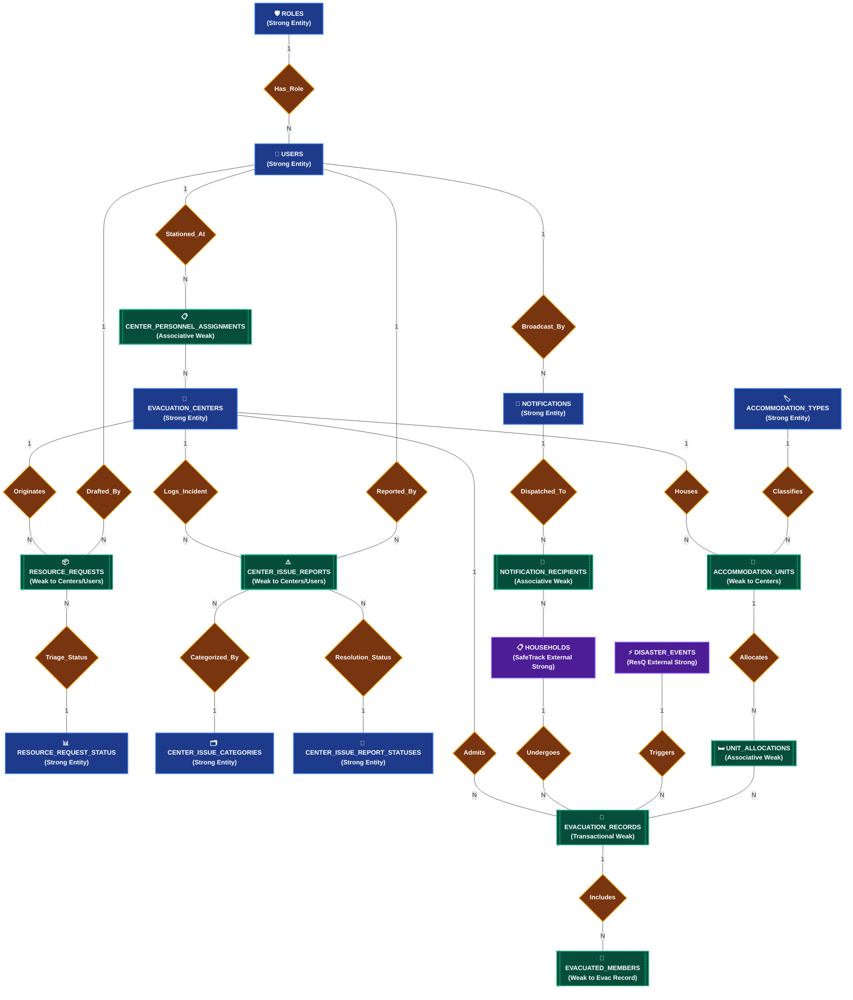
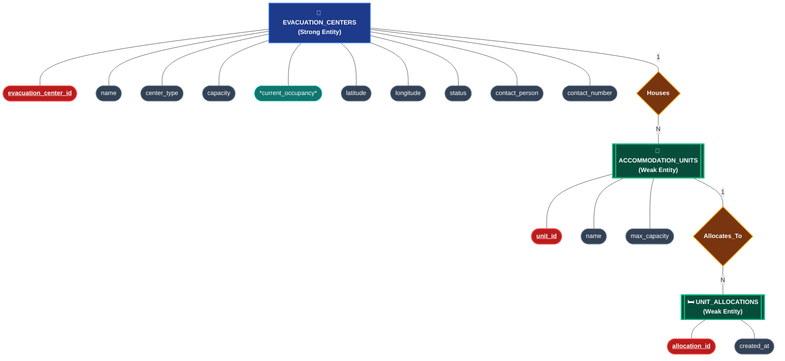
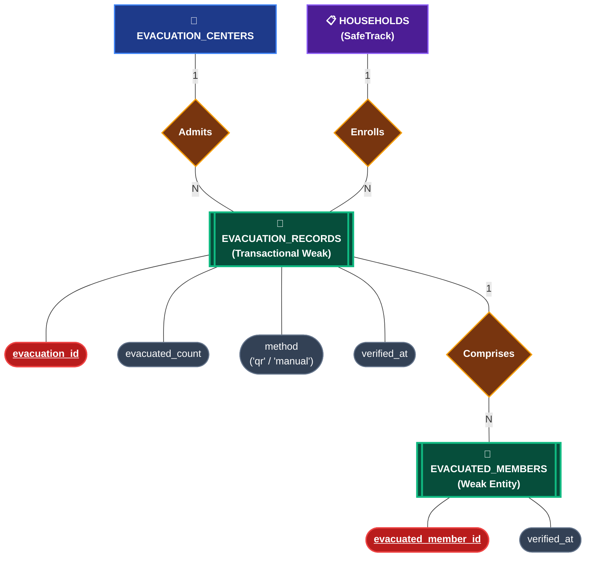
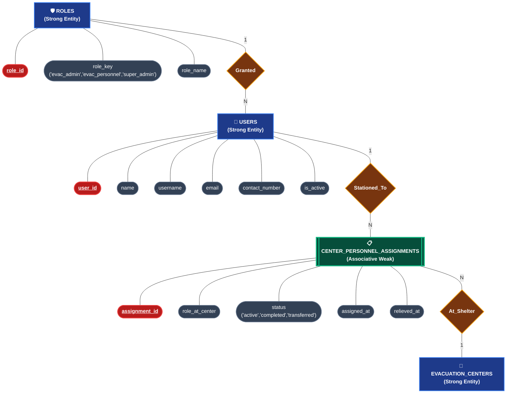
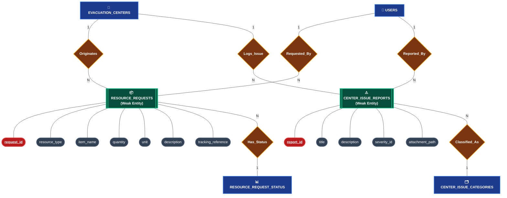

# EvaTrack — Entity-Relationship Diagram (ERD) Specification

**System Scope:** Barangay-based Evacuation Management & Tracking Platform (EvaTrack)  
**Reference Schema:** [`corrected_full_schema.sql`](file:///c:/CAPSTONE/EvaTrack/docs/corrected_full_schema.sql)  
**Notation Standard:** Classic Chen ER Model (Rectangles = Entities, Ovals = Attributes, Diamonds = Relationships, Cardinality Ratios = 1:1, 1:N, M:N)

---

## 1. ER Model Notation Conventions (Chen's Model)

| Component | Chen ER Graphical Symbol | Definition & Representation in Diagram |
| :--- | :---: | :--- |
| **Strong Entity** | **Single Rectangle** `[Entity]` | Independent existence; possesses an internal unique primary key. |
| **Weak Entity** | **Double Rectangle** `[[Entity]]` | Existence-dependent; relies on an identifying relationship with an owner entity. |
| **Primary Key Attribute** | **Oval with Underline** `([<u>PK</u>])` | Unique identifier attribute for an entity set. |
| **Simple Attribute** | **Standard Oval** `([Attribute])` | Atomic property or characteristic describing an entity. |
| **Derived Attribute** | **Dashed Oval** `([*Attribute*])` | Computed dynamically from other stored records (e.g., `current_occupancy`). |
| **Relationship** | **Diamond** `{Verb / Action}` | Association connecting two or more entities. |
| **Cardinality** | **Edge Label** `|1|`, `|N|`, `|M|` | Multiplicity constraint (One-to-One, One-to-Many, Many-to-Many). |

---

## 2. Global Core ERD (Chen Notation: Entities, Relationships & Cardinalities)

This diagram outlines the complete barangay evacuation domain: Strong & Weak entities connected through relationship diamonds with exact cardinality mappings.

---

## 3. Detailed Component Decomposition by Subsystem (Chen Model with Attribute Ovals)

Below, each subsystem is illustrated with its **Attribute Ovals** linked directly to the entity rectangles:
* `([<u>attribute</u>])` represents a **Primary Key**.
* `([attribute])` represents a **Simple / Secondary Attribute**.
* `([*attribute*])` represents a **Derived Attribute**.

---

### Subsystem A: Shelter Infrastructure & Room Allocations
Models evacuation center facilities, internal modular accommodation units, and living space allocations.

---

### Subsystem B: Evacuation Intake, Demographics & Admissions
Models resident arrival, verification method (`qr` vs. `manual`), and individual sheltered family members.

---

### Subsystem C: User Management, Roles & Station Assignments
Models the **Barangay IT / System Administrator (Super Admin)**, **Camp Commander (Evac Admin)**, and **Frontline Staff (Evac Personnel)** station assignments.

---

### Subsystem D: Center Logistics & Issue Incident Reports
Models requisitions (food, water, medical kits) and facility/medical issues logged by camp staff.

---

## 4. Entity & Cardinality Summary Table

| Relationship (Diamond) | Entity 1 (Rectangle) | Entity 2 (Rectangle) | Cardinality Ratio | Participation Constraint | Description |
| :--- | :--- | :--- | :---: | :---: | :--- |
| **`Houses`** | `EVACUATION_CENTERS` | `ACCOMMODATION_UNITS` | **1 : N** | Mandatory (1) to Optional (N) | One center partitions into zero or many rooms/tents. |
| **`Classifies`** | `ACCOMMODATION_TYPES` | `ACCOMMODATION_UNITS` | **1 : N** | Optional (1) to Mandatory (N) | Room classification (classroom, tent, hall). |
| **`Allocates`** | `ACCOMMODATION_UNITS` | `UNIT_ALLOCATIONS` | **1 : N** | Optional (1) to Optional (N) | Living spaces allocated to admitted family units. |
| **`Admits`** | `EVACUATION_CENTERS` | `EVACUATION_RECORDS` | **1 : N** | Mandatory (1) to Optional (N) | Centers register incoming household check-ins. |
| **`Enrolls`** | `HOUSEHOLDS` *(SafeTrack)*| `EVACUATION_RECORDS` | **1 : N** | Mandatory (1) to Optional (N) | A household undergoes one or more evacuation stays. |
| **`Triggers`** | `DISASTER_EVENTS` *(ResQ)*| `EVACUATION_RECORDS` | **1 : N** | Optional (1) to Optional (N) | Evacuations linked to an active disaster incident. |
| **`Comprises`** | `EVACUATION_RECORDS` | `EVACUATED_MEMBERS` | **1 : N** | Mandatory (1) to Mandatory (N) | Each evacuation record lists individual verified members. |
| **`Stationed_At`** | `USERS` | `EVACUATION_CENTERS` | **M : N** (via `ASSIGNMENTS`) | Optional (M) to Optional (N) | Personnel scheduled to serve at specific evacuation centers. |
| **`Granted`** | `ROLES` | `USERS` | **1 : N** | Mandatory (1) to Mandatory (N) | Defines access tier (`super_admin`, `evac_admin`, `evac_personnel`). |
| **`Originates`** | `EVACUATION_CENTERS` | `RESOURCE_REQUESTS` | **1 : N** | Optional (1) to Optional (N) | Shelters submitting logistics/supply replenishment requests. |
| **`Logs_Incident`**| `EVACUATION_CENTERS` | `CENTER_ISSUE_REPORTS` | **1 : N** | Optional (1) to Optional (N) | Center incident tracking (sanitation, medical, security). |
| **`Dispatched_To`**| `NOTIFICATIONS` | `HOUSEHOLDS` | **M : N** (via `RECIPIENTS`) | Optional (M) to Optional (N) | Broadcast SMS and Push emergency alerts dispatched to residents. |

