# EvaTrack – Entity Relationship Diagram Reference

> [!NOTE]
> This document contains all entities and schema relationships actively utilized in the **EvaTrack** system (`mysql_v2` / `shared_db`), verified against database migrations and Laravel Eloquent domain models. Use this as the definitive architectural reference for system data modeling.

---

## Visual ER Diagram (Mermaid)

```mermaid
erDiagram

    %% ══════════════════════════════════════════
    %% AUTHENTICATION & USERS
    %% ══════════════════════════════════════════

    users }o--|| roles : "role_id"
    users }o--o| evacuation_centers : "assigned_center_id"
    users }o--o| households : "household_id"
    users ||--o{ user_notifications : "user_id"

    %% ══════════════════════════════════════════
    %% HOUSEHOLDS & MEMBERS
    %% ══════════════════════════════════════════

    households }o--o| addresses : "address_id"
    households ||--|{ household_members : "household_id"
    households ||--|{ evacuation_records : "household_id"
    households ||--|{ device_tokens : "household_id"
    households ||--|{ notification_recipients : "household_id"
    households ||--|{ notification_logs : "household_id"

    household_members }o--o| genders : "gender_id"
    household_members }o--o| civil_statuses : "civil_status_id"
    household_members }o--o| relationships : "relationship_id"
    household_members ||--|{ member_vulnerable_groups : "member_id"
    household_members ||--|{ evacuated_members : "member_id"

    member_vulnerable_groups }o--|| vulnerable_groups : "vulnerable_group_id"

    %% ══════════════════════════════════════════
    %% ADDRESS HIERARCHY
    %% ══════════════════════════════════════════

    addresses }o--o| puroks : "purok_id"
    addresses }o--o| sitios : "sitio_id"
    addresses }o--o| barangays : "barangay_id"
    addresses }o--o| cities : "city_id"
    addresses }o--o| provinces : "province_id"
    addresses }o--o| regions : "region_id"
    addresses }o--o| zipcodes : "zipcode_id"

    regions ||--|{ provinces : "region_id"
    provinces ||--|{ cities : "province_id"
    cities ||--|{ barangays : "city_id"
    barangays ||--|{ sitios : "barangay_id"
    sitios ||--|{ puroks : "sitio_id"
    zipcodes }o--|| cities : "city_id"

    %% ══════════════════════════════════════════
    %% DISASTER EVENTS
    %% ══════════════════════════════════════════

    disaster_events }o--|| disaster_types : "type_id"
    disaster_events }o--o| severity_levels : "severity_level_id"
    disaster_events ||--|{ evacuation_records : "event_id"
    disaster_events ||--|{ notifications : "evacuation_event_id"
    disaster_events ||--|{ disaster_event_types : "event_id"
    disaster_events ||--|{ analytics : "evacuation_event_id"
    disaster_event_types }o--|| disaster_types : "type_id"

    %% ══════════════════════════════════════════
    %% EVACUATION CENTERS
    %% ══════════════════════════════════════════

    evacuation_centers }o--o| disaster_events : "current_event_id"
    evacuation_centers ||--|{ evacuation_records : "center_id"
    evacuation_centers ||--|{ accommodation_units : "center_id"
    evacuation_centers ||--|{ notifications : "evacuation_center_id"
    evacuation_centers ||--o| center_occupancies : "evacuation_center_id"
    evacuation_centers ||--|{ center_issue_reports : "evacuation_center_id"
    evacuation_centers ||--|{ resource_requests : "evacuation_center_id"
    evacuation_centers ||--|{ analytics : "evacuation_center_id"

    %% ══════════════════════════════════════════
    %% EVACUATION RECORDS
    %% ══════════════════════════════════════════

    evacuation_records }o--|| disaster_events : "event_id"
    evacuation_records }o--|| households : "household_id"
    evacuation_records }o--|| evacuation_centers : "center_id"
    evacuation_records }o--o| household_statuses : "household_status_id"
    evacuation_records }o--o| users : "verified_by"
    evacuation_records ||--|{ evacuated_members : "evacuation_id"
    evacuation_records ||--|{ unit_allocations : "evacuation_id"

    evacuated_members }o--|| evacuation_records : "evacuation_id"
    evacuated_members }o--|| household_members : "member_id"

    %% ══════════════════════════════════════════
    %% ACCOMMODATION UNITS
    %% ══════════════════════════════════════════

    accommodation_units }o--|| evacuation_centers : "center_id"
    accommodation_units }o--|| accommodation_types : "type_id"
    accommodation_units ||--|{ unit_allocations : "unit_id"

    unit_allocations }o--|| evacuation_records : "evacuation_id"
    unit_allocations }o--|| accommodation_units : "unit_id"
    unit_allocations }o--o| users : "assigned_by"

    %% ══════════════════════════════════════════
    %% CENTER ISSUE REPORTS
    %% ══════════════════════════════════════════

    center_issue_reports }o--|| evacuation_centers : "evacuation_center_id"
    center_issue_reports }o--|| users : "reported_by"
    center_issue_reports }o--o| users : "handled_by"
    center_issue_reports }o--|| center_issue_categories : "category_id"
    center_issue_reports }o--o| severity_levels : "severity_id"
    center_issue_reports }o--|| center_issue_report_statuses : "status_id"

    %% ══════════════════════════════════════════
    %% RESOURCE REQUESTS
    %% ══════════════════════════════════════════

    resource_requests }o--|| evacuation_centers : "evacuation_center_id"
    resource_requests }o--|| users : "requested_by"
    resource_requests }o--o| users : "handled_by"
    resource_requests }o--o| urgency_levels : "urgency_id"
    resource_requests }o--|| resource_request_status : "status_id"

    %% ══════════════════════════════════════════
    %% NOTIFICATIONS
    %% ══════════════════════════════════════════

    notifications }o--|| users : "sent_by"
    notifications }o--o| disaster_events : "evacuation_event_id"
    notifications }o--o| evacuation_centers : "evacuation_center_id"
    notifications }o--o| urgency_levels : "urgency_level_id"
    notifications }o--o| recurrence_types : "recurrence_type_id"
    notifications ||--|{ notification_recipients : "notification_id"
    notifications ||--|{ notification_logs : "notification_id"

    notification_logs }o--|| notifications : "notification_id"
    notification_logs }o--o| households : "household_id"
    notification_logs }o--|| notification_channels : "channel_id"
    notification_logs }o--|| notification_statuses : "status_id"

    notification_recipients }o--|| notifications : "notification_id"
    notification_recipients }o--o| households : "household_id"

    device_tokens }o--|| households : "household_id"

    analytics_job_logs }o--|| analytics_job_status : "status_id"
```

---

## Entities by Domain

---

### 1. Authentication & Users

#### `users`
System user accounts for system operators (Super Admin, Evacuation Admin, Evacuation Personnel).

| Column | Type | Constraints | Description |
|--------|------|-------------|-------------|
| `user_id` | varchar(255) | **PK** | Formatted ID (`SUP-YYYY-XXXXXX`, `EAD-YYYY-XXXXXX`, `EPE-YYYY-XXXXXX`) |
| `first_name` | varchar(100) | | User first name |
| `last_name` | varchar(100) | | User last name |
| `name` | varchar(255) | | Full name (or computed accessor) |
| `username` | varchar(100) | nullable | User login handle |
| `email` | varchar(255) | UNIQUE, nullable | User login / contact email |
| `password` | varchar(255) | | Bcrypt hashed password |
| `role_id` | int | **FK → roles.role_id** | User role assignment |
| `contact_number` | varchar(50) | nullable | Primary cellular phone number |
| `assigned_center_id` | varchar(255) | **FK → evacuation_centers.evacuation_center_id**, nullable | Shelter assignment |
| `household_id` | varchar(255) | **FK → households.household_id**, nullable | Linked resident profile |
| `is_active` | tinyint(1) | default 1 | Account activation toggle |
| `profile_photo` | varchar(255) | nullable | Path to avatar image |
| `created_at` | datetime | | Record creation timestamp |
| `updated_at` | timestamp | nullable | Record modification timestamp |
| `deleted_at` | datetime | nullable | Soft delete timestamp |

#### `roles`
Enumeration of user authorization tiers.

| Column | Type | Constraints | Description |
|--------|------|-------------|-------------|
| `role_id` | int | **PK** | 1 = Super Admin, 2 = Evacuation Admin, 3 = Evacuation Personnel |
| `role_key` | varchar(50) | UNIQUE | Machine key (`super_admin`, `evac_admin`, `evac_personnel`) |
| `role_name` | varchar(100) | | Human readable title |

#### `user_notifications`
In-app notifications and alerts targeted to authenticated administrative users.

| Column | Type | Constraints | Description |
|--------|------|-------------|-------------|
| `id` | bigint | **PK**, auto-increment | Notification identifier |
| `user_id` | varchar(255) | **FK → users.user_id** | Recipient staff user |
| `type` | varchar(100) | | Notification classification |
| `title` | varchar(255) | | Alert summary / title |
| `message` | text | | Full notification message |
| `data` | json | nullable | Contextual metadata / deep links |
| `read_at` | datetime | nullable | Read state timestamp |
| `created_at` | datetime | | Creation timestamp |
| `updated_at` | datetime | nullable | Update timestamp |

---

### 2. Households & Members

#### `households`
Master household entity representing families/domiciles (sourced / synced with SafeTrack).

| Column | Type | Constraints | Description |
|--------|------|-------------|-------------|
| `household_id` | varchar(255) | **PK** | SafeTrack formatted identifier (`NHH-YYYY-XXXXXX`) |
| `household_code` | varchar(255) | nullable | Reference code |
| `household_number` | varchar(255) | nullable | Census household serial |
| `household_name` | varchar(100) | | Family / household head surname label |
| `email` | varchar(255) | nullable | Household contact email |
| `address_id` | int | **FK → addresses.address_id**, nullable | Physical residence link |
| `contact_number` | varchar(50) | nullable | Head contact number |
| `emergency_contact` | varchar(50) | nullable | Secondary emergency phone |
| `member_count` | int | default 0 | Number of registered members |
| `created_at` | timestamp | | Creation timestamp |
| `updated_at` | timestamp | nullable | Update timestamp |
| `deleted_at` | timestamp | nullable | Soft delete timestamp |

#### `household_members`
Individual persons belonging to a household.

| Column | Type | Constraints | Description |
|--------|------|-------------|-------------|
| `member_id` | varchar(255) | **PK** | SafeTrack member ID |
| `household_id` | varchar(255) | **FK → households.household_id** | Parent household |
| `first_name` | varchar(100) | | First name |
| `middle_name` | varchar(100) | nullable | Middle name |
| `last_name` | varchar(100) | | Last name |
| `birth_date` | date | NOT NULL | Date of birth for age calculation |
| `gender_id` | int | **FK → genders.gender_id**, nullable | Gender identity |
| `relationship_id` | int | **FK → relationships.relationship_id**, nullable | Relationship to head |
| `civil_status_id` | int | **FK → civil_statuses.status_id**, nullable | Civil status |
| `is_household_head` | tinyint(1) | default 0 | Primary representative flag |
| `can_report_for_household` | tinyint(1) | default 0 | Authorized intake representative |
| `is_senior` | tinyint(1) | default 0 | Senior citizen indicator (60+) |
| `is_pwd` | tinyint(1) | default 0 | Person with disability flag |
| `is_pregnant` | tinyint(1) | default 0 | Pregnancy status flag |
| `contact_number` | varchar(50) | nullable | Member mobile number |
| `occupation` | varchar(100) | nullable | Occupation |
| `education_level_id` | int | nullable | Educational attainment |
| `religion` | varchar(100) | nullable | Religious affiliation |
| `special_needs` | text | nullable | Dietary, medical, or accessibility notes |

#### `household_statuses`
Lookup status for households during disaster events.

| Column | Type | Constraints | Description |
|--------|------|-------------|-------------|
| `status_id` | int | **PK** | Status code (1 = Evacuated, 2 = Not Evacuated) |
| `status_key` | varchar(50) | UNIQUE | `evacuated`, `not_evacuated` |
| `status_label` | varchar(100) | | Display label |

#### `member_vulnerable_groups`
Pivot table mapping household members to specialized vulnerability categories.

| Column | Type | Constraints | Description |
|--------|------|-------------|-------------|
| `id` | int | **PK**, auto-increment | Mapping ID |
| `member_id` | varchar(255) | **FK → household_members.member_id** | Member reference |
| `vulnerable_group_id` | int | **FK → vulnerable_groups.vulnerable_group_id** | Vulnerable classification |

#### `vulnerable_groups`
Lookup definitions of vulnerability classifications.

| Column | Type | Constraints | Description |
|--------|------|-------------|-------------|
| `vulnerable_group_id` | int | **PK**, auto-increment | Primary key |
| `vulnerable_group_key` | varchar(50) | UNIQUE | `pwd`, `pregnant`, `infant`, `senior`, `lactating` |
| `vulnerable_group_label` | varchar(100) | | Display label |

---

### 3. Address / Location Hierarchy

#### `addresses`
Geographic address records linking households to administrative jurisdictions.

| Column | Type | Constraints | Description |
|--------|------|-------------|-------------|
| `address_id` | int | **PK**, auto-increment | Address identifier |
| `street_address` | text | nullable | Street line / house number |
| `purok_id` | int | **FK → puroks.purok_id**, nullable | Sub-community purok |
| `sitio_id` | int | **FK → sitios.sitio_id**, nullable | Sub-community sitio |
| `barangay_id` | int | **FK → barangays.barangay_id**, nullable | Barangay jurisdiction |
| `city_id` | int | **FK → cities.city_id**, nullable | Municipality / City |
| `province_id` | int | **FK → provinces.province_id**, nullable | Province jurisdiction |
| `region_id` | int | **FK → regions.region_id**, nullable | Administrative region |
| `zipcode_id` | int | **FK → zipcodes.zipcode_id**, nullable | Postal code link |
| `created_at` | timestamp | nullable | Record creation timestamp |
| `updated_at` | timestamp | nullable | Record update timestamp |

#### `regions`, `provinces`, `cities`, `barangays`, `sitios`, `puroks`, `zipcodes`
Standard Philippine Standard Geographic Code (PSGC) reference tables establishing jurisdictional nesting:
`regions` → `provinces` → `cities` → `barangays` → `sitios` → `puroks`.

---

### 4. Disaster Events

#### `disaster_events`
Active or historical disaster operations (Typhoon, Flood, Earthquake, Landslide, Fire).

| Column | Type | Constraints | Description |
|--------|------|-------------|-------------|
| `event_id` | varchar(255) | **PK** | Event code (`EVT-YYYY-XXXXXX`) |
| `name` | varchar(100) | | Event title (e.g., "Typhoon Kristine 2026") |
| `type_id` | int | **FK → disaster_types.type_id** | Primary disaster classification |
| `severity_level_id` | int | **FK → severity_levels.severity_id**, nullable | Danger level / alert signal |
| `started_at` | datetime | | Event declaration datetime |
| `ended_at` | datetime | nullable | Event termination datetime |
| `created_at` | timestamp | nullable | Creation timestamp |
| `updated_at` | timestamp | nullable | Modification timestamp |

#### `disaster_types`
Catalog of disaster classifications.

| Column | Type | Constraints | Description |
|--------|------|-------------|-------------|
| `type_id` | int | **PK**, auto-increment | Type identifier |
| `type_code` | varchar(20) | UNIQUE | `TYPHOON`, `FLOOD`, `EARTHQUAKE`, `FIRE` |
| `type_name` | varchar(100) | | Display title |
| `is_active` | tinyint(1) | default 1 | Operational status |

#### `disaster_event_types`
Pivot table supporting compound multi-hazard events.

| Column | Type | Constraints | Description |
|--------|------|-------------|-------------|
| `event_type_id` | int | **PK**, auto-increment | Primary key |
| `event_id` | varchar(255) | **FK → disaster_events.event_id** | Disaster event |
| `type_id` | int | **FK → disaster_types.type_id** | Hazard type |

#### `severity_levels`
Alert levels / warning signals.

| Column | Type | Constraints | Description |
|--------|------|-------------|-------------|
| `severity_id` | int | **PK**, auto-increment | Primary key |
| `severity_key` | varchar(50) | UNIQUE | `low`, `moderate`, `high`, `critical` |
| `severity_label` | varchar(100) | | Display label |

---

### 5. Evacuation Centers & Capacity

#### `evacuation_centers`
Shelter facilities designated for disaster relief operations.

| Column | Type | Constraints | Description |
|--------|------|-------------|-------------|
| `evacuation_center_id` | varchar(255) | **PK** | Center identifier (`EC-YYYY-XXXXXX`) |
| `name` | varchar(100) | | Center facility name |
| `osm_address` | varchar(255) | nullable | Street / location label |
| `latitude` | decimal(10,7) | | GPS latitude coordinate |
| `longitude` | decimal(10,7) | | GPS longitude coordinate |
| `capacity` | int | | Max individual capacity |
| `current_event_id` | varchar(255) | **FK → disaster_events.event_id**, nullable | Active linked disaster |
| `created_at` | datetime | | Center registration timestamp |
| `deleted_at` | datetime | nullable | Soft delete timestamp |

#### `center_occupancies`
Real-time capacity tracking snapshot per evacuation center.

| Column | Type | Constraints | Description |
|--------|------|-------------|-------------|
| `id` | int | **PK**, auto-increment | Identifier |
| `evacuation_center_id` | varchar(255) | **FK → evacuation_centers.evacuation_center_id** | Evacuation center link |
| `current_occupancy` | int | default 0 | Current head count |
| `last_updated` | datetime | | Last sync timestamp |

---

### 6. Evacuation Records & Tracking

#### `evacuation_records`
Master intake / admission record for a household arriving at an evacuation center.

| Column | Type | Constraints | Description |
|--------|------|-------------|-------------|
| `evacuation_id` | int | **PK**, auto-increment | Admission ticket number |
| `event_id` | varchar(255) | **FK → disaster_events.event_id** | Linked disaster operation |
| `household_id` | varchar(255) | **FK → households.household_id** | Evacuated household |
| `center_id` | varchar(255) | **FK → evacuation_centers.evacuation_center_id** | Host evacuation shelter |
| `household_status_id` | int | **FK → household_statuses.status_id** | `Evacuated` or `Not Evacuated` |
| `evacuated_count` | int | default 0 | Total members physically present |
| `method` | varchar(50) | | Intake mode (`qr` or `manual`) |
| `verified_by` | varchar(255) | **FK → users.user_id**, nullable | Registering staff user |
| `verified_at` | datetime | nullable | Admission timestamp |
| `created_at` | datetime | | Record creation timestamp |
| `updated_at` | datetime | nullable | Record update / checkout timestamp |

#### `evacuated_members`
Individual household members physically verified and checked into the center.

| Column | Type | Constraints | Description |
|--------|------|-------------|-------------|
| `evacuated_member_id` | int | **PK**, auto-increment | Record ID |
| `evacuation_id` | int | **FK → evacuation_records.evacuation_id** | Household admission parent |
| `member_id` | varchar(255) | **FK → household_members.member_id** | Individual member profile |
| `verified_at` | datetime | nullable | Member verification timestamp |

---

### 7. Accommodation Units (Rooms & Spaces)

#### `accommodation_units`
Individual rooms, classrooms, modular tents, or zones within a shelter.

| Column | Type | Constraints | Description |
|--------|------|-------------|-------------|
| `unit_id` | int | **PK**, auto-increment | Room / unit ID |
| `center_id` | varchar(255) | **FK → evacuation_centers.evacuation_center_id** | Host evacuation facility |
| `name` | varchar(100) | | Room designation (e.g. "Room 101", "Tent A-3") |
| `type_id` | int | **FK → accommodation_types.type_id** | Unit classification |
| `max_capacity` | int | | Max individual occupancy limit |

#### `accommodation_types`
Classification of living quarters (Classroom, Modular Tent, Gym Floor, Covered Court).

| Column | Type | Constraints | Description |
|--------|------|-------------|-------------|
| `type_id` | int | **PK**, auto-increment | Primary key |
| `type_key` | varchar(50) | UNIQUE | `classroom`, `modular_tent`, `hall` |
| `type_label` | varchar(100) | | Display title |

#### `unit_allocations`
Assignment of an admitted household to a specific accommodation unit.

| Column | Type | Constraints | Description |
|--------|------|-------------|-------------|
| `allocation_id` | int | **PK**, auto-increment | Allocation ticket |
| `evacuation_id` | int | **FK → evacuation_records.evacuation_id** | Household admission record |
| `unit_id` | int | **FK → accommodation_units.unit_id** | Allocated room/space |
| `assigned_by` | varchar(255) | **FK → users.user_id**, nullable | Staff performing allocation |
| `selected_by_resident` | tinyint(1) | default 0 | Resident selection flag |

---

### 8. Center Issue Reports (Incident & Health Triage)

#### `center_issue_reports`
On-the-ground operational incidents, medical emergencies, facility damages, and security alerts.

| Column | Type | Constraints | Description |
|--------|------|-------------|-------------|
| `report_id` | varchar(255) | **PK** | Issue ticket code (`CIR-YYYY-XXXXXX`) |
| `evacuation_center_id` | varchar(255) | **FK → evacuation_centers.evacuation_center_id** | Affected facility |
| `reported_by` | varchar(255) | **FK → users.user_id** | Reporting personnel / admin |
| `handled_by` | varchar(255) | **FK → users.user_id**, nullable | Assigned responder |
| `category_id` | int | **FK → center_issue_categories.category_id** | Incident category |
| `title` | varchar(150) | | Issue summary |
| `description` | text | | Detailed circumstances / triage notes |
| `severity_id` | int | **FK → severity_levels.severity_id**, nullable | Severity rating |
| `status_id` | int | **FK → center_issue_report_statuses.status_id** | Triage lifecycle status |
| `attachment_path` | varchar(255) | nullable | Photo / documentation upload path |
| `created_at` | datetime | | Filing timestamp |
| `updated_at` | datetime | nullable | Resolution timestamp |

#### `center_issue_categories`
Classification of center issues (`facility_damage`, `medical_emergency`, `sanitation`, `security`, `food_water`).

| Column | Type | Constraints | Description |
|--------|------|-------------|-------------|
| `category_id` | int | **PK**, auto-increment | Category identifier |
| `category_key` | varchar(50) | UNIQUE | Machine key |
| `category_label` | varchar(100) | | Display title |

#### `center_issue_report_statuses`
Lifecycle state of reported center issues (`pending`, `under_review`, `in_progress`, `resolved`, `dismissed`).

| Column | Type | Constraints | Description |
|--------|------|-------------|-------------|
| `status_id` | int | **PK**, auto-increment | Status identifier |
| `status_key` | varchar(50) | UNIQUE | Machine key |
| `status_label` | varchar(100) | | Display title |

---

### 9. Resource Requests (Logistics & Assistance Routing)

#### `resource_requests`
Resource shortage requisitions (food packs, cots, medical supplies, manpower) routed to camp management and external dispatch (**ResQperation**).

| Column | Type | Constraints | Description |
|--------|------|-------------|-------------|
| `request_id` | varchar(255) | **PK** | Request reference code (`REQ-YYYY-XXXXXX`) |
| `evacuation_center_id` | varchar(255) | **FK → evacuation_centers.evacuation_center_id** | Requesting center |
| `requested_by` | varchar(255) | **FK → users.user_id** | Requesting personnel / admin |
| `handled_by` | varchar(255) | **FK → users.user_id**, nullable | Processing authority |
| `resource_type` | varchar(100) | | Item / service classification |
| `quantity` | int | nullable | Requested item volume / quantity |
| `description` | text | nullable | Specific requirements and rationale |
| `urgency_id` | int | **FK → urgency_levels.urgency_id**, nullable | Priority rating |
| `status_id` | int | **FK → resource_request_status.status_id** | Request lifecycle status |
| `created_at` | datetime | | Requisition timestamp |
| `updated_at` | datetime | nullable | Fulfillment timestamp |

#### `resource_request_status`
Lifecycle stages of logistics requests (`pending`, `acknowledged`, `approved`, `rejected`, `delivered`).

| Column | Type | Constraints | Description |
|--------|------|-------------|-------------|
| `status_id` | int | **PK**, auto-increment | Status identifier |
| `status_key` | varchar(50) | UNIQUE | Status machine key |
| `status_label` | varchar(100) | | Display title |

#### `urgency_levels`
Priority levels for alerts and requisitions (`low`, `moderate`, `high`, `critical`).

| Column | Type | Constraints | Description |
|--------|------|-------------|-------------|
| `urgency_id` | int | **PK**, auto-increment | Priority ID |
| `urgency_key` | varchar(50) | UNIQUE | Machine key |
| `urgency_label` | varchar(100) | | Display title |

---

### 10. Notifications & Alert Broadcast Engine

#### `notifications`
Emergency bulletins, evacuation advisories, and weather warnings dispatched to the public.

| Column | Type | Constraints | Description |
|--------|------|-------------|-------------|
| `notif_id` | int | **PK**, auto-increment | Broadcast identifier |
| `message` | text | | Advisory body text |
| `sent_by` | varchar(255) | **FK → users.user_id**, nullable | Dispatching admin user |
| `evacuation_event_id` | varchar(255) | **FK → disaster_events.event_id**, nullable | Associated disaster |
| `evacuation_center_id` | varchar(255) | **FK → evacuation_centers.evacuation_center_id**, nullable | Targeted shelter (if local) |
| `urgency_level_id` | int | **FK → urgency_levels.urgency_id**, nullable | Threat urgency |
| `scheduled_at` | datetime | nullable | Scheduled dispatch time |
| `is_recurring` | tinyint(1) | default 0 | Periodic recurrence toggle |
| `recurrence_type_id` | int | **FK → recurrence_types.type_id**, nullable | Interval (daily, hourly) |
| `recurrence_end_at` | datetime | nullable | Recurrence cut-off time |
| `last_sent_at` | datetime | nullable | Last transmission timestamp |
| `channel` | varchar(50) | | Gateway medium (`sms`, `push`, `both`) |
| `status` | varchar(50) | | Delivery status |
| `target_filter` | varchar(50) | nullable | Geographic / center demographic filter |
| `created_at` | datetime | | Broadcast creation timestamp |

#### `notification_recipients`
Individual household recipient tracking and acknowledgment records.

| Column | Type | Constraints | Description |
|--------|------|-------------|-------------|
| `id` | int | **PK**, auto-increment | Recipient log ID |
| `notification_id` | int | **FK → notifications.notif_id** | Parent broadcast message |
| `household_id` | varchar(255) | **FK → households.household_id** | Target household |
| `read_at` | datetime | nullable | Mobile read receipt timestamp |
| `acknowledged_at` | datetime | nullable | Resident acknowledgment timestamp |

#### `notification_logs`
Low-level gateway dispatch logs for SMS (TextBee) and Push (**ResQperation** / OneSignal).

| Column | Type | Constraints | Description |
|--------|------|-------------|-------------|
| `log_id` | int | **PK**, auto-increment | Log identifier |
| `notification_id` | int | **FK → notifications.notif_id** | Parent notification |
| `household_id` | varchar(255) | **FK → households.household_id** | Recipient household |
| `channel_id` | int | **FK → notification_channels.channel_id** | Delivery channel |
| `status_id` | int | **FK → notification_statuses.status_id** | Transmission result |
| `sent_at` | datetime | | Gateway dispatch time |
| `retry_count` | int | default 0 | Retry attempts count |
| `external_message_id` | varchar(255) | nullable | Gateway carrier reference ID |

#### `notification_channels`, `notification_statuses`, `recurrence_types`
Lookup tables standardizing channels (`sms`, `push`), transmission statuses (`pending`, `delivered`, `failed`), and intervals (`daily`, `hourly`).

#### `device_tokens`
Registered mobile push endpoints (OneSignal Player IDs / Expo tokens) for app users.

| Column | Type | Constraints | Description |
|--------|------|-------------|-------------|
| `token_id` | bigint | **PK**, auto-increment | Token identifier |
| `household_id` | varchar(255) | **FK → households.household_id** | Linked household profile |
| `player_id` | varchar(255) | | Device push registration token |

---

### 11. Analytics & Demographic Intelligence

#### `analytics`
Aggregated demographic census and vulnerability breakdowns per event and evacuation center.

| Column | Type | Constraints | Description |
|--------|------|-------------|-------------|
| `analytic_id` | varchar(255) | **PK** | Snapshot code (`ANA-YYYY-XXXXXX`) |
| `evacuation_event_id` | varchar(255) | **FK → disaster_events.event_id**, nullable | Monitored disaster |
| `evacuation_center_id` | varchar(255) | **FK → evacuation_centers.evacuation_center_id**, nullable | Shelter facility |
| `snapshot_type` | varchar(50) | | Interval (`hourly`, `daily`, `live`) |
| `recorded_at` | datetime | | Metric snapshot timestamp |
| `total_population` | int | | Total active evacuated persons |
| `total_households` | int | | Total active evacuated families |
| `children_count` | int | | Minors count (< 18 yrs) |
| `adult_count` | int | | Adults count (18–59 yrs) |
| `elderly_count` | int | | Senior citizens count (60+ yrs) |
| `pwd_count` | int | | Persons with disabilities count |
| `pregnant_count` | int | | Pregnant evacuees count |
| `male_count` | int | | Male evacuees count |
| `female_count` | int | | Female evacuees count |

#### `analytics_job_logs` & `analytics_job_status`
Background calculation scheduler logs tracking data rollup execution and status (`pending`, `processing`, `completed`, `failed`).

---

### 12. Demographic Lookup Tables

#### `genders`, `civil_statuses`, `relationships`
Standardized human demographic taxonomies:
- `genders`: Male, Female, Other
- `civil_statuses`: Single, Married, Widowed, Separated, Divorced
- `relationships`: Head, Spouse, Child, Parent, Sibling, Relative, Non-Relative

---

## Relationship Summary Index

| Primary / Origin Table | Foreign Key Column | Cardinality | Target / Referenced Table | Referenced Column |
|---|---|---|---|---|
| `users` | `role_id` | Many-to-One | `roles` | `role_id` |
| `users` | `assigned_center_id` | Many-to-One | `evacuation_centers` | `evacuation_center_id` |
| `users` | `household_id` | Many-to-One | `households` | `household_id` |
| `user_notifications` | `user_id` | Many-to-One | `users` | `user_id` |
| `households` | `address_id` | Many-to-One | `addresses` | `address_id` |
| `household_members` | `household_id` | Many-to-One | `households` | `household_id` |
| `household_members` | `gender_id` | Many-to-One | `genders` | `gender_id` |
| `household_members` | `civil_status_id` | Many-to-One | `civil_statuses` | `status_id` |
| `household_members` | `relationship_id` | Many-to-One | `relationships` | `relationship_id` |
| `member_vulnerable_groups` | `member_id` | Many-to-One | `household_members` | `member_id` |
| `member_vulnerable_groups` | `vulnerable_group_id` | Many-to-One | `vulnerable_groups` | `vulnerable_group_id` |
| `addresses` | `purok_id` | Many-to-One | `puroks` | `purok_id` |
| `addresses` | `sitio_id` | Many-to-One | `sitios` | `sitio_id` |
| `addresses` | `barangay_id` | Many-to-One | `barangays` | `barangay_id` |
| `addresses` | `city_id` | Many-to-One | `cities` | `city_id` |
| `addresses` | `province_id` | Many-to-One | `provinces` | `province_id` |
| `addresses` | `region_id` | Many-to-One | `regions` | `region_id` |
| `addresses` | `zipcode_id` | Many-to-One | `zipcodes` | `zipcode_id` |
| `disaster_events` | `type_id` | Many-to-One | `disaster_types` | `type_id` |
| `disaster_events` | `severity_level_id` | Many-to-One | `severity_levels` | `severity_id` |
| `disaster_event_types` | `event_id` | Many-to-One | `disaster_events` | `event_id` |
| `disaster_event_types` | `type_id` | Many-to-One | `disaster_types` | `type_id` |
| `evacuation_centers` | `current_event_id` | Many-to-One | `disaster_events` | `event_id` |
| `center_occupancies` | `evacuation_center_id` | One-to-One | `evacuation_centers` | `evacuation_center_id` |
| `evacuation_records` | `event_id` | Many-to-One | `disaster_events` | `event_id` |
| `evacuation_records` | `household_id` | Many-to-One | `households` | `household_id` |
| `evacuation_records` | `center_id` | Many-to-One | `evacuation_centers` | `evacuation_center_id` |
| `evacuation_records` | `household_status_id` | Many-to-One | `household_statuses` | `status_id` |
| `evacuation_records` | `verified_by` | Many-to-One | `users` | `user_id` |
| `evacuated_members` | `evacuation_id` | Many-to-One | `evacuation_records` | `evacuation_id` |
| `evacuated_members` | `member_id` | Many-to-One | `household_members` | `member_id` |
| `accommodation_units` | `center_id` | Many-to-One | `evacuation_centers` | `evacuation_center_id` |
| `accommodation_units` | `type_id` | Many-to-One | `accommodation_types` | `type_id` |
| `unit_allocations` | `evacuation_id` | Many-to-One | `evacuation_records` | `evacuation_id` |
| `unit_allocations` | `unit_id` | Many-to-One | `accommodation_units` | `unit_id` |
| `unit_allocations` | `assigned_by` | Many-to-One | `users` | `user_id` |
| `center_issue_reports` | `evacuation_center_id` | Many-to-One | `evacuation_centers` | `evacuation_center_id` |
| `center_issue_reports` | `reported_by` | Many-to-One | `users` | `user_id` |
| `center_issue_reports` | `handled_by` | Many-to-One | `users` | `user_id` |
| `center_issue_reports` | `category_id` | Many-to-One | `center_issue_categories` | `category_id` |
| `center_issue_reports` | `severity_id` | Many-to-One | `severity_levels` | `severity_id` |
| `center_issue_reports` | `status_id` | Many-to-One | `center_issue_report_statuses` | `status_id` |
| `resource_requests` | `evacuation_center_id` | Many-to-One | `evacuation_centers` | `evacuation_center_id` |
| `resource_requests` | `requested_by` | Many-to-One | `users` | `user_id` |
| `resource_requests` | `handled_by` | Many-to-One | `users` | `user_id` |
| `resource_requests` | `urgency_id` | Many-to-One | `urgency_levels` | `urgency_id` |
| `resource_requests` | `status_id` | Many-to-One | `resource_request_status` | `status_id` |
| `notifications` | `sent_by` | Many-to-One | `users` | `user_id` |
| `notifications` | `evacuation_event_id` | Many-to-One | `disaster_events` | `event_id` |
| `notifications` | `evacuation_center_id` | Many-to-One | `evacuation_centers` | `evacuation_center_id` |
| `notifications` | `urgency_level_id` | Many-to-One | `urgency_levels` | `urgency_id` |
| `notifications` | `recurrence_type_id` | Many-to-One | `recurrence_types` | `type_id` |
| `notification_recipients` | `notification_id` | Many-to-One | `notifications` | `notif_id` |
| `notification_recipients` | `household_id` | Many-to-One | `households` | `household_id` |
| `notification_logs` | `notification_id` | Many-to-One | `notifications` | `notif_id` |
| `notification_logs` | `household_id` | Many-to-One | `households` | `household_id` |
| `notification_logs` | `channel_id` | Many-to-One | `notification_channels` | `channel_id` |
| `notification_logs` | `status_id` | Many-to-One | `notification_statuses` | `status_id` |
| `device_tokens` | `household_id` | Many-to-One | `households` | `household_id` |
| `analytics` | `evacuation_event_id` | Many-to-One | `disaster_events` | `event_id` |
| `analytics` | `evacuation_center_id` | Many-to-One | `evacuation_centers` | `evacuation_center_id` |
| `analytics_job_logs` | `status_id` | Many-to-One | `analytics_job_status` | `status_id` |
