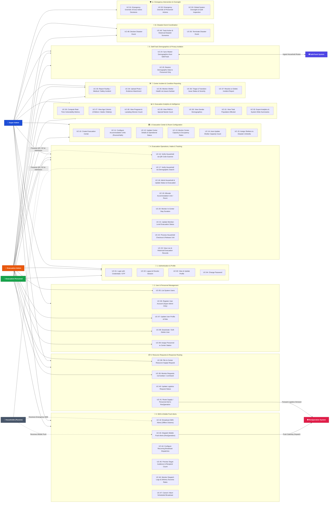

# EvaTrack – Use Case Diagram & Detailed Use Cases

**Project Title:** EVATRACK: Streamlined Evacuation Processes and Coordination Platform Integrating SafeTrack Demographics and ResQperation Response Support  
**Proponents:** Klint M. Ruales, Danica Gelbolingo, Anna Rhea Villadolid, Vhenz Cernal  
**Institution:** School of Computer Studies, University of San Jose-Recoletos (USJ-R)  
**Adviser:** Mr. Stefan A.D. Flores | **Project Coordinator:** Mr. Roderick A. Bandalan  
**Date:** October 2026 (Version 1.1 - Verified Against Production Architecture)

---

## 1. System Overview & Must-Haves Alignment

EvaTrack streamlines evacuation operations, real-time center occupancy tracking, demographic analytics, in-center incident triage, and multi-agency response coordination by integrating with:
1. **SafeTrack System:** Ingests household demographic records solely for on-site personnel identity verification, demographic breakdown, and needs prioritization. This sensitive demographic data is strictly isolated from public/household view.
2. **ResQperation System:** Interoperates for emergency response logistics dispatch (routing resource shortages and personnel demands) and multi-channel push notification broadcasting to citizens.

### Core Must-Have System Capabilities:
1. **SafeTrack Demographics Integration:** Rapid ingestion and verification of family rosters via QR code and manual fallback without exposing data to residents.
2. **Real-Time Evacuation Status Tracking:** Discrete tracking of households and individuals (`Evacuated` [Status ID: 2] vs. `Not Evacuated` [Status ID: 1]).
3. **Automated Shelter Capacity & Room Allocation:** Automatic real-time increments and decrements of shelter occupancy and remaining bed capacity upon admission and checkout.
4. **Demographic Intelligence & Vulnerability Analytics:** Automated aggregation of children (0–17), adults (18–59), elderly (60+), pregnant women, Persons with Disabilities (PWD), gender ratios, and affected populations.
5. **In-Center Incident & Health Condition Reporting:** Real-time triage, severity assessment (`low`, `medium`, `high`, `critical`), photographic evidence uploads, and Jira-style Kanban monitoring of shelter issues.
6. **Resource Logistics & ResQperation Routing:** Automated demand logging and status transition for food, potable water, medical kits, and response personnel.
7. **Multi-Channel Emergency Alerts:** Scheduled, instant, and recurring broadcast dispatch through cellular SMS (for offline residents) and ResQperation push notifications.

---

## 2. System Actors

| Actor | Role Type | Description & System Scope |
|-------|-----------|-----------------------------|
| **Super Admin** | Primary System Actor | Full system oversight across all municipal shelters and administrative jurisdictions. **Exclusively authorized to register new user accounts** (`POST /api/users`). Retains emergency override access over all Evac Admin and Personnel actions for crisis intervention. |
| **Evacuation Admin** | Primary System Actor | Coordinates center operations across assigned evacuation shelters. Configures shelters and accommodation units, assigns personnel to centers, monitors ongoing resource requests and issue reports, broadcasts emergency SMS and push alerts, and manages disaster events. |
| **Evacuation Personnel** | Primary System Actor | Stationed at an assigned evacuation center. Performs rapid intake verification via QR scanning or demographic search, admits households, allocates rooms/units, logs in-center incident/health reports, requests resource supplies, and processes departures/checkouts. |
| **Households / Residents** | Secondary Actor (Passive) | Displaced citizens. Possess no interactive system credentials. Receive SMS/Push warnings, present official SafeTrack QR codes or identification upon arrival, and receive shelter allocations. |
| **SafeTrack System** | External Integration | Authoritative demographic repository. Provides pre-registered household rosters, addresses, and vulnerability tags for verification and analytics. |
| **ResQperation System** | External Integration | Emergency response coordination engine. Receives forwarded resource/personnel aid requests from EvaTrack and serves as the push notification gateway for smartphone alerts. |

---

## 3. High-Fidelity Use Case Diagram

---

## 4. Detailed Use Case Narratives

### Package 1: Authentication & Account Security

#### UC-01: User Login & Session Establishment
* **Actors:** Super Admin, Evacuation Admin, Evacuation Personnel
* **Description:** User authenticates into EvaTrack using registered credentials (Username, Mobile Number, or Email) and password, establishing an encrypted Sanctum bearer token session.
* **Preconditions:** Account exists and has `is_active = 1`.
* **Postconditions:** Bearer token generated in `personal_access_tokens`; user redirected to role-tailored dashboard.
* **Main Flow:**
  1. User navigates to `/login` and provides identifier (e.g., `09888888888` or `EPE-2026-PERS1`) and password.
  2. System validates input against Bcrypt hash in `users.password`.
  3. System loads assigned role (`roles`) and station (`evacuation_centers`).
  4. System issues API token and sets local session store.
* **Alternative Flows:**
  * Invalid password → Rejection prompt with failed attempt notice.
  * Inactive account (`is_active = 0`) → Displays "Account deactivated. Contact Administrator."
* **API Endpoint & DB Tables:** `POST /api/login` | `users`, `roles`, `personal_access_tokens`.

#### UC-02: User Logout
* **Actors:** All Authenticated Users
* **Description:** User terminates their current operational session; the system revokes the active personal access token.
* **API Endpoint & DB Tables:** `POST /api/logout` | `personal_access_tokens`.

#### UC-03: View & Update Profile
* **Actors:** All Authenticated Users
* **Description:** Operator updates their personal information (name, contact phone number, profile avatar).
* **API Endpoint & DB Tables:** `GET /api/user`, `PUT /api/user/profile` | `users`.

#### UC-04: Password Change & Security Reset
* **Actors:** All Authenticated Users
* **Description:** Operator updates password by validating their old password or through OTP SMS verification.
* **API Endpoint & DB Tables:** `PUT /api/user/password`, `POST /api/forgot-password/*` | `users`.

---

### Package 2: User & Personnel Management

#### UC-05: List System Users
* **Actors:** Super Admin, Evacuation Admin
* **Description:** Displays a paginated roster of system accounts with role filters, station assignments, and contact details.
* **API Endpoint & DB Tables:** `GET /api/users` | `users`, `roles`, `evacuation_centers`.

#### UC-06: Register User Account (Super Admin Exclusive)
* **Actors:** Super Admin
* **Description:** Super Admin creates new Evacuation Admin or Evacuation Personnel accounts. The system enforces business rules, hashes passwords, maps roles, and generates standard UIDs (`SUP-`, `EAD-`, `EPE-`).
* **Preconditions:** Authenticated user is `super_admin`.
* **Main Flow:**
  1. Super Admin opens User Management modal and inputs First Name, Last Name, Password, Role, Contact Number, and optional Email.
  2. Frontend sends payload to `POST /api/users`.
  3. Backend validates uniqueness of contact/email via `StoreUserRequest`.
  4. `CreateUserAction` resolves role, hashes password, and creates row in `users`.
  5. `User::boot()` assigns prefixed UID (e.g., `EPE-2026-XXXXXX`).
* **API Endpoint & DB Tables:** `POST /api/users` | `users`, `roles`.

#### UC-07: Update User Profile & Role
* **Actors:** Super Admin, Evacuation Admin (for Personnel only)
* **Description:** Modifies official user parameters, contact numbers, or role designations.
* **API Endpoint & DB Tables:** `PUT /api/users/{id}` | `users`, `roles`.

#### UC-08: Deactivate / Delete User Account
* **Actors:** Super Admin, Evacuation Admin (Personnel only)
* **Description:** Executes a soft-delete (`deleted_at`) or flips `is_active = 0` to immediately block login access.
* **API Endpoint & DB Tables:** `DELETE /api/users/{id}` | `users`.

#### UC-09: Assign Personnel to Center Station
* **Actors:** Super Admin, Evacuation Admin
* **Description:** Associates an Evacuation Personnel operator with a specific physical shelter.
* **Postconditions:** `users.assigned_center_id` updated to target `evacuation_center_id`.
* **API Endpoint & DB Tables:** `POST /api/users/{user}/assign-center` | `users`, `evacuation_centers`.

---

### Package 3: Evacuation Center & Room Configuration

#### UC-10: Create Evacuation Center
* **Actors:** Evacuation Admin, Super Admin
* **Description:** Registers a new shelter facility with official name, capacity, GPS coordinates, and OpenStreetMap address.
* **API Endpoint & DB Tables:** `POST /api/evacuation-centers` | `evacuation_centers`.

#### UC-11: Configure Accommodation Units (Rooms / Spaces)
* **Actors:** Evacuation Admin, Super Admin
* **Description:** Subdivides a center into discrete accommodation units (e.g. Room 101, Gym Sector A) with individual capacities.
* **API Endpoint & DB Tables:** `POST /api/centers/{centerId}/units` | `accommodation_units`, `accommodation_types`.

#### UC-12: Update Center Details & Operational Status
* **Actors:** Evacuation Admin, Super Admin
* **Description:** Adjusts total shelter capacity, GPS tags, contact persons, or sets facility status (`active`, `full`, `inactive`).
* **API Endpoint & DB Tables:** `PUT /api/evacuation-centers/{center}` | `evacuation_centers`.

#### UC-13: Monitor Center Capacity & Occupancy Rates
* **Actors:** Evacuation Admin, Super Admin
* **Description:** Real-time visualization of occupancy metrics, available headcounts, and percentage capacity utilized.
* **API Endpoint & DB Tables:** `GET /api/evacuation-centers/{center}/capacity` | `evacuation_centers`, `evacuation_records`.

#### UC-14: Auto-Update Shelter Capacity Count
* **Actors:** System Automated Trigger
* **Description:** Internal database transaction that increments `current_occupancy` during intake and decrements during checkout.
* **DB Tables:** `evacuation_centers.current_occupancy`.

#### UC-15: Assign Shelters to Disaster Umbrella
* **Actors:** Evacuation Admin, Super Admin
* **Description:** Links multiple operational centers to an active disaster event (e.g., Typhoon Typhoon Carina).
* **API Endpoint & DB Tables:** `PATCH /api/events/{id}/assign-centers` | `evacuation_centers.current_event_id`.

---

### Package 4: Evacuation Operations, Intake & Tracking

#### UC-16: Verify Household via QR Code Scanner
* **Actors:** Evacuation Personnel, Evacuation Admin
* **Description:** Personnel scans the household's official QR code via device camera. The system reads the encrypted household token, matches the local/SafeTrack database, and extracts family members for intake.
* **API Endpoint & DB Tables:** `POST /api/evacuations/process-scan` | `households`, `household_members`.

#### UC-17: Verify Household via Demographic Search (Fallback)
* **Actors:** Evacuation Personnel, Evacuation Admin
* **Description:** Fallback when QR is damaged or unavailable. Personnel searches by household head surname or street.
* **API Endpoint & DB Tables:** `POST /api/evacuations/verify-manual` | `households`, `household_members`.

#### UC-18: Admit Household & Update Status to Evacuated
* **Actors:** Evacuation Personnel, Evacuation Admin
* **Description:** Personnel checks off arriving members and confirms admission. Creates an admission record, sets household status to `Evacuated` (`household_status_id = 2`), and triggers automated center capacity increment.
* **API Endpoint & DB Tables:** `POST /api/evacuations/admit` | `evacuation_records`, `evacuated_members`, `evacuation_centers`.

#### UC-19: Allocate Accommodation Unit / Room
* **Actors:** Evacuation Personnel, Evacuation Admin
* **Description:** Assigns admitted household to a designated room or space inside the shelter.
* **API Endpoint & DB Tables:** `POST /api/units/{unitId}/allocations` | `unit_allocations`, `accommodation_units`.

#### UC-20: Monitor In-Center Stay Duration
* **Actors:** Evacuation Personnel, Evacuation Admin, Super Admin
* **Description:** Tracks length of stay, admission timestamps, and medical/dietary requirements for current shelter occupants.
* **API Endpoint & DB Tables:** `GET /api/evacuations` | `evacuation_records`.

#### UC-21: Update Member-Level Evacuation Status
* **Actors:** Evacuation Personnel, Evacuation Admin
* **Description:** Updates status of individual family members (e.g. transferred to hospital, verified missing, returned home).
* **API Endpoint & DB Tables:** `PATCH /api/evacuations/{evacuationId}/members/{memberId}/status` | `evacuated_members`.

#### UC-22: Process Household Checkout & Release Unit
* **Actors:** Evacuation Personnel, Evacuation Admin
* **Description:** Formally releases a family departing the shelter. Records checkout timestamp, frees up allocated room space, and decrements shelter occupancy.
* **API Endpoint & DB Tables:** `POST /api/evacuations/{evacuationId}/checkout` | `evacuation_records`, `unit_allocations`, `evacuation_centers`.

#### UC-23: View Live & Historical Evacuation Records
* **Actors:** Evacuation Personnel, Evacuation Admin, Super Admin
* **Description:** Browse and filter master logs of current evacuees and completed evacuations across centers.
* **API Endpoint & DB Tables:** `GET /api/evacuations` | `evacuation_records`.

---

### Package 5: SafeTrack Demographics & Privacy Isolation

#### UC-24: Sync Master Demographics from SafeTrack
* **Actors:** Super Admin, Evacuation Admin, System
* **Description:** Synchronizes verified household demographic baselines, street locations, and vulnerability flags from SafeTrack.
* **API Endpoint & DB Tables:** `POST /api/households/sync` | `households`, `household_members`, `addresses`.

#### UC-25: Restrict Demographic Data to Personnel Only
* **Actors:** System Security Boundary
* **Description:** Enforces architectural data isolation ensuring resident demographics are strictly consumed by authorized staff during intake and NEVER exposed to public portals or resident screens.
* **Policy Rule:** RBAC middleware filtering on all household demographic endpoints.

---

### Package 6: Evacuation Analytics & Demographic Intelligence

#### UC-26: Compute Real-Time Vulnerability Metrics
* **Actors:** System Automated Analytics Engine
* **Description:** Aggregates verified intake data to compute live demographic totals across active shelters.
* **API Endpoint & DB Tables:** `GET /api/analytics` | `analytics`, `evacuation_records`, `household_members`.

#### UC-27: View Age Cohorts (Children / Adults / Elderly)
* **Actors:** Evacuation Admin, Super Admin
* **Description:** Inspects age breakdowns: Minors/Children (0–17), Productive Adults (18–59), and Senior Citizens (60+).

#### UC-28: View Pregnant & Lactating Women Count
* **Actors:** Evacuation Admin, Super Admin
* **Description:** Visualizes total expectant mothers present across centers to prioritize maternal and pediatric aid.

#### UC-29: View PWD & Special Needs Count
* **Actors:** Evacuation Admin, Super Admin
* **Description:** Visualizes evacuees tagged with physical or mental disabilities requiring accessible shelter amenities.

#### UC-30: View Gender Demographics
* **Actors:** Evacuation Admin, Super Admin
* **Description:** Displays male-to-female ratios to evaluate sanitation and gender-separated quarters requirements.

#### UC-31: View Total Population Affected
* **Actors:** Evacuation Admin, Super Admin
* **Description:** High-level summary of total displaced households vs. total displaced individuals.

#### UC-32: Export Analytics & System-Wide Summaries
* **Actors:** Super Admin
* **Description:** Exports consolidated demographic intelligence into formal CSV/PDF reports for municipal DRRMO and council briefing.
* **API Endpoint & DB Tables:** `GET /api/analytics/export` | `analytics`, `evacuation_centers`.

---

### Package 7: Center Incident & Condition Reporting

#### UC-33: Report Facility / Medical / Safety Incident
* **Actors:** Evacuation Personnel, Evacuation Admin
* **Description:** On-site personnel logs an immediate facility issue (water outage, broken latrine), security threat, or medical emergency.
* **Input Payload:** `evacuation_center_id`, `category` (incident, facility_issue, health_issue, safety_issue, other), `title`, `description`, `severity` (low, medium, high, critical).
* **API Endpoint & DB Tables:** `POST /api/center-issue-reports` | `center_issue_reports`, `center_issue_categories`, `severity_levels`.

#### UC-34: Upload Photo / Evidence Attachment
* **Actors:** Evacuation Personnel, Evacuation Admin
* **Description:** Attaches photographic evidence (`image/jpeg, png, max 5MB`) to validate structural damage or health hazards.
* **API Endpoint & DB Tables:** Handled within `POST /api/center-issue-reports` (multipart/form-data) | `center_issue_reports.attachment_path`.

#### UC-35: Monitor Shelter Health via Issues Kanban
* **Actors:** Evacuation Personnel, Evacuation Admin, Super Admin
* **Description:** Visualizes facility problems across an interactive Kanban board (`Open`, `In Progress`, `Resolved`, `Closed`).
* **API Endpoint & DB Tables:** `GET /api/center-issue-reports` | `center_issue_reports`.

#### UC-36: Triage & Transition Issue Status & Severity
* **Actors:** Evacuation Admin, Super Admin
* **Description:** Admin assigns personnel, adjusts severity, or moves report cards between workflow lanes as repairs proceed.
* **API Endpoint & DB Tables:** `PATCH /api/center-issue-reports/{id}/status` | `center_issue_reports`.

#### UC-37: Resolve or Delete Incident Report
* **Actors:** Evacuation Admin, Super Admin
* **Description:** Archives or removes false/resolved incident records once center integrity is restored.
* **API Endpoint & DB Tables:** `DELETE /api/center-issue-reports/{id}` | `center_issue_reports`.

---

### Package 8: Resource Requests & Response Routing

#### UC-38: File In-Center Resource Supply Request
* **Actors:** Evacuation Personnel, Evacuation Admin
* **Description:** Logs urgent resource deficits for drinking water, hygiene kits, food packs, or response manpower.
* **Input Payload:** `evacuation_center_id`, `resource_type`, `quantity`, `description`.
* **API Endpoint & DB Tables:** `POST /api/resource-requests` | `resource_requests`, `resource_request_statuses`.

#### UC-39: Monitor Requests via Kanban / List Board
* **Actors:** Evacuation Personnel, Evacuation Admin, Super Admin
* **Description:** Interactive status tracking (`pending` → `acknowledged` → `approved` / `rejected` → `delivered`).
* **API Endpoint & DB Tables:** `GET /api/resource-requests` | `resource_requests`.

#### UC-40: Update Logistics Request Status
* **Actors:** Evacuation Admin, Super Admin
* **Description:** Admin reviews demand, adjusts approved quantities, and advances dispatch milestones.
* **API Endpoint & DB Tables:** `PATCH /api/resource-requests/{id}/status` | `resource_requests`.

#### UC-41: Route Supply / Personnel Aid to ResQperation
* **Actors:** System Automated Gateway / Evac Admin
* **Description:** Forwards critical resource or search-and-rescue demands directly to the ResQperation incident command system.
* **External Integration:** ResQperation REST API bridge.

---

### Package 9: SMS & Mobile Push Alerts

#### UC-42: Broadcast SMS Alerts (Offline Citizens)
* **Actors:** Evacuation Admin, Super Admin
* **Description:** Dispatches critical disaster advisories and evacuation orders over GSM cellular networks directly to resident phones.
* **API Endpoint & DB Tables:** `POST /api/notifications` | `notifications`, `notification_logs`.

#### UC-43: Dispatch Mobile Push Alerts (ResQperation)
* **Actors:** Evacuation Admin, Super Admin
* **Description:** Sends high-priority push notifications with sound alerts to citizens using the ResQperation mobile app.
* **API Endpoint & DB Tables:** `POST /api/notifications` | `notifications`, `notification_logs`.

#### UC-44: Configure Recurring Broadcast Dispatches
* **Actors:** Evacuation Admin, Super Admin
* **Description:** Automates repeating announcements (e.g. hourly weather updates) with designated cutoff dates.
* **Input Payload:** `is_recurring = true`, `recurrence_type` (`hourly`, `daily`, `weekly`), `recurrence_end_at`.
* **API Endpoint & DB Tables:** `POST /api/notifications` | `notifications`.

#### UC-45: Preview Target Audience & Recipient Count
* **Actors:** Evacuation Admin, Super Admin
* **Description:** Queries target criteria (`all`, `evacuated`, `not_evacuated`, or specific center) to inspect recipient volume before firing broadcast.
* **API Endpoint & DB Tables:** `GET /api/notifications/preview` | `notifications`, `households`.

#### UC-46: Monitor Dispatch Logs & Delivery Success Rates
* **Actors:** Evacuation Admin, Super Admin
* **Description:** Inspects individual recipient delivery statuses (`sent`, `failed`, `pending`) and computes delivery success percentages.
* **API Endpoint & DB Tables:** `GET /api/notifications/{notification}/logs` | `notification_logs`.

#### UC-47: Cancel / Abort Scheduled Broadcast
* **Actors:** Evacuation Admin, Super Admin
* **Description:** Immediately terminates recurring dispatches or cancels scheduled alerts prior to transmission.
* **API Endpoint & DB Tables:** `DELETE /api/notifications/{notification}` | `notifications`.

---

### Package 10: Disaster Event Coordination

#### UC-48: Declare Disaster Event
* **Actors:** Evacuation Admin, Super Admin
* **Description:** Initializes a new emergency umbrella (typhoon, flood, landslide, earthquake) with disaster type, severity, and operational jurisdiction.
* **API Endpoint & DB Tables:** `POST /api/events` | `disaster_events`, `disaster_types`.

#### UC-49: Track Active & Historical Disaster Scenarios
* **Actors:** Evacuation Personnel, Evacuation Admin, Super Admin
* **Description:** Monitors live operational events and reviews completed past disaster operations.
* **API Endpoint & DB Tables:** `GET /api/events/active`, `GET /api/events/history` | `disaster_events`.

#### UC-50: Terminate Disaster Event
* **Actors:** Evacuation Admin, Super Admin
* **Description:** Formally concludes the disaster operational phase, setting `ended_at` and archiving associated center deployments.
* **API Endpoint & DB Tables:** `PATCH /api/events/{id}/end` | `disaster_events`.

---

### Package 11: Emergency Intervention & Oversight

#### UC-51: Emergency Override of Evac Admin Decisions
* **Actors:** Super Admin Only
* **Description:** Protocol-level override power to countermand center closures, re-allocate critical assets, or modify administrative settings during catastrophic contingencies.

#### UC-52: Emergency Override of Personnel Actions
* **Actors:** Super Admin Only
* **Description:** Direct administrative override to correct intake data, adjust erroneous allocations, or remediate shelter discrepancies.

#### UC-53: Global System Oversight & Audit Inspection
* **Actors:** Super Admin Only
* **Description:** Continuous monitoring across all system metrics, user actions, and error logs for accountability and governance compliance.
* **API Endpoint & DB Tables:** `GET /api/reports/system-wide` | System-wide audit inspection.

---

## 5. Role-to-Use-Case Traceability Matrix

| Use Case ID & Title | Super Admin | Evac Admin | Evac Personnel | Households | SafeTrack | ResQperation |
|:---|:---:|:---:|:---:|:---:|:---:|:---:|
| **UC-01 Login with Credentials** | ✓ | ✓ | ✓ | — | — | — |
| **UC-02 Logout & Revoke Session** | ✓ | ✓ | ✓ | — | — | — |
| **UC-03 View & Update Profile** | ✓ | ✓ | ✓ | — | — | — |
| **UC-04 Change Password** | ✓ | ✓ | ✓ | — | — | — |
| **UC-05 List System Users** | ✓ | ✓ | — | — | — | — |
| **UC-06 Register User Account** | **✓ (Exclusive)** | — | — | — | — | — |
| **UC-07 Update User Profile & Role** | ✓ | ✓ (Personnel) | — | — | — | — |
| **UC-08 Deactivate / Soft-Delete User** | ✓ | ✓ (Personnel) | — | — | — | — |
| **UC-09 Assign Personnel to Center Station** | ✓ | ✓ | — | — | — | — |
| **UC-10 Create Evacuation Center** | ✓ | ✓ | — | — | — | — |
| **UC-11 Configure Accommodation Units** | ✓ | ✓ | — | — | — | — |
| **UC-12 Update Center Details & Status** | ✓ | ✓ | — | — | — | — |
| **UC-13 Monitor Center Capacity Rates** | ✓ | ✓ | ✓ | — | — | — |
| **UC-14 Auto-Update Shelter Capacity** | *System* | *System* | *System* | — | — | — |
| **UC-15 Assign Shelters to Event** | ✓ | ✓ | — | — | — | — |
| **UC-16 Verify via QR Scanner** | ✓ | ✓ | ✓ | Presents QR | Syncs data | — |
| **UC-17 Verify via Demographic Search** | ✓ | ✓ | ✓ | Presents ID | Syncs data | — |
| **UC-18 Admit Household & Set Evacuated** | ✓ | ✓ | ✓ | Admitted | — | — |
| **UC-19 Allocate Accommodation Unit** | ✓ | ✓ | ✓ | Allocated | — | — |
| **UC-20 Monitor In-Center Stay Duration** | ✓ | ✓ | ✓ | — | — | — |
| **UC-21 Update Member-Level Status** | ✓ | ✓ | ✓ | — | — | — |
| **UC-22 Process Checkout & Free Space** | ✓ | ✓ | ✓ | Released | — | — |
| **UC-23 View Evacuation Records** | ✓ | ✓ | ✓ | — | — | — |
| **UC-24 Sync Master Demographics** | *System* | ✓ | — | — | **Source** | — |
| **UC-25 Restrict Demographic Data** | *Policy* | *Policy* | *Policy* | Hidden | Isolated | — |
| **UC-26 Compute Vulnerability Metrics** | *System* | *System* | *System* | — | — | — |
| **UC-27 View Age Cohorts Breakdown** | ✓ | ✓ | — | — | — | — |
| **UC-28 View Pregnant Women Count** | ✓ | ✓ | — | — | — | — |
| **UC-29 View PWD / Special Needs Count**| ✓ | ✓ | — | — | — | — |
| **UC-30 View Gender Demographics** | ✓ | ✓ | — | — | — | — |
| **UC-31 View Total Affected Population** | ✓ | ✓ | — | — | — | — |
| **UC-32 Export System-Wide Summaries** | **✓ (Exclusive)** | — | — | — | — | — |
| **UC-33 Report Incident / Center Issue** | ✓ | ✓ | ✓ | — | — | — |
| **UC-34 Upload Evidence Photo** | ✓ | ✓ | ✓ | — | — | — |
| **UC-35 Monitor Issues Kanban Board** | ✓ | ✓ | ✓ | — | — | — |
| **UC-36 Triage & Update Issue Status** | ✓ | ✓ | — | — | — | — |
| **UC-37 Resolve or Delete Incident** | ✓ | ✓ | — | — | — | — |
| **UC-38 File Resource Supply Request** | ✓ | ✓ | ✓ | — | — | — |
| **UC-39 Monitor Resource Demands Board**| ✓ | ✓ | ✓ | — | — | — |
| **UC-40 Update Resource Request Status** | ✓ | ✓ | — | — | — | — |
| **UC-41 Route Aid to ResQperation** | *System* | ✓ | — | — | — | **Target** |
| **UC-42 Broadcast Emergency SMS** | ✓ | ✓ | — | **Receives** | — | — |
| **UC-43 Dispatch Mobile Push Alerts** | ✓ | ✓ | — | **Receives** | — | **Gateway** |
| **UC-44 Configure Recurring Dispatches** | ✓ | ✓ | — | **Receives** | — | **Gateway** |
| **UC-45 Preview Recipient Volume** | ✓ | ✓ | — | — | — | — |
| **UC-46 Monitor Dispatch Logs & Rates** | ✓ | ✓ | — | — | — | — |
| **UC-47 Cancel / Abort Scheduled Alert** | ✓ | ✓ | — | — | — | — |
| **UC-48 Declare Disaster Event** | ✓ | ✓ | — | — | — | — |
| **UC-49 Track Active & Historical Events**| ✓ | ✓ | ✓ | — | — | — |
| **UC-50 Terminate Disaster Event** | ✓ | ✓ | — | — | — | — |
| **UC-51 Emergency Override of Admins** | **✓ (Exclusive)** | — | — | — | — | — |
| **UC-52 Emergency Override of Personnel**| **✓ (Exclusive)** | — | — | — | — | — |
| **UC-53 Global System Oversight** | **✓ (Exclusive)** | — | — | — | — | — |
